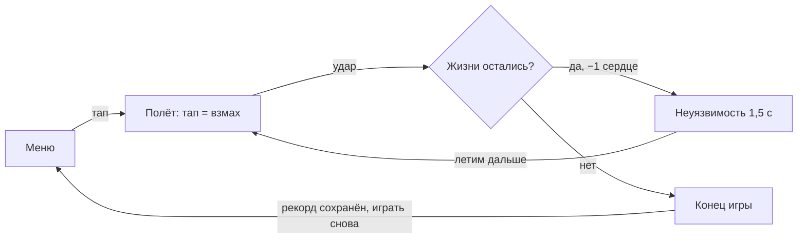

# Flappy Dragon — гейм-дизайн-документ

2026-11-11

Онлайн-версия со схемами: https://claude.ai/artifact/5xwfWbwPC6zWRhooL4XTSQ

## 1. Обзор

**Flappy Dragon** — мобильный аркадный раннер на одно касание: игрок ведёт маленького дракона сквозь проходы между сталактитами и сталагмитами скалистого ущелья на рассвете. Основа — механика Flappy Bird; сверху добавлены жизни, огненный рывок, этапы и три уровня сложности.

| Параметр | Значение |
| --- | --- |
| Жанр | Казуальная аркада, бесконечный раннер (endless) |
| Платформа | Android (смартфоны), портретная ориентация |
| Экран | Игровое поле 3:4; сверху и снизу — чёрные полосы с очками, сложностью, жизнями и рывком |
| Движок | Unity 6 LTS, C# |
| Аудитория | 10+ лет, казуальные игроки; сессия 1–3 минуты |
| Монетизация | Нет (учебный проект); при желании позже — скины |
| Срок | 13 недель × 20 ч ≈ 260 ч, один разработчик |

**Цель игрока:** пролететь как можно дальше и побить свой рекорд.

**Чем игра отличается от Flappy Bird:**

- Ошибка не всегда смертельна: у дракона 3 жизни.
- Огненный рывок пробивает препятствия: его заряжают сбором огоньков — маленьких языков пламени и запускают отдельной кнопкой, когда игроку удобно.
- Полёт бесконечный: сталактиты и сталагмиты генерируются за краем экрана без конца, игра ускоряется по этапам.
- Три сложности на выбор: лёгкая, средняя и сложная.
- Узнаваемый вид: плавно анимированный 2D-дракон в рассветном ущелье вместо птицы и труб.

## 2. Игровой процесс

Забег длится 1–3 минуты и заканчивается, только когда потеряно последнее сердце. Перезапуск — одним тапом, без загрузок.



*Во время полёта: проход = +1 очко, огонёк = заряд рывка.*

Дракон постоянно падает под действием гравитации; мир сам движется справа налево. Игрок управляет только высотой и моментом рывка.

**Управление**

| Действие | Жест | Результат |
| --- | --- | --- |
| Взмах | Тап по игровому полю | Дракон подлетает вверх |
| Огненный рывок | Отдельная кнопка в нижней полосе; активна, только когда шкала ускорения полная | Ускорение и пробивание препятствий |
| Пауза | Кнопка в верхней полосе или сворачивание приложения | Игра замирает |

## 3. Механики

Все числа ниже — стартовые значения для прототипа; их подбирают на плейтестах и держат в инспекторе Unity, а не в коде.

### 3.1 Полёт и препятствия

- Тап задаёт дракону фиксированную скорость вверх; наклон спрайта следует за вертикальной скоростью.
- Препятствие = пара каменных форм: сталактит свисает сверху, сталагмит растёт снизу, между ними проход на случайной высоте.
- Генерация бесконечная: новые препятствия появляются за правым краем экрана, а ушедшие за левый край возвращаются в пул и используются снова. Игрок никогда не видит, как препятствие появляется или исчезает.
- У каждого нового препятствия случайные высота прохода и вариант формы (3–4 спрайта), чтобы ущелье не выглядело однообразно.
- Касание земли или верхней границы игрового поля считается ударом.

### 3.2 Жизни

- Старт: 3 сердца, максимум 3.
- Удар снимает 1 сердце, даёт 1,5 с неуязвимости (дракон мигает), короткая тряска экрана и вибрация.
- После удара о землю дракон подбрасывается в центр экрана.
- Подбор «сердце» появляется редко (примерно раз в 25 проходов) и только если жизней меньше 3.

### 3.3 Огненный рывок

- В проходах горят огоньки — маленькие языки пламени. Каждый собранный огонёк заполняет **шкалу ускорения в нижней полосе экрана** (на средней сложности нужно 10).
- Когда шкала полная, загорается **кнопка рывка** в нижней полосе. Рывок — опция: игрок сам решает, когда его потратить. До заполнения шкалы кнопка неактивна.
- Рывок длится 2 с: скорость мира ×2, дракон летит по прямой, неуязвим; шкала опустеет.
- Сталактиты и сталагмиты на пути разлетаются на камни (частицы) и дают +1 очко.
- После рывка — 0,5 с неуязвимости, чтобы игрок успел сориентироваться.

### 3.4 Сложность

Игрок выбирает в меню одну из трёх сложностей: **лёгкую, среднюю или сложную**. У каждой свой рекорд, текущая сложность видна в верхней полосе. Значения хранятся в ScriptableObject `DifficultySettings`.

| Параметр | Лёгкая | Средняя | Сложная |
| --- | --- | --- | --- |
| Жизни на старте | 3 | 3 | 1 |
| Скорость мира, ед./с | 2,5 | 3 | 3,5 |
| Высота прохода, ед. | 3,2 | 2,8 | 2,4 |
| Расстояние между препятствиями, ед. | 5 | 4,5 | 4 |
| Огоньков до полной шкалы | 8 | 10 | 12 |

### 3.5 Этапы

- Каждые 15 очков — новый этап: плашка «Этап N», скорость +8%, проход −5% (но не уже заданного минимума).
- С этапа 3 появляются подвижные сталактиты, которые медленно опускаются и поднимаются; с этапа 5 — падающие камни (если хватит времени).

### 3.6 Атмосфера: рассвет

- Одна постоянная тема — **рассвет**: тёплое розово-оранжевое небо у горизонта переходит в голубое, свет мягкий и низкий, скалы подсвечены с одной стороны.
- Смены дня и ночи нет: один набор фонов и единый узнаваемый вид.
- Живость фону дают 3–4 слоя параллакса, медленно плывущие облака и пыль в лучах солнца. На игру атмосфера не влияет.

## 4. Визуальный стиль и звук

Стиль — 2D пиксель-арт с ограниченной палитрой: рассветное скалистое ущелье, дракон скорее милый, чем страшный. Референсы: Flappy Bird (читаемость), Celeste (плавная пиксельная анимация), Shovel Knight (пиксельное средневековье).

**Анимации: плавные, только 2D.** Вся графика — плоские спрайты, без 3D-моделей. Плавность дают два приёма:

- больше кадров покадровой анимации (взмах — 8 кадров вместо 4) и промежуточные кадры между позами;
- программные движения поверх кадров: плавный наклон, покачивание, сжатие и растяжение при взмахе, плавные появления экранов интерфейса (DOTween).

| Элемент | Описание | Размер / кадры |
| --- | --- | --- |
| Дракон | Маленький, круглый, большие глаза, яркий цвет (зелёный или красный) | 32×32 px; взмах 8 кадров, удар 2, рывок 4 + наклон и сжатие кодом |
| Препятствия | Каменные сталактиты (сверху) и сталагмиты (снизу), 3–4 варианта формы, подсветка рассветом с одной стороны | 32 px шириной у основания, длина растягивается (9-slice) |
| Фон | 3–4 слоя параллакса: рассветное небо, дальние скалы, ближние скалы, облака | Одна рассветная палитра, без ночных версий |
| Подборы | Огонёк — маленькое оранжевое пламя (заряжает рывок), красное сердце | 16×16 px, 4–6 кадров мерцания |
| Эффекты | Искры при взмахе, камни при разрушении, огненный шлейф рывка | Particle System |

**Палитра:** одна готовая на 16–32 цвета с [lospec.com](https://lospec.com/palette-list) на весь проект. Камера: Pixel Perfect Camera, фильтр спрайтов Point (no filter).

**Звук:**

- Музыка: средневековый чиптюн-луп для игры и более спокойный — для меню (лицензии CC0 или CC-BY).
- Эффекты: взмах, огонёк, проход (+1), удар, рывок, разрушение препятствия, новый этап, конец игры, нажатие кнопки.
- Инструменты: jsfxr / ChipTone, freesound.org.

## 5. Интерфейс и экраны

Игровое поле всегда имеет пропорции 3:4. На вытянутом экране телефона сверху и снизу остаются чёрные полосы, и в них живёт вся игровая информация. Так поле одинаково на любом телефоне, а цифры и кнопки не закрывают препятствия.

```
┌──────────────────────────┐
│ ЧЁРНАЯ ПОЛОСА            │  сложность · очки · пауза
│ [Средняя]   12      [II] │
├──────────────────────────┤
│        ▼ сталактит       │
│                          │
│  ■ дракон    * огонёк    │  игровое поле 3:4
│                          │
│        ▲ сталагмит       │
├──────────────────────────┤
│ ЧЁРНАЯ ПОЛОСА            │  сердца · шкала ускорения · кнопка рывка
│ ♥♥♥  [██████░░░]    (🔥) │
└──────────────────────────┘
```

Высота полос зависит от телефона: на экране 20:9 они занимают примерно по 20% высоты, на 16:9 — около 12%. В меню и на паузе плашки показываются поверх поля.

| Экран | Что на нём |
| --- | --- |
| Главное меню | Логотип, кнопка «Играть», выбор сложности (Лёгкая / Средняя / Сложная), рекорд, настройки; дракон парит на рассветном фоне |
| Игра: верхняя полоса | Сложность слева, очки по центру, кнопка паузы справа |
| Игра: нижняя полоса | Сердца (жизни) слева, шкала ускорения по центру, кнопка рывка справа |
| Пауза | «Продолжить», «Заново», «В меню», звук вкл./выкл. |
| Конец игры | Счёт, рекорд (плашка «Новый рекорд!»), сложность, достигнутый этап, «Играть снова», «В меню» |
| Настройки | Музыка, эффекты, вибрация, сброс рекордов |

Первый запуск: подсказка «Тапни, чтобы взлететь» и первое препятствие через 2 с; при первой полной шкале — стрелка на кнопку рывка в нижней полосе. Отдельного туториала нет.

## 6. Техническая часть

Проект: Unity 6 LTS, шаблон 2D (URP), новая Input System, цель — стабильные 60 FPS на среднем Android-смартфоне. Одна сцена игры, меню — панели UI поверх неё. Камера рисует только поле 3:4 по центру экрана (Viewport Rect), остальное — чёрные полосы с интерфейсом на Canvas.

| Скрипт | Отвечает за |
| --- | --- |
| `GameManager` | Состояния игры: Меню, Игра, Пауза, Конец |
| `DragonController` | Взмах, гравитация, плавный наклон, столкновения |
| `ObstacleSpawner`, `Obstacle` | Бесконечная генерация сталактитов и сталагмитов за правым краем экрана из пула объектов, движение, разрушение |
| `ScoreManager` | Счёт и рекорды по сложностям |
| `LivesSystem` | Сердца, неуязвимость, событие для UI |
| `DashAbility` | Шкала ускорения, кнопка рывка и сам рывок |
| `Pickup` | Огоньки и сердца |
| `DifficultySettings` (ScriptableObject) | Числа для лёгкой, средней и сложной сложности |
| `StageManager` | Этапы и рост сложности |
| `ParallaxLayer`, `DawnBackground` | Рассветный фон, облака, слои параллакса |
| `LetterboxCamera` | Поле 3:4 и чёрные полосы на любом экране |
| `UIManager`, `AudioManager` | Экраны, верхняя и нижняя полосы, музыка и эффекты |
| `SaveSystem` | Рекорды и настройки в PlayerPrefs |

**Правила кода:** скрипты общаются через события (`event`/`UnityEvent`), числа баланса — в `[SerializeField]` или ScriptableObject, никаких Instantiate/Destroy во время забега. Код ведётся в Git, коммит после каждого работающего шага.

**Android:** портретная ориентация, сборка AAB, собственный keystore (хранится в двух местах), тесты на экранах 16:9, 19,5:9 и 20:9: поле 3:4 не искажается, полосы не заходят на вырезы камеры. Публикация в Google Play требует закрытого теста: 12 тестировщиков, 14 дней; запасной вариант — itch.io.

## 7. Объём, приоритеты и вехи

Релиз за 13 недель возможен, только если после Вехи 2 не добавлять новых фич — только арт, звук и исправления.

| Фаза | Недели | Содержание | Веха в конце |
| --- | --- | --- | --- |
| Фундамент | 1–4 | Полёт, сталактиты и сталагмиты, столкновения; счёт, меню, рекорд; поле 3:4 с полосами; первая сборка на телефон | **Веха 1:** прототип играется на телефоне |
| Механики | 5–8 | Жизни и огненный рывок; три сложности и этапы; рассветный фон | **Веха 2:** фичи заморожены, все механики работают |
| Арт и релиз | 9–13 | Пиксель-арт, плавные анимации, звук; оптимизация под Android; закрытый тест и публикация | **Релиз:** Google Play или itch.io |

| Приоритет | Что входит |
| --- | --- |
| Обязательно | Полёт, бесконечные сталактиты и сталагмиты, счёт и рекорд, жизни, шкала ускорения и кнопка рывка, три сложности, этапы, поле 3:4 с чёрными полосами, рассветный фон, плавные анимации дракона, звук, сборка на Android |
| Желательно | Подбор сердца, подвижные сталактиты, анимации интерфейса |
| Если останется время | Падающие камни, плашка ежедневных заданий, магазин скинов за огоньки, достижения и таблица лидеров Google Play Games |

При отставании сначала режутся пункты из «Желательно», снизу вверх; ощущение от полёта и рассветная атмосфера не режутся никогда.

**Открытые вопросы:**

- [ ] Цвет и характер дракона — решить к концу недели 4
- [ ] Финальное название игры (проверить, не занято ли в Google Play)
