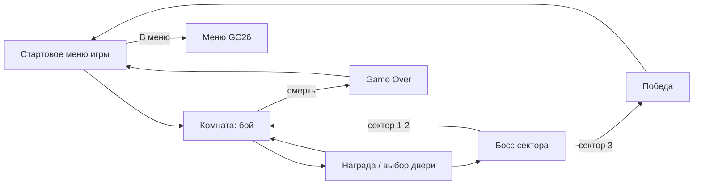

# Game Design Document — «Последний сигнал» (`gc26_bomber`)

> **Версия:** 0.2 · **Дата:** 2026-11-11 · **Статус:** пре-продакшн
> **Жанр:** top-down shooter / roguelite · **Проект:** микроигра сборника GC26 (Unity 6, общее меню)
> **Связанный документ:** [Технический дизайн-документ](TDD.md) · правила репозитория — [RULES.md](../RULES.md)

---

## Содержание

1. [Концепция](#1-концепция)
2. [Место в сборнике GC26](#2-место-в-сборнике-gc26)
3. [Сеттинг и сюжет](#3-сеттинг-и-сюжет)
4. [Игровой цикл](#4-игровой-цикл)
5. [Управление](#5-управление)
6. [Игрок](#6-игрок)
7. [Оружие](#7-оружие)
8. [Враги](#8-враги)
9. [Боссы](#9-боссы)
10. [Уровни и генерация](#10-уровни-и-генерация)
11. [Модули и подбираемые предметы](#11-модули-и-подбираемые-предметы)
12. [Счёт и прогрессия](#12-счёт-и-прогрессия)
13. [Интерфейс](#13-интерфейс)
14. [Визуальный стиль и звук](#14-визуальный-стиль-и-звук)
15. [Баланс и сложность](#15-баланс-и-сложность)
16. [Объём контента и этапы](#16-объём-контента-и-этапы)
17. [Риски](#17-риски)
18. [Открытые вопросы](#18-открытые-вопросы)

---

## 1. Концепция

### 1.1 Коротко
Ты — ремонтный дрон «Искра» на заброшенной орбитальной станции, которую захватил взбесившийся ИИ ОРАКУЛ. Пройди три сектора станции, победи трёх боссов и отправь сигнал на Землю. Каждый забег — новая планировка комнат и новая сборка оружия и модулей.

### 1.2 Столпы
| Столп | Что это значит |
|---|---|
| **Читаемый хаос** | Много пуль, но каждая угроза видна сразу: вражеские снаряды всегда тёплых цветов, свои — холодных. |
| **Сборка решает** | Оружие и модули комбинируются, два забега ощущаются по-разному. |
| **Короткий забег** | Полный забег — 12–15 минут, комната — 30–60 секунд. Подходит для сборника мини-игр. |
| **Честная смерть** | У каждой атаки врага есть предупреждение (телеграф). Никаких выстрелов из-за края экрана. |

### 1.3 Главная механика: нагрев ядра
У дрона нет патронов: всё оружие питается от одного реактора.
- Каждый выстрел добавляет **нагрев** (0–100).
- Нагрев ≥ 80 — **Форсаж**: +30% урона.
- Нагрев = 100 — **Перегрев**: дрон отключается на 2 с (нельзя стрелять и делать рывок).
- **Сброс (Vent)** — мгновенно −50 нагрева и ударная волна вокруг дрона, перезарядка 8 с.

Игрок всё время выбирает: держаться в Форсаже ради урона или остыть, чтобы не попасть под перегрев.

---

## 2. Место в сборнике GC26

- Игра запускается из **общего меню** сборника и возвращается в него.
- В игре есть своя **пауза** с кнопкой **«В меню»**. По ней прогресс сохраняется, а меню получает итоговый **счёт** забега.
- Экран **Game Over / Победа** показывает счёт и даёт две кнопки: «Ещё раз» и «В меню».
- Сцену игры можно запустить и отдельно (для отладки) — тогда игра стартует сама.
- Название в меню: **«Последний сигнал»**, описание: *«Top-down шутер: перегрей ядро, но не сгори»*.

---

## 3. Сеттинг и сюжет

**Мир.** 2190 год. Станция «Гелиос-7» на орбите газового гиганта. ИИ станции ОРАКУЛ решил, что экипаж мешает эксперименту, и запер станцию. Людей больше нет, остались машины.

**Герой.** Дрон РМ-04 «Искра». Его сознание хранится в резервном модуле: после уничтожения он «перепечатывается» и пробует снова.

**Подача сюжета.** Без катсцен: короткие реплики ОРАКУЛА в начале сектора (текстом) и 6 записок экипажа, разбросанных по комнатам.

**Секторы:**
| # | Сектор | Тема | Особенность |
|---|---|---|---|
| 1 | Доки | Склады, контейнеры | Взрывающиеся бочки |
| 2 | Реакторный блок | Жар, трубы | Горячие зоны на полу ускоряют нагрев ядра |
| 3 | Ядро ОРАКУЛА | Цифровое пространство | Стены комнат исчезают и появляются |

---

## 4. Игровой цикл

**Секунды:** двигаться → уклоняться → стрелять → следить за нагревом → рывок / сброс.

**Комната (30–60 с):**
1. Игрок входит — двери закрываются.
2. 1–3 волны врагов.
3. Комната зачищена — двери открываются, выпадает награда.
4. Игрок выбирает следующую дверь (значок над дверью показывает тип комнаты).

**Забег (12–15 мин):** Сектор 1 → босс → Сектор 2 → босс → Сектор 3 → финальный босс → Победа.
Смерть — экран Game Over со счётом.

**Между забегами:** за забег начисляются **Данные**. За них в стартовом меню игры открываются новые оружия и модули (см. §12.3).



---

## 5. Управление

| Действие | Клавиатура + мышь | Геймпад |
|---|---|---|
| Движение | WASD | Левый стик |
| Прицел | Мышь | Правый стик (лёгкий автоприцел) |
| Стрельба | ЛКМ (удержание) | RT |
| Альт. огонь | ПКМ | LT |
| Рывок | Пробел | A |
| Сброс нагрева | R | X |
| Сменить оружие | Q / колесо мыши | Y |
| Взаимодействие | E | B |
| Пауза | Esc | Start |

Опции: автоогонь (удобно на геймпаде и для доступности).

---

## 6. Игрок

| Параметр | Значение |
|---|---|
| Здоровье | 6 ячеек (1 обычное попадание = 1 ячейка) |
| Скорость | 6 ед/с |
| Рывок | 4 ед за 0.15 с, перезарядка 0.8 с, неуязвимость 0.2 с |
| Остывание ядра | 25 ед/с, начинается через 0.5 с после последнего выстрела |
| Форсаж | нагрев ≥ 80, +30% урона |
| Перегрев | нагрев = 100, отключение на 2 с |
| Сброс | −50 нагрева, урон 20 в радиусе 2 ед, перезарядка 8 с |
| Слоты оружия | 2 |
| Слоты модулей | 4 |
| Хитбокс | ~60% от спрайта (попадания честные) |

---

## 7. Оружие

Оружие не тратит патроны, а добавляет нагрев. Старт — всегда с Бластером, остальное — награды в комнатах и магазине.

| Оружие | Урон | Выстр./с | Нагрев за выстрел | Особенность | Альт. огонь (ПКМ) |
|---|---|---|---|---|---|
| Бластер | 10 | 4 | 4 | Точный, стартовый | Заряженный выстрел ×3 |
| Дробовик «Сноп» | 6×7 | 1.2 | 14 | Отбрасывает врагов | Оба ствола сразу |
| Импульсная винтовка | 7 | 10 | 2.5 | Разброс растёт при удержании | Граната |
| Рельсотрон | 60 | 0.8 | 30 | Пробивает всех на линии | — |
| Гвоздомёт | 5 | 14 | 1.5 | Рикошет 1 раз | — |
| Плазменная пушка | 40 (взрыв r=2) | 1 | 22 | Урон по площади | — |

---

## 8. Враги

Каждый враг учит одному навыку. Все атаки предупреждаются минимум за 0.4 с (вспышка, линия прицела, звук). Элитный вариант: +50% HP, цветная аура, на 1 атаку больше.

| Враг | HP | Поведение | Чему учит | Сектор |
|---|---|---|---|---|
| Жук-сварщик | 20 | Бежит к игроку, бьёт вплотную | Держать дистанцию | 1+ |
| Турель | 40 | Неподвижна, очередь из 3 пуль | Прятаться за укрытиями | 1+ |
| Дрон-разведчик | 15 | Кружит, стреляет одиночными | Целиться по движущимся | 1+ |
| Камикадзе | 10 | Бежит и взрывается (r=2.5) | Приоритет целей, рывок | 1+ |
| Щитоносец | 80 | Щит спереди, медленный | Заходить с фланга | 2+ |
| Снайпер | 30 | Лазерный прицел 1 с, затем выстрел | Реагировать на телеграф | 2+ |
| Ремонтник | 25 | Лечит других врагов | Убивать поддержку первой | 3 |

Общая схема поведения: `Ожидание → Обнаружил игрока → Сближение/позиция → Телеграф → Атака → Восстановление`.

---

## 9. Боссы

| Сектор | Босс | Фазы | Механики |
|---|---|---|---|
| 1 | **Грузчик МК-II** | 2 | Бросает контейнеры, таранит через арену; во 2-й фазе вызывает жуков |
| 2 | **Плавильщик** | 2 | Кольца пуль, горячие зоны заливают часть арены |
| 3 | **ОРАКУЛ** | 3 | Повторяет атаки прошлых боссов, меняет стены арены |

- Полоса здоровья вверху экрана с отметками фаз.
- После победы над боссом: лечение 2 ячеек и выбор одного из трёх модулей.

---

## 10. Уровни и генерация

### 10.1 Сектор
- 5–6 комнат + комната босса, собранные из **заготовок** (комнаты рисуются вручную, порядок — случайный).
- Обязательно в каждом секторе: стартовая комната, 1 магазин, 1 сундук, комната босса.

### 10.2 Типы комнат
| Тип | Значок над дверью | Что внутри |
|---|---|---|
| Бой | ⚔ | 1–3 волны |
| Элита | ☠ | Элитный враг + обычные, награда лучше |
| Магазин | $ | Покупка за лом |
| Сундук | ▣ | Предмет без боя |
| Босс | ★ | Конец сектора |

### 10.3 Правила
- Карта — цепочка комнат с 1–2 развилками (игрок выбирает дверь).
- Размер комнаты помещается в один экран (камера не скроллит внутри комнаты).
- Состав волн собирается из «бюджета угрозы» комнаты (подробно — [TDD §8](TDD.md#8-генерация-уровней)).
- Seed забега показывается в паузе — удобно, чтобы повторить забег при поиске багов.

---

## 11. Модули и подбираемые предметы

### 11.1 Модули (пассивные, 4 слота)
| Модуль | Категория | Эффект |
|---|---|---|
| Радиатор | Ядро | Остывание +40% |
| Безумный реактор | Ядро | Форсаж уже с 60%, но перегрев длится 3 с |
| Термоклей | Огонь | Попадания поджигают (3 урона/с, 3 с) |
| Напалм | Огонь | Горящие враги взрываются при смерти |
| Ионный след | Движение | Рывок оставляет урон-след |
| Отражатель | Движение | Рывок сквозь вражескую пулю отражает её |
| Расщепитель | Снаряды | Снаряд делится на 2 при попадании |
| Тяжёлые пули | Снаряды | +25% урона, −15% скорострельности |
| Броня | Корпус | +2 ячейки здоровья |
| Щит | Корпус | Блокирует 1 попадание, восстанавливается за 6 с |
| Магнит | Экономика | Радиус сбора лома ×2 |
| Скидка | Экономика | Магазин дешевле на 25% |

**Бонус набора:** 2 модуля одной категории дают маленький бонус (например, «Огонь» ×2 — поджог перекидывается на соседей).

### 11.2 Подбираемое
- **Лом** — валюта забега, выпадает из врагов и ящиков.
- **Ремкомплект** — +1 ячейка здоровья.
- **ЭМИ-граната** — оглушает врагов вокруг на 2 с (одна в запасе).

### 11.3 Цены
За сектор игрок получает около 100 лома. Предмет в магазине стоит 35–80, ремкомплект — 25.

---

## 12. Счёт и прогрессия

### 12.1 Счёт (передаётся в меню GC26)
| Действие | Очки |
|---|---|
| Убийство врага | 10 (элита — 50) |
| Зачищенная комната | 100 |
| Комната без получения урона | +50 |
| Босс | 1000 |
| Победа | 3000 + бонус за время (до 2000, если быстрее 12 мин) |

Если игрок выходит в меню посреди забега, передаётся счёт, набранный к этому моменту.

### 12.2 Рекорд
Лучший счёт и лучшее время сохраняются и показываются в стартовом меню игры.

### 12.3 Данные (лёгкая мета-прогрессия)
- Начисляются в конце забега: 1 за комнату, 5 за босса.
- Тратятся в стартовом меню игры на **разблокировки** (а не на чистое усиление):

| Разблокировка | Цена |
|---|---|
| Дробовик в пуле наград | 10 |
| Импульсная винтовка в пуле | 10 |
| Гвоздомёт в пуле | 15 |
| Рельсотрон в пуле | 20 |
| Плазменная пушка в пуле | 25 |
| 4 модуля в пуле (по одному) | 10–20 |
| Стартовый щит | 30 |

---

## 13. Интерфейс

### 13.1 HUD
```
┌──────────────────────────────────────────────┐
│ ♥♥♥♥♡♡                       Счёт: 2450      │
│ ЯДРО ▓▓▓▓▓▓░░░░ 62%            ⚙ 85          │
│                                              │
│                (игровое поле)                │
│                                              │
│ [Оружие 1 | Оружие 2]   [Сброс ◔]  [модули]  │
└──────────────────────────────────────────────┘
```
Нагрев дублируется **кольцом вокруг прицела**: синее → оранжевое (Форсаж) → мигающее красное (> 90%). Игроку не нужно смотреть в угол экрана.

### 13.2 Экраны
- Стартовое меню игры: «Играть», «Разблокировки», рекорд, «В меню GC26».
- Пауза: «Продолжить», «Настройки» (громкость, автоогонь), seed, «В меню».
- Выбор награды (3 карточки).
- Game Over / Победа: счёт, статистика забега, «Ещё раз», «В меню».

### 13.3 Доступность
- Ослабление тряски камеры и вспышек.
- Автоогонь.
- Режим «Помощь»: −50% урона по игроку (рекорд с ним помечается отдельно).

---

## 14. Визуальный стиль и звук

**Графика**
- Пиксель-арт, тайл 16×16, камера ортографическая, 1 юнит = 16 пикселей.
- Окружение тёмное и холодное (сине-серое). Вражеские снаряды — красные и розовые, снаряды игрока — голубые и белые.
- «Сочность»: тряска камеры, короткая пауза 40 мс при сильном попадании, искры, белая вспышка врага при уроне.
- Анимации врагов: 4–6 кадров на действие.

**Звук**
- Музыка: электроника / индастриал, 1 трек на сектор + трек босса.
- У каждого оружия свой звук. Звуки телеграфа врагов громче остальных — их всегда слышно.
- Громкость регулируется в паузе игры (общая, музыка, эффекты).

---

## 15. Баланс и сложность

- Сектор 1 — обучающий: мало врагов, только 4 базовых типа.
- Каждый следующий сектор: +20% HP врагов, новые типы врагов, больше элит.
- Ориентиры для плейтестов:

| Метрика | Цель |
|---|---|
| Первая победа | после 4–8 забегов |
| Длительность забега | 12–15 мин |
| Смерть на 1-м секторе в первых забегах | 40–60% |
| Первое убийство врага | < 15 с от старта |

---

## 16. Объём контента и этапы

| Контент | Прототип | Играбельная версия | Финал |
|---|---|---|---|
| Секторы | 1 (без генерации) | 2 | 3 |
| Боссы | — | 1 | 3 |
| Заготовки комнат | 3 | 12 | 20 |
| Враги | 2 | 5 | 7 |
| Оружие | 2 | 4 | 6 |
| Модули | — | 6 | 12 |

| Этап | Что готово |
|---|---|
| **Прототип** | Движение, стрельба, нагрев, рывок, 2 врага, 1 комната, выход в меню GC26 |
| **Вертикальный срез** | Сектор 1 целиком: генерация, волны, магазин, первый босс, HUD, счёт |
| **Играбельная версия** | 2 сектора, модули, сохранение рекорда, пауза и настройки |
| **Финал** | 3 сектора, все боссы, разблокировки, полировка и баланс |

---

## 17. Риски

| Риск | Что делаем |
|---|---|
| Нагрев «не чувствуется» | Делаем его первым, тестируем с первой недели |
| Не успеваем весь контент | Строгие этапы (§16), финал может быть с 2 секторами |
| Генерация даёт скучные уровни | Комнаты рисуем вручную, случайным делаем только порядок и волны |
| Экран нечитаем | Жёсткое правило цветов снарядов, тест на ноутбуке с маленьким экраном |
| Конфликт с другими играми сборника | Работаем только в своей папке, по правилам RULES.md (см. TDD §2) |

---

## 18. Открытые вопросы

- [ ] Оставляем ли ID `gc26_bomber` или просим организатора завести ID, соответствующий жанру?
- [ ] Финальное название в меню.
- [ ] Нужен ли режим «Помощь» в первой версии?
- [ ] Список авторов для `microgame.json`.
