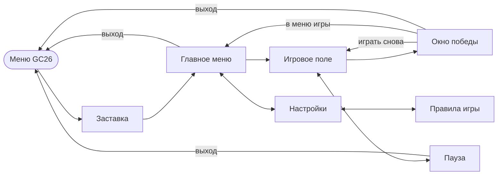

# Emo Party — Game Design Document

**ID игры в репозитории:** `gc26_findepair` · **Версия документа:** 2.0 (11.11.2026) · заменяет `GDD_Emo_Party.pdf`, `Plan_Emo_Party.pdf`, `plan.html`, README и старые версии «Лесная пара».

Emo Party — казуальная мобильная игра на память («Найди пару»): игрок находит 6 пар карточек с оригинальными неоновыми иллюстрациями в стиле эмо-культуры 2000-х. Игра — одна из 11 мини-игр сборника **GC26** и запускается из общего меню.

Технические детали — в [TDD.md](TDD.md). Играбельный прототип — [prototype/index.html](prototype/index.html).

---

## 1. Общие сведения

| Параметр | Значение |
|---|---|
| Название | Emo Party |
| Жанр | Казуальная головоломка на память (memory / «Найди пару») |
| Платформа | Android (основная), iOS (по возможности) |
| Движок и язык | Unity 6 (6000.5), C# |
| Ориентация | Портретная, поле 3 × 4 (в ландшафте — раскладка 4 × 3, см. TDD) |
| Аудитория | Подростки 12+ и взрослые 25–35 лет с ностальгией по 2000-м |
| Длина сессии | 1–3 минуты |
| Монетизация | Нет (учебный проект), без рекламы |
| Язык интерфейса | Русский |
| Срок | 8 недель |

## 2. Концепция

Игра тренирует зрительную память через короткую спокойную партию с узнаваемыми вещами из эмо-культуры 2000-х. Главная ценность — авторские неоновые иллюстрации и приятный отклик на каждое действие.

- **Цель игрока:** открыть все 6 пар за минимум ходов и времени.
- **Цель проекта:** за 8 недель сделать готовую игру, которая запускается из меню сборника GC26.
- **Настроение:** доброе, уютное, без стресса — эмо с самоиронией, без мрачности. Проиграть нельзя, можно только побить свой рекорд.

## 3. Игровой процесс

Поле — 12 карточек рубашкой вверх, сетка 3 × 4. Перед каждой партией карточки перемешиваются случайно.

1. Игрок нажимает на карточку — она переворачивается.
2. Нажимает на вторую — это считается **одним ходом**.
3. Картинки совпали — карточки остаются открытыми, играет звук успеха.
4. Не совпали — через 0,8 с обе закрываются; пока идёт проверка, нажатия блокируются.
5. Все 6 пар найдены — победа: окно с ходами, временем, звёздами и рекордом.

**Управление:** одиночное касание (tap). Нет свайпов и долгих нажатий.

**Нельзя:** нажать на уже открытую или найденную карточку; открыть третью карточку во время проверки; нажимать на поле во время паузы.

### Счёт и результат

- Считаются **ходы** и **время** (таймер останавливается на паузе).
- **Рекорд** = меньше ходов, при равенстве — меньше время. Хранится между запусками.
- **Звёзды за партию** (минимум возможных ходов — 6):

| Звёзды | Ходов |
|---|---|
| ★★★ | до 9 |
| ★★ | 10–13 |
| ★ | больше 13 |

## 4. Карточки и иллюстрации

Все 7 изображений (6 лицевых сторон + рубашка) рисуются с нуля. Каждая карточка — узнаваемая вещь эмо-подростка середины 2000-х; карточки различаются **силуэтом и основным цветом**, а не только деталями: на телефоне карточка около 3 см.

| Карточка | Отсылка к трендам 2000-х | Основной цвет | Отличительная деталь |
|---|---|---|---|
| Эмо-котик | Косая чёлка на один глаз | Чёрный + неоновый розовый | Чёлка с розовой прядью, подводка |
| Эмо-мишка | Плюшевый мишка в эмо-образе | Светло-розовый | Косая чёлка, заплатка-сердце, полосатый шарф |
| Полароид | Мгновенная камера и селфи «сверху» | Фуксия | Из камеры выезжает снимок с сердечком |
| MP3-плеер | Плеер с проводными наушниками и плейлистом | Неоновый голубой | Провод наушников в форме сердца |
| Банка энергетика | Энергетик — топливо ночных переписок | Неоновый фиолетовый | Кислотно-зелёная молния, без логотипа бренда |
| Череп с бантиком | Розовый черепок — милый символ эмо-стиля | Белый + розовый | Большой бант, глаза-сердечки |
| **Рубашка** | Шахматная клетка | Чёрный + неоновый розовый | Сердце с молнией в центре |

Рубашка одинакова для всех карт и не намекает на содержимое.

**Запасные идеи:** клетчатые кеды, телефон-раскладушка, сумка со значками, кассета-микстейп, заколка-звезда, полосатые гетры, гитара с наклейками, аська-статус «в сети».

### Стиль

- Плоская иллюстрация с неоновым свечением, толстый светлый контур на тёмном фоне, одинаковая рамка у всех карточек.
- Палитра — неон, преимущественно розовый:

| Роль | Цвет |
|---|---|
| Розовый (основной) | `#FF2FB3` |
| Светло-розовый | `#FF7AD9` |
| Фиолетовый | `#9B5CFF` |
| Голубой | `#2DE2E6` |
| Акцент, кислотно-зелёный | `#39FF88` |
| Фон, почти чёрный | `#15101C` |
| Контур | `#FCEBFF` |

### Фоны

- **Главное меню** — кирпичная стена с неоновыми граффити (надпись Emo Party, сердечки, звёзды) и обклеенными объявлениями.
- **Игровое поле** — пробковая доска объявлений с флаерами игр и концертов, наклейками и полароидами; карточки выглядят как приколотые к доске заметки.
- Фон затемнён и слегка размыт, чтобы неоновые карточки читались лучше.

### Требования к файлам

Формат карточки 3:4, PNG 900 × 1200 px (минимум 600 × 800), все спрайты в одном Sprite Atlas. Инструменты: Krita, Figma или Inkscape.

## 5. Экраны и интерфейс

Семь экранов игры: заставка, главное меню, игровое поле, пауза, окно победы, настройки, правила игры.

- Из главного меню в игру — одно касание; из любого экрана до игры — не больше двух.
- На игровом поле сверху — счётчик ходов, таймер и кнопка паузы.
- Кнопки не меньше 48 × 48 dp; учитываются вырезы экрана (Safe Area).
- **Выход в меню сборника GC26** — кнопка «Выйти» в главном меню, в паузе и в окне победы. Перед выходом сохраняются рекорд и настройки.

| Экран | Содержимое |
|---|---|
| Заставка | Мерцающий неоновый логотип EMO PARTY; переход в меню сам или по касанию |
| Главное меню | Логотип «EMO PARTY — найди пару», «Играть», «Настройки», «Выйти», строка с рекордом |
| Игровое поле | HUD (ходы, время, пауза) + сетка карточек |
| Пауза | «Продолжить», «Заново», «В меню», «Выйти» |
| Окно победы | «Все пары найдены!», звёзды, значок «Новый рекорд!», ходы, время, рекорд, «Играть снова», «В меню», «Выйти» |
| Настройки | «Назад», переключатели «Звуки», «Музыка», «Вибрация», «Правила игры», «Сбросить рекорд» |
| Правила игры | Текст правил, кнопка «Понятно» |

Кнопка «Выйти» (в меню сборника GC26) — новая по сравнению с HTML-прототипом; остальное в прототипе уже есть.

### Текст окна «Правила игры»

1. Нажми на карточку — она откроется.
2. Открой вторую: если картинки совпали, пара остаётся открытой.
3. Не совпали — запомни, где они лежат: карточки закроются.
4. Найди все 6 пар за наименьшее число ходов; ход — это две открытые карточки.
5. Звёзды: 3★ — до 9 ходов, 2★ — 10–13, 1★ — больше 13. Проиграть нельзя — можно только побить свой рекорд.

## 6. Звук и анимация

| Событие | Анимация | Звук | Вибрация |
|---|---|---|---|
| Нажатие на карточку | Переворот, 0,25 с | Щелчок затвора полароида | — |
| Пара найдена | «Пульс» и розовая неоновая вспышка | Гитарный аккорд | Короткая (40 мс) |
| Пара не совпала | Покачивание, затем обратный переворот | Мягкий низкий тон | — |
| Победа | Окно с конфетти из сердечек и звёзд | Короткий поп-панк-рифф | Двойная |
| Фон | Мерцание неоновых граффити | Спокойная инди / поп-панк мелодия (петля) | — |

Звуки — из бесплатных библиотек с лицензией CC0 (Kenney, freesound.org). Звук, музыку и вибрацию можно выключить в настройках.

## 7. План разработки (8 недель, ≈160–200 часов)

| Неделя | Этап | Задачи | Результат |
|---|---|---|---|
| 1 | Подготовка | Тема и аудитория, GDD, референсы и палитра, установка Unity, ветка в репозитории GC26, папка игры | Концепция и стиль утверждены |
| 2 | Прототип и скетчи | Скрипты карточки, данных и правил; временная графика (цветные квадраты); скетчи 6 карточек и рубашки по 2–3 варианта | **Прототип**, который можно пройти до конца |
| 3 | Иллюстрации I | Чистовые эмо-котик, эмо-мишка, полароид; рубашка; проверка читаемости на телефоне; в коде — анимации переворота и совпадения | 3 карточки + рубашка |
| 4 | Иллюстрации II + UI | MP3-плеер, банка энергетика, череп с бантиком; фоны, кнопки, шрифт с кириллицей, окно победы; экспорт PNG, Sprite Atlas | **Вся графика в игре** |
| 5 | Доработка геймплея | HUD, звуки, вибрация, сохранение рекорда, звёзды | **Альфа** |
| 6 | Меню и экраны | Главное меню, пауза, настройки, окно правил, Safe Area, подгонка сетки, иконка, заставка, выход в меню GC26 | **Бета** |
| 7 | Тестирование | 3–5 реальных устройств, 5+ игроков из целевой аудитории, исправление багов (быстрые нажатия, двойной клик, перезапуск), оптимизация | Release Candidate |
| 8 | Сдача | Финальное слияние в `main`, проверка запуска из меню GC26, отчёт / презентация | **Релиз** |

Иллюстрации — самая долгая часть, поэтому их начинают на 2-й неделе, параллельно с прототипом. Недели 5–7 содержат резерв по ~2 дня.

| Направление | Доля времени |
|---|---|
| Иллюстрации и графика интерфейса | ~35% |
| Программирование на C# | ~30% |
| Тестирование и исправления | ~15% |
| Документация, звук, сдача | ~20% |

### Риски

| Риск | Что делать |
|---|---|
| Иллюстрации занимают дольше плана | Начинать на неделе 2. Если не успеваете — упростить меню и настройки, но не сокращать тестирование |
| Карточки плохо различаются на маленьком экране | Разные силуэты и основные цвета; проверка на телефоне на неделе 3 |
| Конфликты при слиянии с `main` | Работать только в своей папке, раз в неделю подтягивать `main` (см. TDD) |
| Потеря работы | Коммиты в Git каждый день, пуш в свою ветку |
| Публикация в Google Play отдельным приложением | Аккаунт разработчика 25 $; для новых личных аккаунтов — закрытое тестирование (~12 тестировщиков, 14 дней). Решить с организатором, публикуется ли сборник целиком |

## 8. Идеи для развития

- Уровни сложности: 4 / 6 / 8 пар (код рассчитан на любое число пар).
- Новые наборы иллюстраций — другие субкультуры 2000-х: панк, рейв, скейт.
- Режим на время и ежедневный вызов с одинаковой раскладкой.

## 9. Ссылки

| Что | Где |
|---|---|
| Репозиторий | https://github.com/Zaidejas/GC26 |
| Доска задач | https://github.com/users/Zaidejas/projects/12 |
| Правила репозитория GC26 | [RULES.md](../RULES.md) |
| Технический дизайн | [TDD.md](TDD.md) |
| HTML-прототип | [prototype/index.html](prototype/index.html) |
