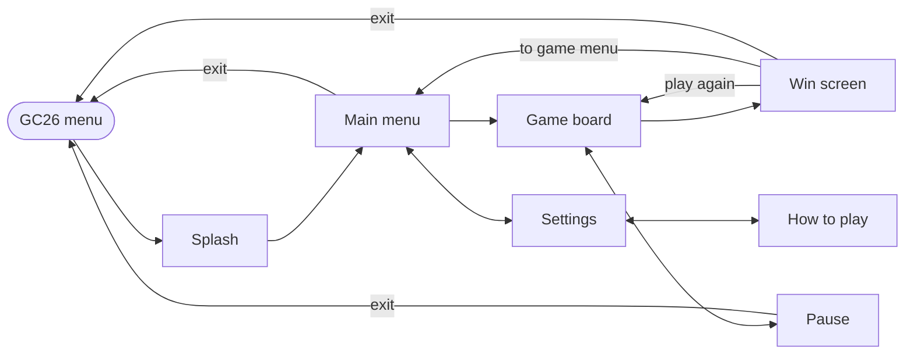

# Emo Party — Game Design Document

**Game ID in the repository:** `gc26_findepair` · **Document version:** 2.1 (2026-11-18) · replaces `GDD_Emo_Party.pdf`, `Plan_Emo_Party.pdf`, `plan.html`, the README and the old "Lesnaya para" (Forest Pair) versions.

Emo Party is a casual mobile memory game ("Find the Pair"): the player finds 6 pairs of cards with original neon illustrations in the style of 2000s emo culture. The game is one of the 11 mini-games in the **GC26** collection and is launched from the shared menu.

Technical details are in [TDD_findepair.md](TDD_findepair.md). The playable prototype is [prototype_findepair/index.html](prototype_findepair/index.html).

---

## 1. Overview

| Parameter | Value |
|---|---|
| Title | Emo Party |
| Genre | Casual memory puzzle (memory / "Find the Pair") |
| Platform | Android (main), iOS (if possible) |
| Engine and language | Unity 6 (6000.5), C# |
| Orientation | Portrait, 3 × 4 board (in landscape, a 4 × 3 layout — see TDD) |
| Audience | Teens 12+ and adults 25–35 nostalgic for the 2000s |
| Session length | 1–3 minutes |
| Monetization | None (student project), no ads |
| UI language | English |
| Timeline | 8 weeks |

## 2. Concept

The game trains visual memory through a short, calm round with recognizable items from 2000s emo culture. Its main value is the original neon illustrations and satisfying feedback on every action.

- **Player goal:** turn over all 6 pairs in as few moves and as little time as possible.
- **Project goal:** in 8 weeks, deliver a finished game that launches from the GC26 collection menu.
- **Mood:** kind, cozy, stress-free — emo with self-irony, not gloom. You can't lose, only beat your record.

## 3. Gameplay

The board is 12 face-down cards in a 3 × 4 grid. The cards are shuffled randomly before each round.

1. The player taps a card and it turns over.
2. They tap a second one — this counts as **one move**.
3. The pictures match — a success sound plays; 1 s later the pair bursts into pink sparkles and vanishes from the board, leaving an empty slot. While the pair waits to burst, other cards can be turned.
4. No match — after 0.8 s both cards turn back over; taps are blocked while the check is running.
5. All 6 pairs found and vanished — win: a window with moves, time, stars and the record.

**Controls:** single tap. No swipes or long presses.

**Not allowed:** tapping a card that is already face-up or found; turning a third card during a check; tapping the board while paused.

### Score and result

- **Moves** and **time** are counted (the timer stops while paused).
- **Record** = fewer moves; on a tie, less time. It is kept between launches.
- **Stars per round** (the minimum possible is 6 moves):

| Stars | Moves |
|---|---|
| ★★★ | up to 9 |
| ★★ | 10–13 |
| ★ | more than 13 |

## 4. Cards and illustrations

All 7 images (6 card faces + the card back) are drawn from scratch. Each card is a recognizable item of a mid-2000s emo teen; cards differ by **silhouette and main color**, not only by details: on a phone a card is about 3 cm tall.

| Card | 2000s trend reference | Main color | Distinctive detail |
|---|---|---|---|
| Emo kitty | Side-swept fringe over one eye | Black + neon pink | Fringe with a pink streak, eyeliner |
| Emo bear | Teddy bear in an emo look | Light pink | Side fringe, heart patch, striped scarf |
| Polaroid | Instant camera and "from above" selfies | Fuchsia | A photo with a heart slides out of the camera |
| MP3 player | Player with wired earphones and a playlist | Neon cyan | Heart-shaped earphone cable |
| Energy drink can | Energy drinks — fuel for late-night chats | Neon violet | Acid-green lightning bolt, no brand logo |
| Bow skull | Pink skull — a cute emo-style symbol | White + pink | Big bow, heart eyes |
| **Card back** | Checkerboard | Black + neon pink | Heart with a lightning bolt in the center |

The card back is the same for all cards and gives no hint of the face. Card faces have no names or text — the picture alone identifies the card.

**Backup ideas:** checkered sneakers, flip phone, bag covered in pins, mixtape cassette, star hair clip, striped leg warmers, guitar with stickers, ICQ "online" status.

### Style

- Flat illustration with a neon glow, thick light outline on a dark background, the same frame on every card.
- Palette — neon, mostly pink:

| Role | Color |
|---|---|
| Pink (main) | `#FF2FB3` |
| Light pink | `#FF7AD9` |
| Violet | `#9B5CFF` |
| Cyan | `#2DE2E6` |
| Accent, acid green | `#39FF88` |
| Background, near-black | `#15101C` |
| Outline | `#FCEBFF` |

### Backgrounds

- **Main menu** — a brick wall with neon graffiti (the Emo Party logo, hearts, stars) and posted flyers.
- **Game board** — a cork notice board with flyers for games and gigs, stickers and Polaroids; the cards look like notes pinned to the board.
- The background is darkened and slightly blurred so the neon cards read better.

### File requirements

Card format 3:4, PNG 900 × 1200 px (minimum 600 × 800), all sprites in one Sprite Atlas. Tools: Krita, Figma or Inkscape.

## 5. Screens and UI

The game has seven screens: splash, main menu, game board, pause, win screen, settings, how to play.

- From the main menu to the game is one tap; from any screen, no more than two.
- At the top of the game board: the move counter, the timer and the pause button.
- Buttons are at least 48 × 48 dp; screen cutouts are respected (Safe Area).
- **Exit to the GC26 collection menu** — the "Exit" button in the main menu, the pause screen and the win screen. The record and settings are saved before exiting.

| Screen | Contents |
|---|---|
| Splash | Flickering neon EMO PARTY logo; goes to the menu by itself or on tap |
| Main menu | Logo "EMO PARTY — find the pair", "Play", "Settings", "Exit", record line |
| Game board | HUD (moves, time, pause) + card grid |
| Pause | "Resume", "Restart", "Menu", "Exit" |
| Win screen | "All pairs found!", stars, "New record!" badge, moves, time, record, "Play again", "Menu", "Exit" |
| Settings | "Back", toggles "Sound", "Music", "Vibration", "How to play", "Reset record" |
| How to play | Rules text, "Got it" button |

The "Exit" button (to the GC26 collection menu) is new compared with the HTML prototype; everything else is already in the prototype.

### "How to play" window text

1. Tap a card to turn it over.
2. Turn over a second one: if the pictures match, the pair bursts into sparkles and vanishes.
3. No match? Remember where they are: the cards turn back over.
4. Find all 6 pairs in as few moves as you can; one move is two turned cards.
5. Stars: 3★ — up to 9 moves, 2★ — 10–13, 1★ — more than 13. You can't lose — only beat your record.

## 6. Sound and animation

| Event | Animation | Sound | Vibration |
|---|---|---|---|
| Tap on a card | Flip, 0.25 s | Polaroid shutter click | — |
| Pair found | "Pulse" and a pink neon flash | Guitar chord | Short (40 ms) |
| 1 s after the match | Bright pink sparkle burst with a white-pink flash, the cards grow and fade out (0.25 s), an empty slot remains | — | — |
| No match | Shake, then flip back | Soft low tone | — |
| Win | Window with confetti of hearts and stars | Short pop-punk riff | Double |
| Background | Flickering neon graffiti | Calm indie / pop-punk tune (loop) | — |

Sounds come from free CC0 libraries (Kenney, freesound.org). Sound, music and vibration can be turned off in the settings.

## 7. Development plan (8 weeks, ≈160–200 hours)

| Week | Stage | Tasks | Result |
|---|---|---|---|
| 1 | Preparation | Theme and audience, GDD, references and palette, Unity install, branch in the GC26 repository, game folder | Concept and style approved |
| 2 | Prototype and sketches | Card, data and rules scripts; placeholder art (colored squares); sketches of the 6 cards and the back, 2–3 variants each | **Prototype** playable to the end |
| 3 | Illustrations I | Final emo kitty, emo bear, Polaroid; card back; readability check on a phone; in code — flip and match animations | 3 cards + back |
| 4 | Illustrations II + UI | MP3 player, energy drink can, bow skull; backgrounds, buttons, font, win screen; PNG export, Sprite Atlas | **All art in the game** |
| 5 | Gameplay polish | HUD, sounds, vibration, record saving, stars | **Alpha** |
| 6 | Menus and screens | Main menu, pause, settings, rules window, Safe Area, grid fitting, icon, splash, exit to the GC26 menu | **Beta** |
| 7 | Testing | 3–5 real devices, 5+ players from the target audience, bug fixing (fast taps, double tap, restart), optimization | Release Candidate |
| 8 | Delivery | Final merge into `main`, check launching from the GC26 menu, report / presentation | **Release** |

Illustrations are the longest part, so they start in week 2, in parallel with the prototype. Weeks 5–7 each include ~2 days of buffer.

| Area | Share of time |
|---|---|
| Illustrations and UI art | ~35% |
| C# programming | ~30% |
| Testing and fixes | ~15% |
| Documentation, sound, delivery | ~20% |

### Risks

| Risk | What to do |
|---|---|
| Illustrations take longer than planned | Start in week 2. If behind, simplify the menus and settings, but don't cut testing |
| Cards are hard to tell apart on a small screen | Different silhouettes and main colors; check on a phone in week 3 |
| Conflicts when merging with `main` | Work only in your own folder, pull `main` once a week (see TDD) |
| Losing work | Commit to Git every day, push to your branch |
| Publishing to Google Play as a separate app | Developer account $25; new personal accounts need closed testing (~12 testers, 14 days). Agree with the organizer whether the whole collection is published instead |

## 8. Ideas for later

- Difficulty levels: 4 / 6 / 8 pairs (the code supports any number of pairs).
- New illustration sets — other 2000s subcultures: punk, rave, skate.
- Time-attack mode and a daily challenge with the same layout for everyone.

## 9. Links

| What | Where |
|---|---|
| Repository | https://github.com/Zaidejas/GC26 |
| Task board | https://github.com/users/Zaidejas/projects/12 |
| GC26 repository rules | [RULES.md](../RULES.md) |
| Technical design | [TDD_findepair.md](TDD_findepair.md) |
| HTML prototype | [prototype_findepair/index.html](prototype_findepair/index.html) |
