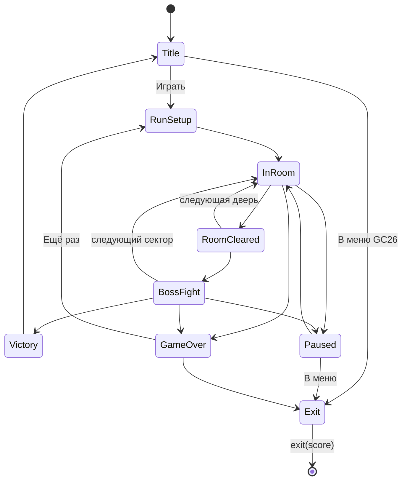

# Technical Design Document — «Последний сигнал» (`gc26_bomber`)

> **Версия:** 0.2 · **Дата:** 2026-11-11
> **Связанные документы:** [GDD](GDD.md) · [RULES.md](../RULES.md) (правила репозитория GC26 — главнее этого документа)

---

## Содержание

1. [Цели](#1-цели)
2. [Ограничения репозитория GC26](#2-ограничения-репозитория-gc26)
3. [Стек](#3-стек)
4. [Структура папки игры](#4-структура-папки-игры)
5. [Архитектура](#5-архитектура)
6. [Ключевые системы](#6-ключевые-системы)
7. [Данные (ScriptableObject)](#7-данные-scriptableobject)
8. [Генерация уровней](#8-генерация-уровней)
9. [ИИ врагов](#9-ии-врагов)
10. [Коллизии без своих слоёв](#10-коллизии-без-своих-слоёв)
11. [Ввод](#11-ввод)
12. [UI](#12-ui)
13. [Аудио](#13-аудио)
14. [Сохранения](#14-сохранения)
15. [Производительность](#15-производительность)
16. [Тестирование](#16-тестирование)
17. [Git-процесс](#17-git-процесс)
18. [Отладка](#18-отладка)
19. [Технические риски](#19-технические-риски)

---

## 1. Цели

| Цель | Критерий |
|---|---|
| Стабильный FPS | 60 FPS на учебном ноутбуке при 300 снарядах и 25 врагах |
| Чистый выход в меню | После `exit(score)` в сцене не остаётся ничего, `Time.timeScale` и физика как были |
| Детерминированная генерация | Один seed → одна и та же карта |
| Контент без кода | Новое оружие, враг или модуль добавляется ассетом ScriptableObject |
| Тестируемость | Нагрев, урон, статы и генерация — чистый C#, покрыты EditMode-тестами |
| Ноль конфликтов при слиянии | Изменения только в `Assets/Microgames/gc26_bomber/` |

---

## 2. Ограничения репозитория GC26

Игра — одна из микроигр общего Unity-проекта. Из [RULES.md](../RULES.md) следуют жёсткие технические ограничения:

| Правило | Что это значит для нас |
|---|---|
| Только своя папка | Весь код и ассеты — в `Assets/Microgames/gc26_bomber/`; GDD и TDD — в `docs/` в корне репозитория |
| Свой asmdef и неймспейс | `GC26.Bomber.asmdef`, весь код в `namespace GC26.Bomber` (и `GC26.Bomber.*`) |
| Сцены с префиксом | `gc26_bomber_Main.unity`, `gc26_bomber_Test.unity`, `gc26_bomber_Stress.unity` |
| Resources только в подпапке ID | `Resources/gc26_bomber/...`, `Resources.Load("gc26_bomber/...")` |
| Нельзя трогать ProjectSettings | **Нет своих слоёв, тегов, настроек физики, Build Settings.** См. §10 |
| Нельзя трогать Packages | Только пакеты, уже стоящие в `main` (см. §3). Нет Cinemachine, DOTween, Newtonsoft, Addressables |
| Без глобального состояния | Нет `DontDestroyOnLoad`, нет статических синглтонов. `Time.timeScale` возвращаем в `OnDisable` |
| Контракт с оболочкой | Ровно один `IMicrogame` в стартовой сцене, выход через `exit(score)` |
| Сохранения | Только в `MicrogameSave.Folder(Id)`, ключи `PlayerPrefs` — через `MicrogameSave.Key(Id, ...)` |
| Неуникальные имена файлов запрещены | Нет `Player.cs`, `Enemy.cs`, `GameManager.cs` и т.п. — проверяет `tools/check_names.py` |

> Если что-то из проекта всё же нужно (пакет, слой, 2D Renderer) — это отдельная ветка `core/<что>` и PR организатору, а не правка в нашей ветке.

---

## 3. Стек

Всё ниже уже есть в `Packages/manifest.json` ветки `main`.

| Компонент | Выбор | Примечание |
|---|---|---|
| Движок | Unity 6 (6000.5) | Версия зафиксирована в `ProjectSettings/ProjectVersion.txt` |
| Рендер | URP (общий ассет `PC_RPAsset`) | Рендерер проекта не 2D, поэтому **2D-освещения нет**. Спрайты — `Sprite-Unlit-Default`, «свечение» — аддитивные спрайты |
| Язык | C# | |
| Ввод | Input System 1.20 | Свой `.inputactions` в папке игры (§11) |
| UI | uGUI + TextMeshPro | |
| Физика | Physics2D | Гравитация проекта `y = -9.81` — у всех наших `Rigidbody2D` ставим `gravityScale = 0`, глобальную не трогаем |
| Камера | Своя `CameraRig` (следование + тряска) | Cinemachine нет |
| Твины | Свои корутины / `AnimationCurve` | DOTween нет |
| JSON | `JsonUtility` | Newtonsoft нет |
| Уровни | Префабы комнат из спрайтов и `BoxCollider2D` | Пакета Tile Palette (`com.unity.2d.tilemap`) нет — тайлмапы не используем |
| Арт | PNG-спрайтшиты | Импортёра Aseprite нет — экспорт из Aseprite в PNG |
| Тесты | Unity Test Framework 1.7 | |

---

## 4. Структура папки игры

```
Assets/Microgames/gc26_bomber/
├── microgame.json               паспорт игры (обязательно)
├── GC26.Bomber.asmdef           своя сборка (обязательно)
├── README.md
├── Scenes/
│   ├── gc26_bomber_Main.unity   стартовая сцена (entry_scene)
│   ├── gc26_bomber_Test.unity   песочница: одна комната, читы
│   └── gc26_bomber_Stress.unity стресс-тест производительности
├── Scripts/
│   ├── BomberGame.cs            IMicrogame — точка входа
│   ├── Core/                    BomberContext, EventBus, пулы, SeededRandom, состояния игры
│   ├── Domain/                  чистый C#: HeatModel, Stat, DamageCalculator, генератор
│   ├── Gameplay/                игрок, оружие, снаряды, враги, комнаты, подбираемое
│   ├── AI/                      состояния и профили ИИ
│   ├── UI/                      HUD, пауза, экраны
│   └── Save/                    сохранение рекорда и разблокировок
├── Input/
│   └── gc26_bomber_Input.inputactions
├── Data/                        ScriptableObject-ассеты (оружие, враги, модули, секторы)
├── Prefabs/
│   └── Rooms/                   заготовки комнат
├── Art/  Audio/
├── Resources/
│   └── gc26_bomber/             только если без Resources.Load не обойтись
└── Tests/
    ├── GC26.Bomber.Tests.asmdef
    └── EditMode/
```

**Сборки:**
| asmdef | Ссылается на | Назначение |
|---|---|---|
| `GC26.Bomber` | `GC26.Core`, `Unity.InputSystem`, `Unity.TextMeshPro`, `UnityEngine.UI` | Вся игра |
| `GC26.Bomber.Tests` (в `Tests/`) | `GC26.Bomber`, тест-раннер | EditMode-тесты, только для Editor |

Одной сборки на игру достаточно: размер маленький, а лишние asmdef `check_names.py` помечает предупреждением. Слой `Domain` отделяем папкой и правилом «никакого `UnityEngine.Object` внутри».

---

## 5. Архитектура

### 5.1 Принципы
- **Композиция:** поведение собирается из компонентов (`Health`, `Hurtbox`, `Mover`, `WeaponHolder`).
- **Данные отдельно от логики:** статы — в ScriptableObject, состояние забега — в обычных C#-классах.
- **Чистая логика без MonoBehaviour** (нагрев, урон, статы, генерация) → легко тестировать.
- **Никакой статики на сессию.** Всё живёт в сцене и умирает вместе с ней.

### 5.2 Корень сцены: `BomberContext`
Вместо синглтонов и ServiceLocator — один компонент в стартовой сцене, который создаёт сервисы и раздаёт ссылки.

```csharp
namespace GC26.Bomber
{
    public sealed class BomberContext : MonoBehaviour
    {
        [SerializeField] private BomberContentDatabase _content;
        [SerializeField] private CameraRig _camera;
        [SerializeField] private BomberAudio _audio;

        public EventBus Events { get; private set; }
        public PoolService Pools { get; private set; }
        public BomberInput Input { get; private set; }
        public RunState Run { get; private set; }      // seed, сектор, лом, счёт, сборка
        public BomberContentDatabase Content => _content;

        private void Awake()
        {
            Events = new EventBus();
            Pools  = new PoolService(transform);        // объекты пулов — дети контекста, внутри сцены
            Input  = new BomberInput();
        }

        private void OnDestroy()
        {
            Input.Dispose();
            Events.Clear();
        }
    }
}
```

Компоненты получают контекст через `[SerializeField]` или через `GetComponentInParent<BomberContext>()` один раз в `Awake`. `FindObjectOfType` и `GameObject.Find` не используем.

### 5.3 Точка входа: `BomberGame : IMicrogame`

```csharp
public sealed class BomberGame : MonoBehaviour, IMicrogame
{
    public const string Id = "gc26_bomber";

    [SerializeField] private BomberContext _context;
    [SerializeField] private GameStateMachine _states;

    private Action<int> _exit;
    private bool _started;

    public void Begin(Action<int> exit)
    {
        _started = true;
        _exit = exit;
        BomberSave.Load(_context);
        _states.Enter<TitleState>();
    }

    private void Start()
    {
        if (!_started && !MicrogameRunner.IsRunning)
            Begin(score => Debug.Log($"[{Id}] exit, score = {score}"));
    }

    public void ExitToMenu()
    {
        BomberSave.Save(_context);
        var exit = _exit; _exit = null;
        exit?.Invoke(_context.Run?.Score ?? 0);
    }

    private void OnDisable() => Time.timeScale = 1f;   // правило 6
}
```

### 5.4 Состояния игры



`GameStateMachine` — компонент на объекте игры, состояния — классы с `Enter() / Tick(dt) / Exit()`.

### 5.5 Шина событий (экземпляр, не статика)

```csharp
public sealed class EventBus
{
    private readonly Dictionary<Type, Delegate> _handlers = new();
    public void Subscribe<T>(Action<T> h) where T : struct { /* ... */ }
    public void Unsubscribe<T>(Action<T> h) where T : struct { /* ... */ }
    public void Publish<T>(in T e) where T : struct { /* ... */ }
    public void Clear() => _handlers.Clear();
}

public readonly struct EnemyKilled   { public readonly EnemyDefinition Def; public readonly Vector2 Pos; }
public readonly struct RoomCleared   { public readonly int RoomIndex; public readonly bool NoDamage; }
public readonly struct HeatChanged   { public readonly float Value; public readonly HeatState State; }
public readonly struct PlayerDamaged { public readonly int HpLeft; }
```

Подписка — в `OnEnable`, отписка — в `OnDisable`.

---

## 6. Ключевые системы

### 6.1 Игрок
- `Rigidbody2D` (Kinematic, `gravityScale = 0`), движение через `MovePosition` в `FixedUpdate`, упор в стены — `Rigidbody2D.Cast`.
- Разгон/торможение кривыми: время до максимальной скорости ≈ 0.06 с.
- Состояния: `Normal / Dashing / Overheated / Dead`.
- Прицел: мышь → мировая точка через камеру; геймпад → правый стик + автоприцел (конус 12°).

```
PlayerDrone (префаб)
├── PlayerController   состояния
├── PlayerMotor        физика движения
├── PlayerAim          направление прицела
├── WeaponHolder       2 слота
├── CoreHeat           обёртка над HeatModel
├── Health, Hurtbox
├── ModuleInventory
└── StatContainer
```

### 6.2 Нагрев (`HeatModel`, чистый C#)

```csharp
public enum HeatState { Normal, Overdrive, Overheated }

public sealed class HeatModel
{
    public float Value { get; private set; }
    public HeatState State { get; private set; }
    public bool CanFire => State != HeatState.Overheated;
    public event Action<HeatState> StateChanged;

    private readonly HeatConfig _cfg;   // Max, CoolRate, CoolDelay, OverdriveAt, OverheatTime
    private float _sinceShot, _overheatLeft;

    public HeatModel(HeatConfig cfg) => _cfg = cfg;
    public void AddHeat(float amount) { /* +amount, пороги Overdrive / Overheated */ }
    public void Vent(float amount)    { /* мгновенный сброс */ }
    public void Tick(float dt)        { /* остывание после CoolDelay, таймер перегрева */ }
}
```

Модули («Радиатор», «Безумный реактор») меняют `HeatConfig` через систему статов, а не саму модель.

### 6.3 Статы и модификаторы

```csharp
public enum ModType { Flat, PercentAdd, PercentMult }

public sealed class Stat
{
    public float BaseValue;
    private readonly List<StatModifier> _mods = new();
    // Итог = (Base + ΣFlat) × (1 + ΣPercentAdd) × Π(1 + PercentMult), кэш до изменения
    public float Value { get; }
    public void Add(StatModifier m);
    public void RemoveFrom(object source);   // снять всё от модуля
}
```

### 6.4 Оружие
```
WeaponDefinition (SO)  статы, паттерн стрельбы, снаряд, звук
WeaponInstance (C#)    текущие статы с модификаторами
WeaponBehaviour (MB)   таймер, стрельба, добавление нагрева
```
Паттерн стрельбы — стратегия, выбирается в инспекторе через `[SerializeReference]`:
```csharp
public interface IFirePattern { void Fire(in FireContext ctx); }
// SingleShot, Spread(count, angle), Burst(count, interval), Charge(maxTime)
```

### 6.5 Снаряды
- Без `Rigidbody2D` и без коллайдеров на пулях. Один `ProjectileSystem` двигает все снаряды в своём `Update`.
- Данные — массив структур, GameObject из пула — только картинка.
- Попадания — `Physics2D.CircleCast` от прошлой позиции к новой (пуля не «проскакивает» тонкие стены).

```csharp
public struct ProjectileData
{
    public Vector2 Position, Velocity;
    public float Damage, Radius, Lifetime;
    public Faction Faction;          // Player / Enemy
    public ProjectileFlags Flags;    // Pierce, Bounce, Split, Burn
    public byte BouncesLeft, PierceLeft;
    public int ViewIndex;
}
```

### 6.6 Урон
```csharp
public readonly struct DamageInfo
{
    public readonly float Amount;
    public readonly DamageType Type;   // Kinetic, Fire, Explosive
    public readonly Vector2 Direction;
    public readonly float Knockback;
    public readonly Faction From;
}
public interface IDamageable { void TakeDamage(in DamageInfo info); }
```
`DamageCalculator` (чистый C#) учитывает Форсаж и модификаторы. Поджог и оглушение — `StatusEffects` на цели.

### 6.7 Комнаты
`RoomController` на префабе-заготовке:
- точки спавна (`SpawnPoint`: наземный / летающий / край);
- двери N/E/S/W (`RoomDoor`), значок типа следующей комнаты;
- жизненный цикл: `Dormant → Active (двери закрыты) → Wave 1..N → Cleared → награда`.

Комнаты сектора создаются при входе в сектор (дети объекта `Level` внутри нашей сцены), неактивные выключены. Переход — плавный сдвиг камеры к центру новой комнаты.

### 6.8 Камера
`CameraRig`: ортографическая камера, привязка к центру комнаты, небольшой сдвиг в сторону прицела (до 1.5 ед), тряска с затуханием. Камера — часть нашей сцены. Пиксельная чёткость: размер ортокамеры подбирается под 16 px на юнит; если общий рендерер мешает — просим организатора о Pixel Perfect Camera.

### 6.9 Пауза и hit-stop
Оба используют `Time.timeScale`. Владелец — один компонент `TimeScaleOwner`: хранит стек запросов и **всегда ставит `1` в `OnDisable`**, чтобы после выхода в меню время шло нормально.

---

## 7. Данные (ScriptableObject)

Весь контент — ассеты в `Data/`. Имена классов уникальны (без `Enemy.cs`, `Player.cs`).

| Тип | Основные поля |
|---|---|
| `WeaponDefinition` | id, название, иконка, урон, скорострельность, нагрев, паттерн, альт-огонь, снаряд, звук |
| `ProjectileDefinition` | спрайт, скорость, радиус, время жизни, флаги |
| `EnemyDefinition` | id, префаб, HP, скорость, `threatCost`, допустимые секторы, лут, профиль ИИ |
| `ModuleDefinition` | id, категория, модификаторы, эффекты (`[SerializeReference]`) |
| `RoomTemplate` | префаб, тип, сектор, маска дверей, множитель бюджета угрозы |
| `SectorDefinition` | название, пул комнат, пул врагов, босс, музыка, число комнат |
| `LootTable` | записи (предмет, вес, мин. сектор) |
| `UnlockDefinition` | id, цена в Данных, что открывает |
| `HeatConfig`, `PlayerConfig` | базовые параметры |

- У каждого определения есть строковый `id` — его пишем в сохранения, а не ссылку на ассет.
- `BomberContentDatabase` — один SO со списками всех определений; заполняется кнопкой в инспекторе (editor-скрипт в `Scripts/Editor/`).

---

## 8. Генерация уровней

### 8.1 Сектор
1. `sectorSeed = Hash(runSeed, sectorIndex)`. Свой `SeededRandom` (xorshift128+), **не `UnityEngine.Random`** — он глобальный и общий с другими играми.
2. Цепочка из 5–6 комнат + босс, 1–2 развилки по 2 двери.
3. Типы: старт → … → босс; магазин и сундук — на случайных позициях, но не подряд.
4. Для каждой позиции выбирается `RoomTemplate` с подходящими дверями.
5. Проверка: все комнаты достижимы, обязательные есть. Если нет — повтор с `seed + 1` (до 10 раз).

### 8.2 Волны
```
budget = 6 × SectorMult[sector] × template.threatMult
```
- `threatCost`: жук 1, разведчик 1, камикадзе 1, турель 2, снайпер 3, щитоносец 4, ремонтник 3.
- Бюджет делится на 1–3 волны (60/40 или 40/35/25).
- Ограничения: не больше 2 снайперов и 1 ремонтника одновременно.
- Следующая волна — когда у текущей осталось ≤ 20% HP или прошло 15 с.

### 8.3 Независимые потоки случайности
| Поток | Для чего |
|---|---|
| `LayoutRng` | Карта и выбор комнат |
| `EncounterRng` | Волны |
| `LootRng` | Награды |
| `CombatRng` | Разброс, криты (не влияет на карту) |

---

## 9. ИИ врагов

- **Машина состояний** с переиспользуемыми состояниями: `Idle, Chase, KeepDistance, Strafe, Telegraph, Attack, Recover, Stunned, Dead`.
- `AIProfile` (SO) задаёт параметры, поэтому «Турель» и «Снайпер» собираются из одних состояний.
- Навигация: комнаты маленькие, поэтому **поле направлений (flow field)** по сетке комнаты от игрока, пересчёт 5 раз в секунду, одно на всех. Плюс простое расталкивание врагов друг от друга.
- Тик решений ИИ — 10 раз в секунду, движение — каждый кадр.
- Линия видимости — `Physics2D.Linecast` с кэшем на 0.2 с.
- Боссы: `BossBrain` со списком фаз (`BossPhase` SO: порог HP + набор атак). Узоры пуль — данные (`BulletPattern` SO: количество, угол, скорость вращения, задержка).

---

## 10. Коллизии без своих слоёв

Своих слоёв и матрицы коллизий у нас нет (это `ProjectSettings`), поэтому всё на слое `Default`, а фильтрацию делаем кодом:

| Объект | Коллайдер | Как отличаем |
|---|---|---|
| Стены, укрытия | `BoxCollider2D` | компонент `SolidWall` |
| Игрок | `CircleCollider2D` (триггер) | `Hurtbox { Faction = Player }` |
| Враги | `CircleCollider2D` (триггер) | `Hurtbox { Faction = Enemy }` |
| Подбираемое | `CircleCollider2D` (триггер) | `Pickup` |
| Ямы | `BoxCollider2D` (триггер) | `Pit` |
| Снаряды | **нет коллайдера** | запросы `CircleCast` из `ProjectileSystem` |

- Запросы — через `ContactFilter2D` с `useTriggers = true` и `NonAlloc`-буферами; по попавшему коллайдеру берём кэшированный компонент (`Dictionary<Collider2D, Hurtbox>`, заполняется при спавне).
- Чтобы не задевать объекты других игр (оболочка грузит сцены аддитивно), учитываем только коллайдеры, зарегистрированные в нашем реестре.
- Физику Unity используем минимально: движение игрока и врагов — `Rigidbody2D.Cast` против стен.

---

## 11. Ввод

- Свой ассет `Input/gc26_bomber_Input.inputactions` (карты `gc26_bomber_Gameplay`, `gc26_bomber_UI`), генерируемый класс `BomberInputActions` в `namespace GC26.Bomber`.
- Общий `Assets/InputSystem_Actions.inputactions` **не используем и не меняем**.
- `BomberInput` — обёртка: `Move`, `AimWorld`, `FireHeld`, `DashPressed`, `VentPressed`… Включается в `OnEnable` игры, **выключается и освобождается в `OnDisable`/`OnDestroy`**, чтобы не ловить ввод после выхода в меню.
- Автоопределение схемы (клавиатура / геймпад) для подсказок и прицела.
- Буфер ввода: нажатие рывка за 0.1 с до конца перезарядки срабатывает.
- Переназначение клавиш — в финальной версии, хранится вместе с настройками (§14).

---

## 12. UI

- uGUI + TextMeshPro, один `Canvas` внутри нашей сцены (Screen Space — Overlay, сортировка выше 0, чтобы не путаться с оболочкой).
- `EventSystem`: если оболочка уже дала свой — используем его; если сцена запущена отдельно — создаём свой (проверка `EventSystem.current` в `Awake`).
- HUD обновляется по событиям (`HeatChanged`, `PlayerDamaged`…), а не опросом каждый кадр.
- Кольцо нагрева вокруг прицела — `Image` с `fillAmount` + смена цвета.
- Экраны: `BomberScreenStack.Push/Pop`, Esc / Start — централизованно.

---

## 13. Аудио

- `BomberAudio` в нашей сцене: пул `AudioSource`, `PlayOneShot(SoundDefinition, pos)`, лимит одинаковых звуков (например, ≤ 4 выстрела гвоздомёта), pitch ±5%.
- Своя громкость (общая / музыка / эффекты) — множители в `BomberAudio`, без изменения глобального `AudioListener.volume`. Если общий `AudioMixer` проекта появится в `Shared` — переходим на него.
- Звуки телеграфа врагов — отдельная категория, не режется лимитом.

---

## 14. Сохранения

| Файл в `MicrogameSave.Folder("gc26_bomber")` | Содержимое | Когда пишем |
|---|---|---|
| `profile.json` | рекорд, лучшее время, Данные, id разблокировок, статистика | конец забега, покупка, «В меню» |
| `settings.json` | громкость, автоогонь, тряска, режим «Помощь», переназначения | при изменении |

- `JsonUtility`, поле `version` + простые миграции по номеру версии.
- Только строковые `id` контента, никаких ссылок на ассеты.
- Атомарная запись: `profile.tmp` → `File.Replace` (с `profile.bak`).
- Забег посреди сессии **не сохраняем** — при «В меню» забег заканчивается, в меню уходит текущий счёт.
- `PlayerPrefs` не используем; если понадобится — только `MicrogameSave.Key(BomberGame.Id, "...")`.

---

## 15. Производительность

| Подсистема | Бюджет (из 16.6 мс) |
|---|---|
| Геймплей + ИИ | 4 мс |
| Снаряды | 1.5 мс |
| Физика | 2 мс |
| Рендер | 6 мс |
| UI | 1 мс |

- Ноль аллокаций в бою (проверка в Profiler: GC Alloc = 0).
- Пулы (`UnityEngine.Pool.ObjectPool<T>`) для снарядов, эффектов, врагов, цифр урона, звуков. Объекты пулов — дети `BomberContext`, поэтому выгружаются вместе со сценой.
- Спрайты в Sprite Atlas (ассет атласа — в нашей папке).
- Кэшировать `GetComponent` и камеру; никаких `Camera.main` в `Update`.
- Сцена `gc26_bomber_Stress`: 500 снарядов + 40 врагов, замер FPS.

---

## 16. Тестирование

| Тип | Что | Пример |
|---|---|---|
| EditMode | `HeatModel`, `Stat`, `DamageCalculator`, генератор, `LootTable`, миграции сохранений | `Heat_At100_Overheats_AndBlocksFire()` |
| EditMode | Детерминизм генерации | `SameSeed_SameLayout()` на 500 seed-ах |
| EditMode | Проверка контента | нет пустых полей и одинаковых `id` в `BomberContentDatabase` |
| Ручной | Выход в меню | после «В меню» в иерархии нет наших объектов, `Time.timeScale == 1`, ввод не реагирует |
| Ручной | Запуск сцены отдельно | игра стартует без оболочки |

Тесты лежат в `Tests/` со своим `GC26.Bomber.Tests.asmdef`. Запуск: Window → General → Test Runner.

---

## 17. Git-процесс

- Работаем в ветке игры, меняем **только** `Assets/Microgames/gc26_bomber/` и `Assets/Microgames/gc26_bomber.meta`.
- Раз в неделю: `git fetch && git merge origin/main`.
- Один раз на клон включить проверку перед push: `git config core.hooksPath tools/hooks`.
- Перед push вручную: `python tools/check_scope.py` и `python tools/check_names.py`.
- Коммиты — в стиле Conventional Commits: `feat(weapons): add railgun`, `fix(ai): sniper LOS`, `docs: update GDD`.
- Сцены: одна сцена — один человек в момент времени; максимум контента — в префабах.
- Чужие ассеты не копируем вместе с `.meta` — только дублировать в Unity (Ctrl+D).

---

## 18. Отладка

Только в Editor и Development-сборках (`#if UNITY_EDITOR || DEVELOPMENT_BUILD`):
- Панель читов (F1): бессмертие, выдать оружие/модуль, заспавнить врага, пропустить комнату, задать seed, задать нагрев.
- Гизмо: поле направлений, радиусы атак, хитбоксы, бюджет угрозы комнаты.
- Счётчик FPS / снарядов / врагов.
- Логи через `BomberLog.Info/Warn/Error`, с префиксом `[gc26_bomber]`.

---

## 19. Технические риски

| Риск | Что делаем |
|---|---|
| ID `gc26_bomber` нет в `tools/games.txt` | `check_names.py` и CI будут падать на PR в `main`, пока организатор не добавит ID |
| После выхода в меню что-то остаётся (ввод, время, объекты) | Всё — дети нашей сцены; `OnDisable` чистит ввод и `timeScale`; ручной тест в §16 |
| Нет 2D-освещения и Pixel Perfect | Аддитивные спрайты вместо света; при необходимости — PR организатору |
| Нет своих слоёв | Фильтрация коллизий кодом (§10) |
| Просадки FPS | Своя система снарядов, пулы, стресс-сцена |
| Конфликты в сценах | Владение сценами, мелкие префабы, Smart Merge (настраивает организатор) |
| Недетерминизм генерации | Свой `SeededRandom`, тест на детерминизм |

---

## Приложение A. Порядок реализации

1. **Каркас:** `BomberGame`, `BomberContext`, сцена `gc26_bomber_Main`, выход в меню GC26.
2. **Прототип:** движение, прицел, `HeatModel` + тесты, 2 оружия, `ProjectileSystem`, урон, 2 врага, 1 комната.
3. **Срез:** `RoomController`, волны, генератор + тесты, переходы, HUD, счёт, магазин, первый босс.
4. **Играбельная версия:** статы и модули, 2-й сектор, сохранение рекорда, пауза и настройки.
5. **Финал:** 3-й сектор, боссы, разблокировки, полировка, баланс.

## Приложение B. Глоссарий

| Термин | Значение |
|---|---|
| Оболочка | Общее меню GC26 (`MicrogameRunner`), которое загружает игры |
| Забег | Одна попытка от старта до смерти или победы |
| Нагрев | Ресурс ядра вместо патронов |
| Форсаж | Бонус к урону при высоком нагреве |
| Бюджет угрозы | Сумма `threatCost` врагов в комнате |
| SO | ScriptableObject |
| Телеграф | Предупреждение перед атакой |
