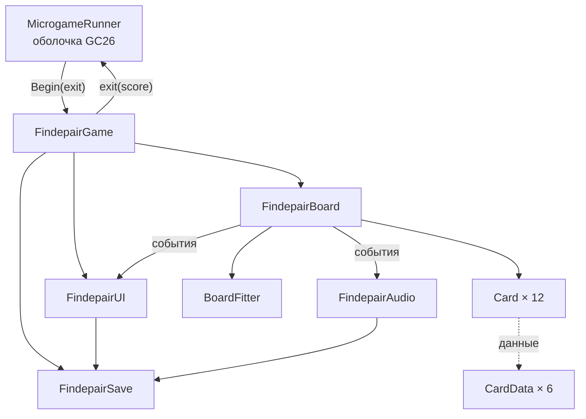
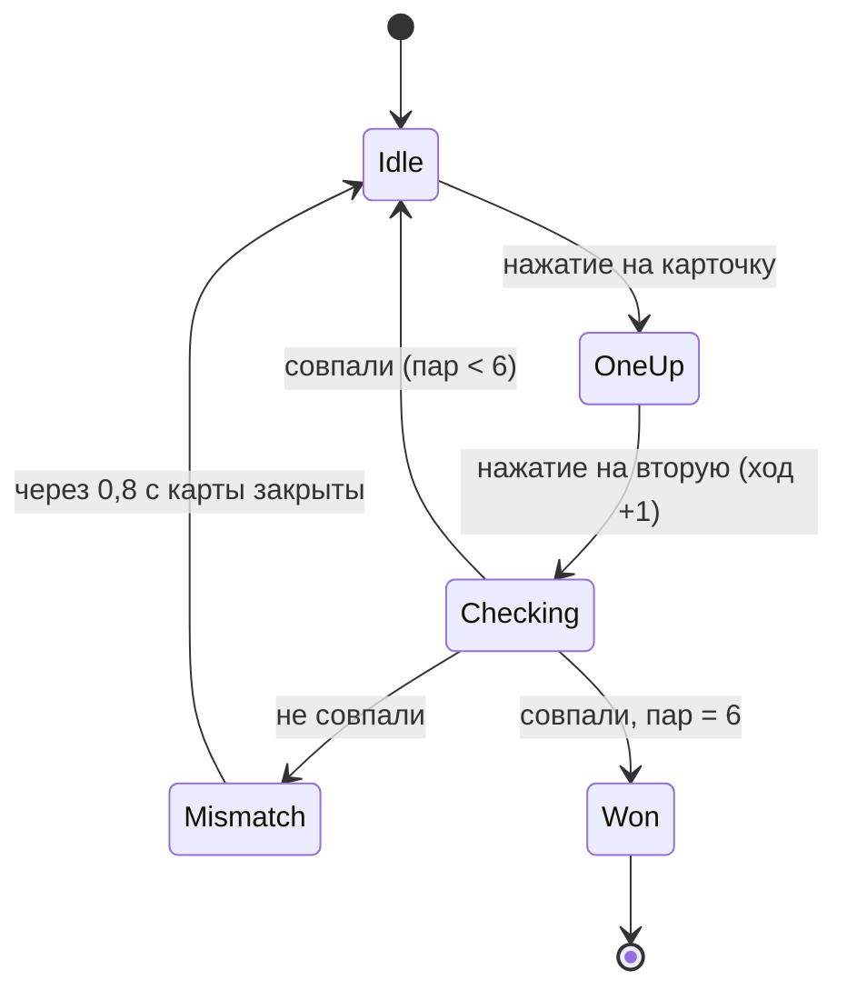

# Emo Party — Technical Design Document

**ID игры:** `gc26_findepair` · **Версия документа:** 1.0 (11.11.2026) · основан на прежних GDD, плане разработки, README и HTML-прототипе, с учётом правил репозитория GC26 ([RULES.md](../RULES.md)).

Что делает игра и как она выглядит — в [GDD_findepair.md](GDD_findepair.md). Этот документ описывает, как она устроена в коде и в репозитории.

---

## 1. Среда и ограничения

| Параметр | Значение |
|---|---|
| Unity | 6000.5.6f1, URP 17.5 |
| UI | Unity UI (uGUI 2.5) + TextMesh Pro (уже есть в `Assets/TextMesh Pro`) |
| Ввод | Только новая Input System (`activeInputHandler: 1`) → в `EventSystem` нужен `InputSystemUIInputModule` |
| Android | минимум API 26 (Android 8.0) — уже задано в проекте |
| Ориентация в проекте | AutoRotation, разрешены все четыре положения |
| Целевые показатели | 60 FPS, вклад игры в сборку — до 15 МБ (вся сборка GC26 — до 50 МБ) |

Проект — один на 11 мини-игр. Игра живёт **только в своей папке** и подчиняется правилам GC26:

| Правило | Что это значит для Emo Party |
|---|---|
| Своя папка | Все файлы — в `Assets/Microgames/gc26_findepair/` |
| Своя сборка и неймспейс | `GC26.Findepair.asmdef`, весь код в `namespace GC26.Findepair`, ссылки только на `GC26.Core`, `Unity.TextMeshPro`, `Unity.InputSystem` |
| Сцены с префиксом | `gc26_findepair_Main.unity` |
| Без общих имён файлов | Нельзя `GameManager.cs`, `UIManager`-подобные `UI.cs`, `AudioManager.cs` и т. п. — CI отклонит |
| Resources | Только `Resources/gc26_findepair/...` |
| Сохранения | Ключи PlayerPrefs через `MicrogameSave.Key(Id, "...")` |
| Без глобального состояния | Никаких `DontDestroyOnLoad`, статических синглтонов, изменений `Time.timeScale` |
| Нельзя менять | `ProjectSettings/`, `Packages/`, Build Settings, `Assets/Core`, `Assets/Shared` |

## 2. Структура папки

```
Assets/Microgames/gc26_findepair/
    microgame.json
    GC26.Findepair.asmdef
    README.md
    Scenes/
        gc26_findepair_Main.unity      стартовая сцена (одна на всю игру)
    Scripts/
        FindepairGame.cs               точка входа IMicrogame, переходы между экранами
        FindepairBoard.cs              правила: раскладка, проверка пар, ходы, таймер, победа
        Card.cs                        одна карточка: нажатие, анимации
        CardData.cs                    ScriptableObject пары
        BoardFitter.cs                 подгонка сетки под экран
        FindepairUI.cs                 экраны, HUD, окно победы, окно правил
        FindepairAudio.cs              звуки, музыка, вибрация
        FindepairSave.cs               рекорд и настройки
        SafeAreaFitter.cs              отступы под вырезы экрана
    Data/
        Cards/  EmoCat.asset … BowSkull.asset   6 × CardData
    Prefabs/
        Card.prefab
    Art/
        Cards/  emo_cat.png … bow_skull.png, back.png   900 × 1200
        Backgrounds/  wall.png, cork.png
        UI/  кнопки, иконки
        FindepairAtlas.spriteatlasv2
    Audio/
        flip.wav, match.wav, miss.wav, win.wav, music_loop.ogg
    Fonts/
        шрифт с кириллицей + TMP Font Asset
```

### `microgame.json`

```json
{
  "id": "gc26_findepair",
  "title": "Emo Party",
  "description": "Найди 6 пар неоновых карточек из эмо-2000-х",
  "entry_scene": "gc26_findepair_Main",
  "authors": ["…"]
}
```

## 3. Архитектура



Все объекты — в одной сцене `gc26_findepair_Main`. Ссылки задаются в инспекторе, без `FindObjectOfType` и синглтонов. Связь между частями — через C#-события (`event Action`), чтобы правила не зависели от UI и звука.

### Скрипты

| Скрипт | Отвечает за | Ключевое API |
|---|---|---|
| `FindepairGame` | Реализует `IMicrogame`; запускает игру; переключает экраны; выход в оболочку | `const string Id = "gc26_findepair"`, `Begin(Action<int>)`, `ExitToShell()` |
| `FindepairBoard` | Тасование, раскладка, проверка пары, ходы, таймер, пауза, победа | `NewGame()`, `SetPaused(bool)`, события `MovesChanged`, `PairMatched`, `PairMissed`, `CardFlipped`, `Won(Result)` |
| `Card` | Нажатие, переворот, «пульс», покачивание | `Init(CardData, Sprite back, Action<Card>)`, `IEnumerator Flip(bool up)`, `PlayMatch()`, `PlayMiss()`, `IsUp`, `IsMatched` |
| `CardData` | Данные пары (ScriptableObject) | `string id`, `string displayName`, `Sprite front`, `Color glow` |
| `BoardFitter` | Размер ячеек `GridLayoutGroup`; 3 × 4 в портрете, 4 × 3 в ландшафте; пересчёт при смене размера | `OnRectTransformDimensionsChange()` |
| `FindepairUI` | Экраны (заставка, меню, поле, пауза, победа, настройки, правила), HUD, звёзды, конфетти | `Show(FindepairScreen)`, `ShowWin(Result, bool isRecord)` (enum назван не `Screen`, чтобы не путать с `UnityEngine.Screen`) |
| `FindepairAudio` | Звуки, музыка, вибрация с учётом настроек | `Play(Sfx)`, `SetMusic(bool)`, `Vibrate(long ms)` |
| `FindepairSave` | Чтение и запись рекорда и настроек | `Load()`, `Save()`, `TrySetBest(Result)` |
| `SafeAreaFitter` | Отступы корневой панели под `Screen.safeArea` | — |

Имена `Card`, `CardData`, `BoardFitter`, `SafeAreaFitter` не входят в список запрещённых общих имён и защищены неймспейсом; `GameManager` / `UIManager` / `AudioManager` из прежнего GDD переименованы в `FindepairGame` / `FindepairUI` / `FindepairAudio`.

## 4. Связь с оболочкой GC26

```csharp
namespace GC26.Findepair
{
    public class FindepairGame : MonoBehaviour, IMicrogame
    {
        public const string Id = "gc26_findepair";
        Action<int> _exit;
        bool _started;

        public void Begin(Action<int> exit)
        {
            _started = true;
            _exit = exit;
            save.Load();
            ui.Show(FindepairScreen.Splash);
        }

        void Start()
        {
            // Сцена открыта отдельно (без оболочки) — запускаемся сами для отладки
            if (!_started && !MicrogameRunner.IsRunning)
                Begin(score => Debug.Log($"[{Id}] exit, score = {score}"));
        }

        public void ExitToShell()
        {
            save.Save();
            var exit = _exit; _exit = null;
            exit?.Invoke(SessionScore);   // вызывается ровно один раз
        }
    }
}
```

- Кнопка **«Выйти»** есть в главном меню, паузе и окне победы → `ExitToShell()`.
- **Счёт для оболочки** (`SessionScore`): число звёзд лучшей законченной партии за этот запуск (0–3), 0 — если партия не закончена.
- После `exit` оболочка выгружает сцену — всё, что игра создала, должно лежать в этой сцене (без `DontDestroyOnLoad`, без объектов в других сценах).

### Сцена при аддитивной загрузке

Оболочка уже имеет свою камеру, `AudioListener` и, скорее всего, `EventSystem`. Чтобы не было дублей:

| Объект | Правило |
|---|---|
| Canvas | `Screen Space – Overlay`, `sortingOrder` = 100, чтобы перекрыть меню оболочки |
| Камера + `AudioListener` | Объект `StandaloneOnly` — выключен по умолчанию, включается в `Start()`, только если `!MicrogameRunner.IsRunning` |
| `EventSystem` + `InputSystemUIInputModule` | Тоже в `StandaloneOnly`; при работе внутри оболочки используется её `EventSystem` |

## 5. Игровой цикл



| Константа | Значение | Откуда |
|---|---|---|
| `FlipSeconds` | 0,25 | GDD: переворот 0,25 с |
| `MismatchSeconds` | 0,8 | GDD: закрытие через 0,8 с |
| `WinDelaySeconds` | 0,5 | Прототип: пауза перед окном победы |
| Звёзды | `moves <= 9 ? 3 : moves <= 13 ? 2 : 1` | GDD |

Правила, перенесённые из прототипа (`onCardClick` / `checkPair`):

1. Нажатие игнорируется, если идёт проверка (`locked`), игра на паузе или не идёт, карточка уже открыта или найдена.
2. Вторая карточка: `moves++`, `locked = true`, ждём окончания переворота, затем сравниваем `CardData.id`.
3. Совпали — обе `IsMatched`, событие `PairMatched`, `locked = false` (если не победа).
4. Не совпали — `PairMissed`, через 0,8 с обе закрываются, после переворота `locked = false`.
5. Тасование — Фишер — Йетс по списку из 12 ссылок на `CardData` (каждая дважды). Число пар берётся из длины массива `CardData[]` — легко сделать 4 / 8 пар.

**Таймер и пауза.** `Time.timeScale` не меняется (правило GC26). `FindepairBoard` сам копит `elapsed += Time.unscaledDeltaTime` в `Update`, только если `running && !paused`. Задержки — корутины на `WaitForSecondsRealtime`; на паузе корутина проверки дожидается снятия паузы. При `OnApplicationPause(true)` игра сама ставит паузу.

**Защита от быстрых нажатий.** Флаг `locked` ставится синхронно в обработчике нажатия, до старта корутины; `Card` при `IsUp || IsMatched` отключает `Button.interactable`.

## 6. Интерфейс и раскладка

- **Canvas Scaler:** Scale With Screen Size, 1080 × 1920, Match 0.5.
- **Иерархия:** `Canvas / SafeArea / { Splash, Menu, Game { HUD, Board }, Pause, Win, Settings, Rules }`. Экран — `CanvasGroup`; переключение — `alpha` + `interactable` + `blocksRaycasts`.
- **Board:** `GridLayoutGroup` (spacing 24, padding 24) + `BoardFitter`. Карточка 3:4. `BoardFitter` выбирает 3 × 4 при высоте ≥ ширины, иначе 4 × 3, и считает размер ячейки так, чтобы сетка поместилась целиком.
- **Ориентация:** менять `ProjectSettings` нельзя, а в проекте включён автоповорот для всех игр. Поэтому, в отличие от HTML-прототипа (там экран «Поверните телефон»), Unity-версия **поддерживает ландшафт раскладкой 4 × 3**. Блокировать поворот только на время игры через `Screen.orientation` — тоже глобальное состояние; если понадобится, сохранить старое значение и вернуть в `OnDisable`.
- **Кнопки** ≥ 48 dp (≈ 144 px при 1080 по ширине); текст — TextMeshPro, шрифт с кириллицей в своей папке `Fonts/`.

### Анимации

Без Animator — короткие корутины / твины в `Card`:

| Анимация | Реализация |
|---|---|
| Переворот | `localScale.x` 1 → 0 (0,125 с), смена спрайта back ↔ front, 0 → 1 (0,125 с) |
| «Пульс» при совпадении | `localScale` 1 → 1,1 → 1 за 0,3 с + розовое свечение (`Outline` / доп. `Image` с аддитивным материалом) |
| Покачивание при ошибке | `localRotation` ±6° три раза за 0,3 с |
| Конфетти при победе | Пул из 36 символов ♥ / ★ (TextMeshPro) неоновых цветов, падающих 2–4 с со случайной задержкой — как в прототипе |

## 7. Звук и вибрация

- `FindepairAudio`: два `AudioSource` в сцене — `sfx` (`PlayOneShot`) и `music` (loop). При работе внутри оболочки свой `AudioListener` не создаётся (см. раздел 4).
- Клипы — из `Audio/`, CC0 (Kenney, freesound.org). WAV для коротких звуков (Decompress On Load), OGG для музыки (Streaming).
- Вибрация: `Handheld.Vibrate()` на Android даёт ~0,5 с без настройки длительности. Для коротких 40 мс — вызов `android.os.Vibrator` через `AndroidJavaObject` в `FindepairAudio.Vibrate(ms)`; на других платформах — ничего. Модуль `androidjni` уже есть в проекте.

## 8. Сохранения

PlayerPrefs, ключи с префиксом игры через `MicrogameSave.Key(Id, ...)`:

| Ключ | Тип | По умолчанию |
|---|---|---|
| `gc26_findepair_bestMoves` | int | -1 (рекорда нет) |
| `gc26_findepair_bestTimeMs` | int | -1 |
| `gc26_findepair_sound` | int 0/1 | 1 |
| `gc26_findepair_music` | int 0/1 | 1 |
| `gc26_findepair_vibro` | int 0/1 | 1 |

Рекорд обновляется, если `moves < bestMoves` или `moves == bestMoves && timeMs < bestTimeMs`. «Сбросить рекорд» в настройках удаляет два первых ключа. `PlayerPrefs.Save()` — при победе, при выходе в оболочку и в `OnApplicationPause(true)`.

## 9. Графика в Unity

- PNG 900 × 1200 → Texture Type *Sprite (2D and UI)*, Max Size 1024, сжатие ASTC 6×6 (Android).
- Все спрайты карточек и UI — в `FindepairAtlas` (Sprite Atlas v2) внутри своей папки.
- Фоны — отдельные текстуры, Max Size 2048.
- SVG-эскизы из прототипа можно экспортировать в PNG (Inkscape, Figma) как временную графику.

## 10. HTML-прототип

[prototype_findepair/index.html](prototype_findepair/index.html) — один файл (HTML + CSS + JS), без установки. Повторяет правила: 6 пар, поле 3 × 4, ходы, таймер, рекорд, звёзды, экраны «Заставка → Меню → Игра → Пауза / Победа», «Настройки» и «Правила игры». Графика — неоновые SVG, звуки синтезируются Web Audio, рекорд и настройки — в `localStorage` (`emoParty.v1`).

Запуск: открыть `prototype_findepair/index.html` двойным щелчком. С телефона в той же сети Wi-Fi:

```bash
python -m http.server 8000 --directory docs/prototype_findepair
```

и открыть `http://<IP-компьютера>:8000`.

| Прототип (JS) | Unity (C#) |
|---|---|
| `CARDS` | `CardData[]` |
| `newGame`, `shuffle` | `FindepairBoard.NewGame` |
| `onCardClick`, `checkPair` | `FindepairBoard.OnCardClicked`, корутина `CheckPair` |
| `tick`, `setPaused` | `FindepairBoard.Update`, `SetPaused` |
| `win`, `starsFor`, `confetti` | `FindepairBoard.Won` → `FindepairUI.ShowWin` |
| `store` | `FindepairSave` |
| `audio`, `vibrate` | `FindepairAudio` |
| `fitBoard` | `BoardFitter` |
| `show(id)` | `FindepairUI.Show` |

## 11. Сборка сцены

1. `python tools/new_microgame.py gc26_findepair` — создаёт папку, `microgame.json`, asmdef и `FindepairGame.cs`. Дописать в asmdef ссылки `Unity.TextMeshPro`, `Unity.InputSystem`.
2. Создать сцену `Scenes/gc26_findepair_Main.unity`.
3. Assets → Create → Findepair → Card Data, 6 штук в `Data/Cards`: EmoCat, EmoBear, Polaroid, Mp3Player, EnergyCan, BowSkull.
4. Canvas с иерархией из раздела 6, префаб `Card` (Image + Button + `Card`).
5. Объект `Findepair` с `FindepairGame`, `FindepairBoard`, `FindepairUI`, `FindepairAudio`, `FindepairSave`; заполнить ссылки в инспекторе.
6. Объект `StandaloneOnly` (камера, `AudioListener`, `EventSystem` + `InputSystemUIInputModule`), выключен.
7. Проверка отдельно: Play в своей сцене. Проверка в оболочке — после слияния организатор запускает **GC26 → Sync Microgames**.

## 12. Git и проверки

- Рабочая ветка по правилам GC26 — `game/gc26_findepair`. Сейчас работа идёт в `gs26_findepair`: `check_scope.py` считает игровыми только ветки `game/…` и такую ветку **пропускает без проверки**. Стоит перейти на `game/gc26_findepair`.
- Один раз на клон: `git config core.hooksPath tools/hooks` — проверка перед каждым `git push`.
- Раз в неделю: `git fetch && git merge origin/main`.
- Перед пушем: `python tools/check_scope.py` и `python tools/check_names.py gc26_findepair`.
- Папка `docs/` лежит вне `Assets/Microgames/gc26_findepair/` и при PR в `main` нарушит правило «только своя папка». Перед PR перенести документы в папку игры (например, `Assets/Microgames/gc26_findepair/Docs~/` — папки с `~` Unity не импортирует) или оставить их только в своей ветке.

## 13. Тестирование

| Что | Как |
|---|---|
| Правила | EditMode-тесты (Unity Test Framework уже в проекте) для логики `FindepairBoard`: тасование даёт ровно по 2 карты каждой пары, подсчёт ходов, звёзды, сравнение рекордов. Тесты в `Tests/` со своим asmdef `GC26.Findepair.Tests` |
| Быстрые нажатия | Двойной тап по одной карте, тап по третьей карте во время проверки, тап во время паузы |
| Жизненный цикл | Сворачивание приложения во время проверки пары, «Заново» во время анимации, выход в оболочку и повторный вход |
| Оболочка | Нет дублей `EventSystem` / `AudioListener`, после выхода не остаётся объектов игры, `Time.timeScale == 1` |
| Экраны | Device Simulator: телефоны с вырезом, 16:9, 20:9, планшет 4:3, портрет и ландшафт |
| Производительность | 60 FPS на слабом Android 8, профайлер — без аллокаций в `Update` |

## 14. Открытые вопросы

| Вопрос | Кому |
|---|---|
| Значение `score` для оболочки: звёзды (0–3) или другой счёт, единый для всех игр? | Организатор |
| Публикуется ли Emo Party отдельным приложением в Google Play или только в составе сборника GC26? | Организатор / преподаватель |
| Нужна ли блокировка портретной ориентации на время игры? | Команда |
