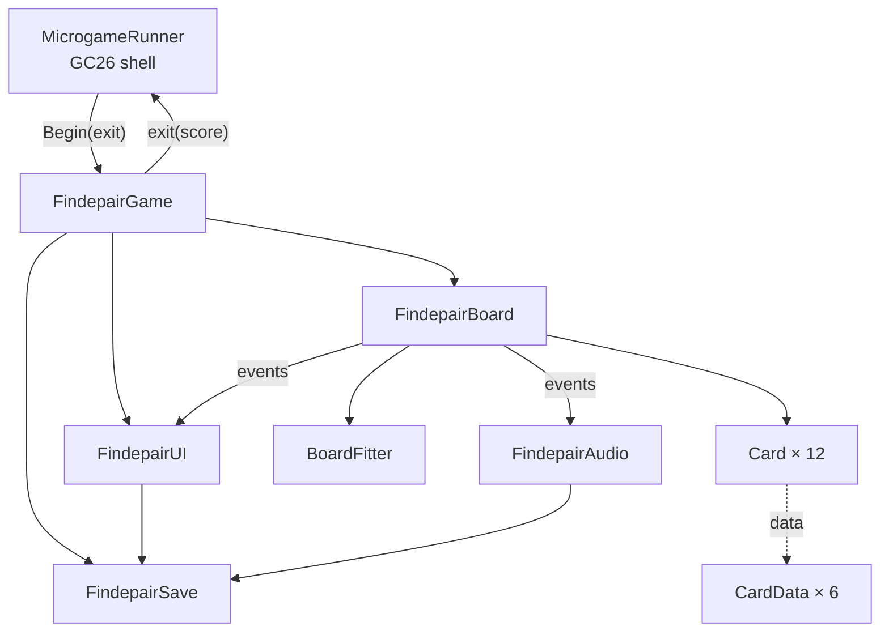
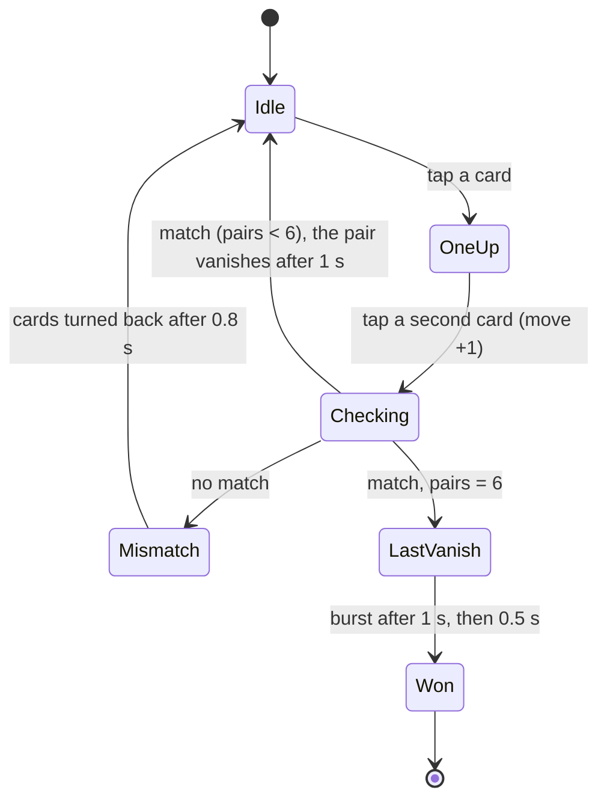

# Emo Party — Technical Design Document

**Game ID:** `gc26_findepair` · **Document version:** 1.1 (2026-11-18) · based on the earlier GDD, development plan, README and HTML prototype, following the GC26 repository rules ([RULES.md](../RULES.md)).

What the game does and how it looks is in [GDD_findepair.md](GDD_findepair.md). This document describes how it is built in code and in the repository.

---

## 1. Environment and constraints

| Parameter | Value |
|---|---|
| Unity | 6000.5.6f1, URP 17.5 |
| UI | Unity UI (uGUI 2.5) + TextMesh Pro (already in `Assets/TextMesh Pro`) |
| Input | New Input System only (`activeInputHandler: 1`) → `EventSystem` needs `InputSystemUIInputModule` |
| Android | minimum API 26 (Android 8.0) — already set in the project |
| Project orientation | AutoRotation, all four orientations allowed |
| Targets | 60 FPS, the game adds up to 15 MB to the build (the whole GC26 build — up to 50 MB) |

One project holds 11 mini-games. The game lives **only in its own folder** and follows the GC26 rules:

| Rule | What it means for Emo Party |
|---|---|
| Own folder | All files in `Assets/Microgames/gc26_findepair/` |
| Own assembly and namespace | `GC26.Findepair.asmdef`, all code in `namespace GC26.Findepair`, references only to `GC26.Core`, `Unity.TextMeshPro`, `Unity.InputSystem` |
| Prefixed scenes | `gc26_findepair_Main.unity` |
| No generic file names | No `GameManager.cs`, `UI.cs`, `AudioManager.cs` and the like — CI rejects them |
| Resources | Only `Resources/gc26_findepair/...` |
| Saves | PlayerPrefs keys via `MicrogameSave.Key(Id, "...")` |
| No global state | No `DontDestroyOnLoad`, static singletons or `Time.timeScale` changes |
| Off limits | `ProjectSettings/`, `Packages/`, Build Settings, `Assets/Core`, `Assets/Shared` |

## 2. Folder structure

```
Assets/Microgames/gc26_findepair/
    microgame.json
    GC26.Findepair.asmdef
    README.md
    Scenes/
        gc26_findepair_Main.unity      entry scene (one for the whole game)
    Scripts/
        FindepairGame.cs               IMicrogame entry point, screen transitions
        FindepairBoard.cs              rules: layout, pair checks, moves, timer, win
        Card.cs                        a single card: tap, animations
        CardData.cs                    pair ScriptableObject
        BoardFitter.cs                 fits the grid to the screen
        SparkleBurst.cs                pink sparkle burst
        FindepairUI.cs                 screens, HUD, win window, rules window
        FindepairAudio.cs              sounds, music, vibration
        FindepairSave.cs               record and settings
        SafeAreaFitter.cs              insets for screen cutouts
    Data/
        Cards/  EmoCat.asset … BowSkull.asset   6 × CardData
    Prefabs/
        Card.prefab
    Art/
        Cards/  emo_cat.png … bow_skull.png, back.png   900 × 1200
        Backgrounds/  wall.png, cork.png
        UI/  buttons, icons
        FX/  sparkle.png
        FindepairAtlas.spriteatlasv2
    Audio/
        flip.wav, match.wav, miss.wav, win.wav, music_loop.ogg
    Fonts/
        UI font + TMP Font Asset
```

### `microgame.json`

```json
{
  "id": "gc26_findepair",
  "title": "Emo Party",
  "description": "Find 6 pairs of neon cards from the emo 2000s",
  "entry_scene": "gc26_findepair_Main",
  "authors": ["…"]
}
```

## 3. Architecture



All objects are in one scene, `gc26_findepair_Main`. References are set in the Inspector, with no `FindObjectOfType` and no singletons. Parts talk to each other through C# events (`event Action`), so the rules don't depend on UI or sound.

### Scripts

| Script | Responsible for | Key API |
|---|---|---|
| `FindepairGame` | Implements `IMicrogame`; starts the game; switches screens; exits to the shell | `const string Id = "gc26_findepair"`, `Begin(Action<int>)`, `ExitToShell()` |
| `FindepairBoard` | Shuffle, layout, pair check, moves, timer, pause, win | `NewGame()`, `SetPaused(bool)`, events `MovesChanged`, `PairMatched`, `PairVanished`, `PairMissed`, `CardFlipped`, `Won(Result)` |
| `Card` | Tap, flip, "pulse", shake, vanish | `Init(CardData, Sprite back, Action<Card>)`, `IEnumerator Flip(bool up)`, `PlayMatch()`, `PlayMiss()`, `IEnumerator PlayVanish()`, `IsUp`, `IsMatched`, `IsGone` |
| `SparkleBurst` | Pink sparkle burst when a pair vanishes, pool of `Image`s | `Play(Vector2 localPos)`, `Clear()` |
| `CardData` | Pair data (ScriptableObject) | `string id`, `string displayName` (for accessibility and debugging only — names are not drawn on the cards), `Sprite front`, `Color glow` |
| `BoardFitter` | `GridLayoutGroup` cell size; 3 × 4 in portrait, 4 × 3 in landscape; recalculated on resize | `OnRectTransformDimensionsChange()` |
| `FindepairUI` | Screens (splash, menu, board, pause, win, settings, rules), HUD, stars, confetti | `Show(FindepairScreen)`, `ShowWin(Result, bool isRecord)` (the enum isn't called `Screen` to avoid clashing with `UnityEngine.Screen`) |
| `FindepairAudio` | Sounds, music, vibration, respecting the settings | `Play(Sfx)`, `SetMusic(bool)`, `Vibrate(long ms)` |
| `FindepairSave` | Reading and writing the record and settings | `Load()`, `Save()`, `TrySetBest(Result)` |
| `SafeAreaFitter` | Root panel insets for `Screen.safeArea` | — |

The names `Card`, `CardData`, `BoardFitter` and `SafeAreaFitter` are not on the banned generic-name list and are protected by the namespace; `GameManager` / `UIManager` / `AudioManager` from the earlier GDD are renamed to `FindepairGame` / `FindepairUI` / `FindepairAudio`.

## 4. Connection to the GC26 shell

```csharp
namespace GC26.Findepair
{
    public class FindepairGame : MonoBehaviour, IMicrogame
    {
        public const string Id = "gc26_findepair";
        Action<int> _exit;
        bool _started;

        public void Begin(Action<int> exit)
        {
            _started = true;
            _exit = exit;
            save.Load();
            ui.Show(FindepairScreen.Splash);
        }

        void Start()
        {
            // Scene opened on its own (no shell): start ourselves for debugging
            if (!_started && !MicrogameRunner.IsRunning)
                Begin(score => Debug.Log($"[{Id}] exit, score = {score}"));
        }

        public void ExitToShell()
        {
            save.Save();
            var exit = _exit; _exit = null;
            exit?.Invoke(SessionScore);   // called exactly once
        }
    }
}
```

- The **"Exit"** button is in the main menu, pause and win screens → `ExitToShell()`.
- **Score for the shell** (`SessionScore`): the stars of the best finished round in this session (0–3), 0 if no round was finished.
- After `exit` the shell unloads the scene — everything the game created must be in this scene (no `DontDestroyOnLoad`, no objects in other scenes).

### The scene when loaded additively

The shell already has its own camera, `AudioListener` and probably an `EventSystem`. To avoid duplicates:

| Object | Rule |
|---|---|
| Canvas | `Screen Space – Overlay`, `sortingOrder` = 100 to cover the shell menu |
| Camera + `AudioListener` | Object `StandaloneOnly` — disabled by default, enabled in `Start()` only if `!MicrogameRunner.IsRunning` |
| `EventSystem` + `InputSystemUIInputModule` | Also in `StandaloneOnly`; inside the shell, the shell's `EventSystem` is used |

## 5. Game loop



A pair vanishes in parallel with play: while a found pair waits 1 s and bursts, the player can already turn other cards.

| Constant | Value | Source |
|---|---|---|
| `FlipSeconds` | 0.25 | GDD: flip 0.25 s |
| `MismatchSeconds` | 0.8 | GDD: turn back after 0.8 s |
| `MatchVanishDelaySeconds` | 1.0 | A found pair stays visible for 1 s, then vanishes |
| `VanishSeconds` | 0.25 | The card scales up to 1.2 and fades out during the burst |
| `SparkleCount` | 16 per card | Number of sparkles in a burst |
| `SparkleLifetime` | 0.5–0.7 s | Lifetime of one sparkle |
| `WinDelaySeconds` | 0.5 | Prototype: pause before the win window (counted after the last pair vanishes) |
| Stars | `moves <= 9 ? 3 : moves <= 13 ? 2 : 1` | GDD |

Rules carried over from the prototype (`onCardClick` / `checkPair`):

1. A tap is ignored if a check is running (`locked`), the game is paused or not running, or the card is already face-up or found.
2. Second card: `moves++`, `locked = true`, wait for the flip to finish, then compare `CardData.id`.
3. Match — both `IsMatched`, event `PairMatched`, "pulse", and `locked = false` right away (unless it's the win). A `VanishPair` coroutine starts for the pair:
   1. waits `MatchVanishDelaySeconds` (1 s) of real time; the countdown stops while paused;
   2. `SparkleBurst.Play()` at the center of each card: a pink sparkle burst;
   3. at the same time `Card.PlayVanish()`: scale 1 → 1.2, opacity 1 → 0 over 0.25 s;
   4. then the card is `IsGone`: `CanvasGroup.alpha = 0`, `blocksRaycasts = false`. The object is **not disabled** — otherwise `GridLayoutGroup` would shift the other cards; an empty slot stays on the board;
   5. event `PairVanished`; if this was the last pair, event `Won` after `WinDelaySeconds`.
4. No match — `PairMissed`, both turn back after 0.8 s, `locked = false` after the flip.
5. Shuffle — Fisher–Yates over a list of 12 `CardData` references (each twice). The number of pairs comes from the length of the `CardData[]` array, so 4 / 8 pairs are easy.

**Timer and pause.** `Time.timeScale` is not changed (GC26 rule). `FindepairBoard` accumulates `elapsed += Time.unscaledDeltaTime` in `Update` itself, only when `running && !paused`. Delays are coroutines on `WaitForSecondsRealtime`; while paused, the check coroutine waits for the pause to end. On `OnApplicationPause(true)` the game pauses itself.

**Fast-tap protection.** The `locked` flag is set synchronously in the tap handler, before the coroutine starts; `Card` disables `Button.interactable` when `IsUp || IsMatched`, so a vanishing pair can't be tapped.

**Stopping.** "Restart", going to the menu and exiting to the shell call `StopAllCoroutines()` on the board and `SparkleBurst.Clear()`: unfinished bursts and vanish waits are cut short, and the sparkles return to the pool.

## 6. UI and layout

- **Canvas Scaler:** Scale With Screen Size, 1080 × 1920, Match 0.5.
- **Hierarchy:** `Canvas / SafeArea / { Splash, Menu, Game { HUD, Board }, Pause, Win, Settings, Rules }`. Each screen is a `CanvasGroup`; switching sets `alpha` + `interactable` + `blocksRaycasts`.
- **Board:** `GridLayoutGroup` (spacing 24, padding 24) + `BoardFitter`. Card ratio 3:4. `BoardFitter` picks 3 × 4 when height ≥ width, otherwise 4 × 3, and sizes the cells so the whole grid fits.
- **Orientation:** `ProjectSettings` can't be changed, and auto-rotation is on for all games in the project. So, unlike the HTML prototype (which shows a "Turn your phone upright" screen), the Unity version **supports landscape with a 4 × 3 layout**. Locking rotation only during play via `Screen.orientation` is also global state; if needed, save the old value and restore it in `OnDisable`.
- **Buttons** ≥ 48 dp (≈ 144 px at 1080 width); text is TextMeshPro, with the font in the game's own `Fonts/` folder.

### Animations

No Animator — short coroutines / tweens in `Card`:

| Animation | Implementation |
|---|---|
| Flip | `localScale.x` 1 → 0 (0.125 s), swap sprite back ↔ front, 0 → 1 (0.125 s) |
| Match "pulse" | `localScale` 1 → 1.1 → 1 over 0.3 s + pink glow (`Outline` / extra `Image` with an additive material) |
| Pair vanish (1 s after the match) | `Card.PlayVanish()`: `localScale` 1 → 1.2 and `CanvasGroup.alpha` 1 → 0 over 0.25 s (ease-in), together with the sparkle burst |
| Pink sparkle burst | `SparkleBurst` (see below) |
| Shake on a miss | `localRotation` ±6° three times over 0.3 s |
| Win confetti | Pool of 36 ♥ / ★ symbols (TextMeshPro) in neon colors, falling for 2–4 s with a random delay — as in the prototype |

### Pink sparkle burst — `SparkleBurst`

`ParticleSystem` doesn't render on a Screen Space – Overlay Canvas, and UI particle packages can't be added (only the organizer changes `Packages/`). So the sparkles are plain pooled `Image`s:

| Parameter | Value |
|---|---|
| Where | One `Sparkles` object on top of `Board` (last child, outside the `GridLayoutGroup`), `raycastTarget = false` on every sparkle |
| Pool | 96 `Image`s (up to 3 pairs at once × 2 cards × 16 sparkles), created at start, no `Instantiate` during play; if the pool runs out, the oldest sparkle is reused |
| Sprite | `Art/FX/sparkle.png` — a four-pointed star 64 × 64 with a soft glow, in the atlas. An additive material is optional, with its own shader in the game folder (`Art/FX/`); otherwise `UI/Default` |
| Colors | Bright pinks `#FF4FC4`, `#FF8FE0`, `#FFC2F0` and white `#FFFFFF`; each sparkle has a white-hot core and a wide pink glow (additive material or a glow sprite) |
| Center flash | At the start of the burst, a radial white → pink glow over each card, about 1.3 × the card width, scaling 0.3 → 1.5 and fading out over 0.32 s |
| Motion | From the card center in all directions, speed 300–700 px/s, slight drag and downward gravity of 600 px/s² |
| Size | 28–60 px, fully bright for the first ~65% of its life, then shrinking and fading to 0, random rotation |
| Lifetime | 0.5–0.7 s; updated in `Update` with `Time.unscaledDeltaTime`; sparkles freeze while paused |
| API | `Play(Vector2 localPos)`, `Clear()` |

## 7. Sound and vibration

- `FindepairAudio`: two `AudioSource`s in the scene — `sfx` (`PlayOneShot`) and `music` (loop). Inside the shell the game doesn't create its own `AudioListener` (see section 4).
- Clips come from `Audio/`, CC0 (Kenney, freesound.org). WAV for short sounds (Decompress On Load), OGG for music (Streaming).
- Vibration: on Android `Handheld.Vibrate()` gives ~0.5 s with no duration control. For a short 40 ms buzz, call `android.os.Vibrator` via `AndroidJavaObject` in `FindepairAudio.Vibrate(ms)`; do nothing on other platforms. The `androidjni` module is already in the project.

## 8. Saves

PlayerPrefs, keys with the game prefix via `MicrogameSave.Key(Id, ...)`:

| Key | Type | Default |
|---|---|---|
| `gc26_findepair_bestMoves` | int | -1 (no record) |
| `gc26_findepair_bestTimeMs` | int | -1 |
| `gc26_findepair_sound` | int 0/1 | 1 |
| `gc26_findepair_music` | int 0/1 | 1 |
| `gc26_findepair_vibro` | int 0/1 | 1 |

The record is updated if `moves < bestMoves`, or `moves == bestMoves && timeMs < bestTimeMs`. "Reset record" in the settings deletes the first two keys. `PlayerPrefs.Save()` is called on a win, on exiting to the shell and on `OnApplicationPause(true)`.

## 9. Art in Unity

- PNG 900 × 1200 → Texture Type *Sprite (2D and UI)*, Max Size 1024, ASTC 6×6 compression (Android).
- All card and UI sprites are in `FindepairAtlas` (Sprite Atlas v2) inside the game folder.
- Backgrounds are separate textures, Max Size 2048.
- The prototype's SVG sketches can be exported to PNG (Inkscape, Figma) as placeholder art.

## 10. HTML prototype

[prototype_findepair/index.html](prototype_findepair/index.html) is a single file (HTML + CSS + JS) with nothing to install. It follows the rules: 6 pairs, a 3 × 4 board, moves, timer, record, stars, matched pairs vanishing in a pink sparkle burst, the screens "Splash → Menu → Game → Pause / Win", "Settings" and "How to play". The art is neon SVG files in `images/`, sounds are synthesized with Web Audio, and the record and settings are kept in `localStorage` (`emoParty.v1`).

### Replaceable images

The full list with titles and descriptions for the artist is in [prototype_findepair/images/ARTWORK.md](prototype_findepair/images/ARTWORK.md).

| File | Size | What it is |
|---|---|---|
| `images/cards/emo_cat.svg`, `emo_bear.svg`, `polaroid.svg`, `mp3_player.svg`, `energy_drink.svg`, `bow_skull.svg` | 900 × 1200 (3:4), transparent background | Card faces; shown with `contain` over the dark card color |
| `images/cards/card_back.svg` | 900 × 1200 | Card back (checkerboard + heart with a lightning bolt), shown with `cover` |
| `images/backgrounds/menu_wall.svg` | 900 × 1950 (9:19.5) | Main menu and settings background (brick wall), shown with `cover` |
| `images/backgrounds/board_cork.svg` | 900 × 1950 | Game board background (cork), shown with `cover` |

To replace a picture, either edit the SVG or put a PNG with the **same name** next to it (for example `images/cards/emo_cat.png`); no code changes are needed. At startup `loadImages()` picks each image in this order: `.png`, then `.svg`, then a built-in base64 copy of the original SVG (`BUILT_IN_IMAGES`). The built-in copy is used only when the files can't be read — for example in a sandboxed preview that opens the page without its folder — so the cards are never blank. A replaced file shows up in a normal browser, not in such a preview. Card frames, glow, push pins, the background darkening, graffiti, flyers and notes stay in CSS. The same files can be exported to PNG for Unity's `Art/` folder.

To run it, double-click `prototype_findepair/index.html`. From a phone on the same Wi-Fi network:

```bash
python -m http.server 8000 --directory docs/prototype_findepair
```

and open `http://<computer-IP>:8000`.

| Prototype (JS) | Unity (C#) |
|---|---|
| `CARDS` | `CardData[]` |
| `newGame`, `shuffle` | `FindepairBoard.NewGame` |
| `onCardClick`, `checkPair` | `FindepairBoard.OnCardClicked`, `CheckPair` coroutine |
| `tick`, `setPaused` | `FindepairBoard.Update`, `SetPaused` |
| `later`, `pauseTimers`, `clearTimers` | `VanishPair` coroutine on `WaitForSecondsRealtime`, `StopAllCoroutines()` |
| `vanish` | `Card.PlayVanish` |
| `sparkle` | `SparkleBurst.Play` |
| `win`, `starsFor`, `confetti` | `FindepairBoard.Won` → `FindepairUI.ShowWin` |
| `store` | `FindepairSave` |
| `audio`, `vibrate` | `FindepairAudio` |
| `fitBoard` | `BoardFitter` |
| `show(id)` | `FindepairUI.Show` |

## 11. Building the scene

1. `python tools/new_microgame.py gc26_findepair` creates the folder, `microgame.json`, the asmdef and `FindepairGame.cs`. Add the `Unity.TextMeshPro` and `Unity.InputSystem` references to the asmdef.
2. Create the scene `Scenes/gc26_findepair_Main.unity`.
3. Assets → Create → Findepair → Card Data, 6 of them in `Data/Cards`: EmoCat, EmoBear, Polaroid, Mp3Player, EnergyCan, BowSkull.
4. Canvas with the hierarchy from section 6, and the `Card` prefab (Image + Button + `Card`).
5. A `Findepair` object with `FindepairGame`, `FindepairBoard`, `FindepairUI`, `FindepairAudio`, `FindepairSave`; fill in the references in the Inspector.
6. A `StandaloneOnly` object (camera, `AudioListener`, `EventSystem` + `InputSystemUIInputModule`), disabled.
7. Test on its own: Play in the game's scene. Test in the shell: after the merge, the organizer runs **GC26 → Sync Microgames**.

## 12. Git and checks

- The working branch under the GC26 rules is `game/gc26_findepair`. Work currently happens in `gs26_findepair`: `check_scope.py` only treats `game/…` branches as game branches, so it **skips this branch without checking**. Switching to `game/gc26_findepair` is recommended.
- Once per clone: `git config core.hooksPath tools/hooks` — a check before every `git push`.
- Once a week: `git fetch && git merge origin/main`.
- Before pushing: `python tools/check_scope.py` and `python tools/check_names.py gc26_findepair`.
- The `docs/` folder is outside `Assets/Microgames/gc26_findepair/`, so a PR to `main` would break the "own folder only" rule. Before the PR, move the documents into the game folder (for example `Assets/Microgames/gc26_findepair/Docs~/` — Unity doesn't import folders ending in `~`) or keep them only in your branch.

## 13. Testing

| What | How |
|---|---|
| Rules | EditMode tests (Unity Test Framework is already in the project) for the `FindepairBoard` logic: the shuffle gives exactly 2 cards of each pair, move counting, stars, record comparison. Tests go in `Tests/` with their own asmdef `GC26.Findepair.Tests` |
| Fast taps | Double tap on one card, tap on a third card during a check, tap while paused, tap on a vanishing pair |
| Pair vanish | A pair vanishes exactly 1 s after the match; pausing during that second delays it; several pairs in a row all burst; the other cards don't shift; the win window appears only after the last pair bursts |
| Lifecycle | Minimizing the app during a pair check, "Restart" during an animation, exiting to the shell and coming back |
| Shell | No duplicate `EventSystem` / `AudioListener`, no game objects left after exit, `Time.timeScale == 1` |
| Screens | Device Simulator: phones with cutouts, 16:9, 20:9, 4:3 tablet, portrait and landscape |
| Performance | 60 FPS on a low-end Android 8 device, no allocations in `Update` in the profiler |

## 14. Open questions

| Question | Who decides |
|---|---|
| The `score` value for the shell: stars (0–3) or another score shared by all games? | Organizer |
| Is Emo Party published to Google Play as a separate app or only as part of the GC26 collection? | Organizer / teacher |
| Should portrait orientation be locked during play? | Team |
