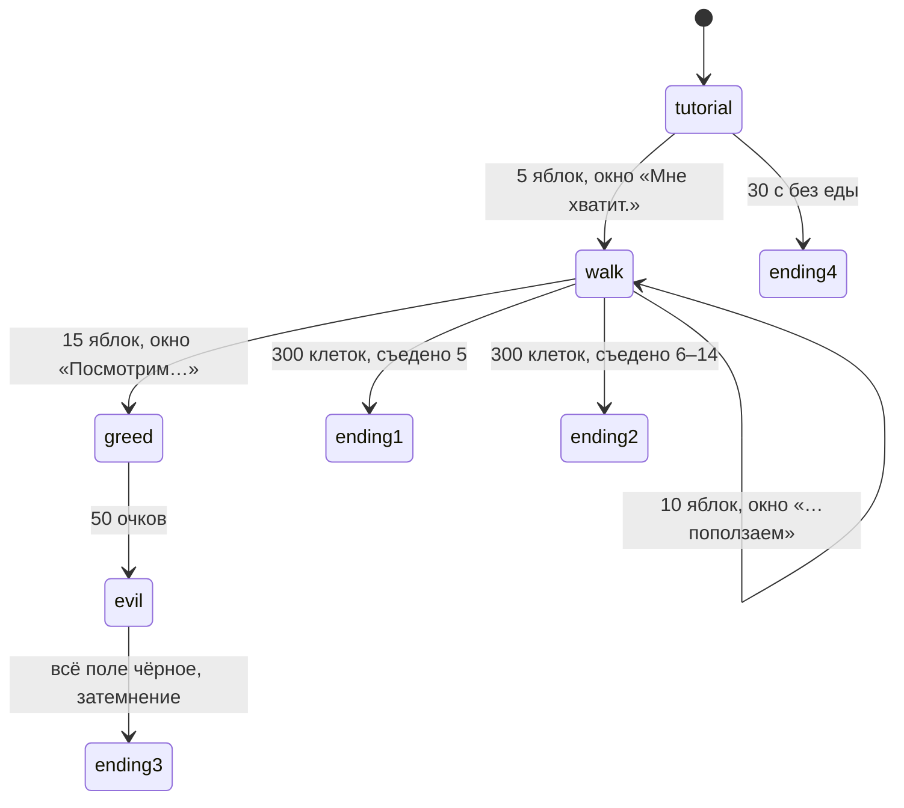

# 🛠 Science Snake — Technical Design Document

> **TDD** · версия документа **1** (25.11.2026) · описывает Unity-версию игры **2.1** в ветке `gc26_science_snake` · дизайн игры — в [GDD](gdd_snake_draft_v2_1.md) · эталон поведения — [HTML-прототип](prototype_snake_2.html)

Этот документ отвечает на вопрос «**как игра устроена внутри**»: из каких файлов состоит, как работает цикл игры, как рисуется поле, где хранятся сохранения, как собрать сборку для Android и что ещё не доделано. Правила, сюжет и концовки описаны в GDD и здесь не повторяются.

---

## Оглавление

1. [Коротко](#1-коротко)
2. [Платформы и требования](#2-платформы-и-требования)
3. [Файлы и папки](#3-файлы-и-папки)
4. [Сцена и объекты во время игры](#4-сцена-и-объекты-во-время-игры)
5. [Игровой цикл](#5-игровой-цикл)
6. [Состояние игры и фазы истории](#6-состояние-игры-и-фазы-истории)
7. [Управление](#7-управление)
8. [Отрисовка поля](#8-отрисовка-поля)
9. [Интерфейс](#9-интерфейс)
10. [Звук и вибрация](#10-звук-и-вибрация)
11. [Тексты и языки](#11-тексты-и-языки)
12. [Сохранения](#12-сохранения)
13. [Эффекты (game feel)](#13-эффекты-game-feel)
14. [Сборка и запуск](#14-сборка-и-запуск)
15. [Тестирование](#15-тестирование)
16. [Производительность](#16-производительность)
17. [Правила репозитория и ограничения](#17-правила-репозитория-и-ограничения)
18. [Известные проблемы и планы](#18-известные-проблемы-и-планы)
19. [История версий](#19-история-версий)

---

## 1. Коротко

| | |
| --- | --- |
| **Движок** | Unity 6.5 (`6000.5.6f1`), Universal Render Pipeline (URP) |
| **Язык** | C# |
| **Вид** | 2D: ортографическая камера, спрайты, интерфейс uGUI |
| **Платформы** | Android (основная), Windows (для проверки и показа) |
| **Папка игры** | `Assets/Microgames/gc26_science_snake/` |
| **Сцена** | `Scenes/gc26_science_snake_Main.unity` |
| **Код** | 4 скрипта игры + 1 скрипт редактора, ≈ 2700 строк |
| **Ассеты** | **нет ни одного файла** картинок, звуков или шрифтов — всё создаётся кодом при запуске |

**Главный принцип:** вся игра собирается из кода одним компонентом `ScienceSnakeGame`. В сцене лежит только пустой объект с этим компонентом и камера. Поэтому игру легко переносить, она не ломается из-за потерянных ссылок в префабах, а изменения хорошо видны в git.

---

## 2. Платформы и требования

| | Android | Windows |
| --- | --- | --- |
| Сборка | APK (`ScienceSnake.apk`, ≈ 33 МБ) | `ScienceSnake.exe` |
| Минимальная версия | Android 8.0 (API 26 — настройка проекта) | Windows 10, 64 бит |
| Ориентация | любая; интерфейс рассчитан на портретную | окно любого размера |
| Частота кадров | **60 fps** (`Application.targetFrameRate = 60`, на Android по умолчанию 30) | 60 fps |
| Разрешение отрисовки | **100 %** — игра сама поднимает `renderScale` URP с 0,8 до 1 (только в собранной игре, файл настроек не меняется) | 100 % |
| Управление | свайпы, экранные стрелки | клавиатура, клик мышью, экранные стрелки |
| Вырезы экрана | учитывается безопасная зона (`Screen.safeArea`) | — |

**Пакеты Unity, которые использует игра:** `com.unity.ugui` (интерфейс), `com.unity.inputsystem` (управление, в проекте включена только новая система ввода), `com.unity.render-pipelines.universal` (URP). Других зависимостей нет.

---

## 3. Файлы и папки

```
Assets/Microgames/gc26_science_snake/
├── GC26.ScienceSnake.asmdef          своя сборка кода (assembly definition)
├── Scenes/
│   └── gc26_science_snake_Main.unity единственная сцена игры
├── Scripts/
│   ├── ScienceSnakeGame.cs           вся игра: состояние, логика, отрисовка, меню (≈ 1670 строк)
│   ├── Procedural.cs                 спрайты и звуки, создаваемые кодом (≈ 415 строк)
│   ├── UiKit.cs                      помощники для интерфейса + компонент PressButton (≈ 200 строк)
│   └── Texts.cs                      тексты RU/EN — генерируется автоматически, руками не править (≈ 310 строк)
├── Editor/
│   ├── GC26.ScienceSnake.Editor.asmdef
│   └── ScienceSnakeSetup.cs          создание сцены, меню «Science Snake», сборки
└── Tools~/
    └── gen_texts.py                  генератор Texts.cs из HTML-прототипа (папка с «~» Unity игнорирует)

docs/
├── prototype_snake_2.html            HTML-прототип — эталон поведения и источник текстов
├── gdd_snake_draft_v2_1.md           дизайн-документ (GDD)
└── TDD_science_snake_1.md            этот документ

Builds/ScienceSnake/                  результаты сборок (в git не попадают)
```

**Сборки кода (asmdef):**

| Сборка | Ссылается на | Зачем |
| --- | --- | --- |
| `GC26.ScienceSnake` | `UnityEngine.UI`, `Unity.InputSystem`, `Unity.RenderPipelines.Universal.Runtime`, `Unity.RenderPipelines.Core.Runtime` | код игры отдельно от остального проекта: быстрее компилируется, не конфликтует с другими играми |
| `GC26.ScienceSnake.Editor` | `GC26.ScienceSnake` | только для редактора; в сборку игры не попадает |

Пространство имён всего кода — `GC26.ScienceSnake`.

---

## 4. Сцена и объекты во время игры

**В сцене (сохранено в файле):**

```
gc26_science_snake_Main
└── Science Snake            компонент ScienceSnakeGame
    └── Camera               камера сцены (чтобы окно Game в редакторе не было чёрным)
```

**Создаётся кодом при запуске (`Awake`):**

```
Science Snake
├── Camera              → фоновая камера: тёмный фон вокруг колонки интерфейса, AudioListener
├── Board Camera        → камера поля: рисует только в свободной области между панелями
├── Board               → всё поле: тень, клетки, маска скруглённых углов, пунктир краёв,
│   ├── Head 0, Head 1     голова (вторая — копия при переходе через край)
│   ├── Segment ×N         круги тела (пул)
│   ├── Scale ×N           ромбики узора на спине (пул)
│   ├── Item ×N, Timer ×N  предметы и кольца таймера (пул)
│   ├── Fx ×N              частицы и вспышки (пул)
│   └── Dark, Flash, Countdown   затемнения поверх поля
├── UI                  → Canvas (Screen Space Overlay) со всем интерфейсом
├── EventSystem         → если в сцене его ещё нет (с InputSystemUIInputModule)
└── AudioSource
```

**Две камеры.** Интерфейс рисуется поверх всего (Overlay Canvas), а поле — отдельной камерой, у которой прямоугольник вывода (`pixelRect`) каждый кадр подгоняется под свободную область между верхней панелью, полосой фактов и стрелками. Размер камеры (`orthographicSize`) подбирается так, чтобы поле 20 × 20 с небольшим полем вокруг поместилось целиком при любой форме экрана.

---

## 5. Игровой цикл

Каждый кадр `Update()` делает по порядку:

1. `LayoutColumn()` — подгоняет колонку интерфейса под ширину экрана и безопасную зону, прямоугольник камеры поля.
2. `HandleInput()` — клавиатура и указатель (мышь/палец).
3. `FxUpdate(dt)` — эффекты в реальном времени (пружина головы, частицы, тряска, замедление).
4. `Tick(dt × slow)` — **логика игры** с учётом замедления времени.
5. `Render()` — перенос состояния на спрайты.
6. Всплывающие подсказки и анимация обучающих мини-полей.

**Время.** Используется `Time.unscaledDeltaTime`, ограниченное 0,05 с (при подвисании игра не «прыгает»). `Time.timeScale` игра **никогда не меняет** — замедление сделано собственным множителем `slow`.

**Движение по сетке.** Логика пошаговая: змейка перемещается на одну клетку за шаг. Накопитель `acc` набирает время; когда его хватает на шаг (`1 / скорость`), выполняется `Step()`. Отрисовка между шагами интерполирует положение (`tt = acc × скорость`), поэтому движение плавное при любой частоте кадров.

**Пауза.** Пока открыто окно (`modalOpen`), идёт отсчёт «Готов?» или змейка возрождается, логика не выполняется. При сворачивании приложения автоматически открывается пауза (`OnApplicationPause`, `OnApplicationFocus`).

---

## 6. Состояние игры и фазы истории

**Состояние партии** — один объект `Game` (`G`):

| Поле | Что хранит |
| --- | --- |
| `mode` | `simple` или `story` |
| `phase` | `simple`, `tutorial`, `walk`, `greed`, `evil` |
| `snake`, `prev` | клетки змейки сейчас и на прошлом шаге (для плавной отрисовки) |
| `dir`, `queue` | направление и очередь до 2 поворотов |
| `items` | предметы на поле: клетка, тип, время появления, срок жизни |
| `c` | счётчики истории: `total` (съедено/очки), `dist` (пройдено клеток), `fact` (номер факта), `greedLine` |
| `lives`, `score` | жизни и счёт |
| `black` | съеденные Злой змеёй клетки поля |
| `noEat` | секунды без еды в начале (для концовки 4) |

**Фазы истории** (переходы — как в GDD §8–9):



**Пороги** — функция `TH`. Обычные значения и значения тестового режима (`-test`):

| Порог | Обычный | Тест |
| --- | --- | --- |
| Окна змеи (съедено) | 5 / 10 / 15 | 5 / 10 / 15 |
| Прогулка до концовок 1–2 (клеток) | 300 | 100 |
| Без еды до концовки 4 (с) | 30 | 10 |
| Очки до Злой змеи | 50 | 25 |
| Смена фактов в «Истории» (с) | 15 | 8 |
| Смена предложений в «Простой змейке» (с) | 10 | 5 |

**Прочие константы:** поле 20 × 20 с открытыми краями; 3 жизни; яблоко в прогулке живёт 10 с; предметы в фазе жадности — 9–12 с; скорость 2,75 / 3,5 / 4,5 клетки в секунду (медленно / нормально / быстро); Злая змея — до 9 клеток в секунду; очки: яблоко 1, котёнок 5, фермер 10.

---

## 7. Управление

Используется **только новая Input System** (так настроен проект).

| Ввод | Как обрабатывается |
| --- | --- |
| Клавиатура | стрелки и WASD → поворот; пробел, P, Esc → пауза. Нажатая клавиша подсвечивает экранную стрелку. |
| Свайп (палец или мышь с зажатой кнопкой) | сдвиг больше 22 точек интерфейса → поворот по преобладающей оси; несколько поворотов за один жест |
| Клик мышью по полю | поворот в сторону клика (ось, по которой дальше); клик позади головы → сначала поворот вбок |
| Экранные стрелки | компонент `PressButton` реагирует на **нажатие**, а не на отпускание — без задержки |

Разворот на 180° запрещён; в очереди не больше двух поворотов. Касания по кнопкам интерфейса не считаются свайпами (проверка через `EventSystem.RaycastAll`).

---

## 8. Отрисовка поля

Поле рисуется спрайтами (`SpriteRenderer`) в мировых координатах: **1 клетка = 1 единица**. Сетка хранит строки сверху вниз, мир — снизу вверх; перевод — функция `W(x, y)`.

**Порядок отрисовки (sorting order), снизу вверх:**

| Order | Что |
| --- | --- |
| −2 | мягкая тень под полем |
| 0 | клетки поля (текстура 20 × 20, точечная фильтрация; съеденные клетки — чёрные) |
| 1 | пунктир по краям (края открыты) |
| 2 | кольцо таймера предмета |
| 3 | предметы; тёмный контур тела змеи |
| 4 | тело змеи |
| 5 | ромбики узора, язык |
| 6 | голова |
| 7–9 | глаза, ноздри, зрачки, брови |
| 10–11 | вспышки и частицы |
| 20–22 | затемнение (концовка), вспышка удара, светлая подложка отсчёта |

**Скруглённые углы.** Всё, что лежит на поле, рисуется внутри `SpriteMask` в форме скруглённого квадрата; тень и сама маска — снаружи.

**Змейка:**

- **Тело** — плавная трубка: между соседними клетками по 5 кругов, сначала тёмный контур (чуть шире), затем цвет тела с переходом от головы к хвосту. Ширина: узкая шея → полное тело (0,74 клетки) → хвост сужается до 0,16 на последних трёх клетках. «Комок» еды увеличивает ширину в месте, где он сейчас проходит.
- **Покачивание** — каждая точка тела смещается поперёк движения по синусоиде (S-образно); у головы смещения нет, поэтому управление остаётся точным. Это только картинка: столкновения считаются по клеткам.
- **Узор** — ромбики вдоль спины каждые полклетки.
- **Голова** — спрайт «гадюки» в оттенках серого, который окрашивается цветом настроения; янтарные глаза с вертикальными зрачками, ноздри, язык каждые 1,6 с.
- **Настроения:** обычная, сытая (жёлто-зелёная, глаза «^»), голодная (бледная, узкие зрачки), злая (бордовая, красные глаза, брови).
- **Переход через край** — у каждого круга и у головы рисуются копии со смещением ±20 клеток (`Ghosts`); маска обрезает лишнее, и змейка плавно «перетекает» на другую сторону.

**Предметы** — яблоко, котёнок, фермер (спрайты 128 × 128 с mip-уровнями). Кольцо таймера — дуга, которая убывает по часовой стрелке (49 заранее готовых шагов). За 2 с до исчезновения предмет мигает; появляется с «пружинящим» увеличением.

**Спрайты кодом** (`Procedural.cs`): небольшой растеризатор со сглаживанием рисует круги, эллипсы, треугольники, дуги и толстые линии в текстуру, затем создаёт `Sprite`. Все спрайты кешируются и создаются один раз.

---

## 9. Интерфейс

- **Canvas** — Screen Space Overlay, `CanvasScaler` «Scale With Screen Size», эталон 480 × 854, подстройка по высоте. Всё содержимое — в **колонке шириной до 480 точек** по центру; на широком экране по бокам тёмный фон.
- **Безопасная зона** — колонка сжимается сверху и снизу на величину выреза экрана (`Screen.safeArea`).
- **Шрифты** — системные, без файлов в проекте: с засечками (Georgia / Noto Serif / Droid Serif) для заголовков, реплик змеи и фактов; без засечек (Segoe UI / Roboto / Arial) для остального. Если нужного шрифта нет — встроенный шрифт Unity.
- **Экраны:** меню; игра (верхняя панель 54 точки, полоса фактов 92, поле, стрелки 140); окно поверх всего (карточка шириной до 360 с мягкой тенью).
- **Окна** собираются одной функцией `Modal(...)`: надзаголовок, заголовок, мини-поле обучения, текст, произвольное содержимое (настройки), источник, кнопки. Тёмный вариант — для плохой концовки.
- **Настройки** — строки с переключателями и сегментными кнопками (скорость, стрелки, звук, вибрация, тряска, язык).
- **Палитра** — как в HTML-версии, с двумя исправлениями для читаемости: мелкий серый текст темнее (`#4a6652`), сердечки светлее (`#ffcdd2`).

---

## 10. Звук и вибрация

- Звуки **синтезируются кодом** при запуске (`Procedural.Synth`): синус, треугольник, пила или меандр с падением частоты и затуханием. Звуки: съедение, удар, «динь» окна, рычание Злой змеи, тёплый аккорд хорошей концовки, удар плохой концовки, промах.
- Каждый звук играется с небольшим случайным изменением высоты (×0,95–1,05), чтобы повторы не утомляли.
- Один `AudioSource` на объекте игры; `AudioListener` добавляется на камеру, если в сцене его нет.
- **Вибрация** — `Handheld.Vibrate()` только на Android/iOS, при ударе и превращении в Злую змею; отключается в настройках.

---

## 11. Тексты и языки

- **Единственный источник текстов** — объект `L` в HTML-прототипе (`docs/prototype_snake_2.html`), русский и английский.
- `Texts.cs` **генерируется** скриптом `Tools~/gen_texts.py`. После правки текстов в HTML выполнить из корня репозитория:

  ```bash
  python Assets/Microgames/gc26_science_snake/Tools~/gen_texts.py docs/prototype_snake_2.html Assets/Microgames/gc26_science_snake/Scripts/Texts.cs
  ```

- Функция `T(key, ...)` возвращает строку на текущем языке и подставляет значения (`{0}`, `{1}`).
- **Исключения для Unity** — словари `UnityRu` / `UnityEn` в `ScienceSnakeGame.cs`: строки, где HTML использует эмодзи, которые не умеют рисовать шрифты Unity (сейчас одна — подсказка «котёнок +5 · фермер +10»).

---

## 12. Сохранения

Всё хранится в `PlayerPrefs`; ключи с префиксом `gc26_science_snake_`, чтобы не пересекаться с другими играми проекта.

| Ключ | Тип | Что хранит |
| --- | --- | --- |
| `…_lang` | строка | `ru` / `en` |
| `…_speed` | строка | `slow` / `normal` / `fast` |
| `…_pad`, `…_sound`, `…_vibe`, `…_shake` | 0/1 | настройки |
| `…_best` | число | рекорд «Простой змейки» |
| `…_endings` | строка | открытые концовки через запятую: `thanks`, `chairs`, `greed`, `care` |
| `…_tutSeen` | 0/1 | обучение уже показано |
| `…_checkpoint` | JSON | фаза (`walk`/`greed`) и счётчики для «Продолжить историю» |

Чекпоинт сохраняется при входе в «Прогулку» и «Жадность», при паузе и выходе в меню; стирается при любой концовке. Кнопка «Сбросить прогресс» очищает рекорд, концовки, чекпоинт и флаг обучения.

---

## 13. Эффекты (game feel)

Приёмы взяты из открытого кода игры **SNKRX** (a327ex, лицензия MIT) и написаны заново:

| Эффект | Как сделан |
| --- | --- |
| Пружина головы | затухающая пружина (жёсткость 200, демпфирование 10) масштабирует голову при еде и ударе |
| Частицы | 4–6 прямоугольников, разлетаются и уменьшаются за 0,2–0,6 с |
| Вспышка-круг | круг сначала белый, затем цвета объекта, сжимается |
| Тряска | интерполированный шум с линейным затуханием; трясётся только камера поля; отключается в настройках |
| Замедление | множитель времени падает (25 % при ударе, 40 % при превращении) и плавно возвращается |
| Белая вспышка | змея на 0,15–0,2 с рисуется белой |
| «Комок» в теле | утолщение проходит от головы к хвосту (своя идея) |

---

## 14. Сборка и запуск

**В редакторе:** меню **Science Snake**:

| Пункт | Что делает |
| --- | --- |
| Open Scene | открывает сцену игры (создаёт её, если её нет) |
| Build Windows | собирает `Builds/ScienceSnake/Windows/ScienceSnake.exe` |
| Build Android (APK) | собирает `Builds/ScienceSnake/Android/ScienceSnake.apk` |

Сборки передают сцену напрямую, поэтому **общие Build Settings проекта не меняются**.

**Из командной строки** (редактор должен быть закрыт):

```bash
"C:/Program Files/Unity/Hub/Editor/6000.5.6f1/Editor/Unity.exe" -batchmode -nographics -projectPath "<папка проекта>" -buildTarget Android -executeMethod GC26.ScienceSnake.Editor.ScienceSnakeSetup.BuildAndroidBatch -logFile build.log
```

Для Windows — `-buildTarget Win64` и метод `BuildWindowsBatch`.

**Установка на телефон:** скопировать APK на телефон и открыть (Android попросит разрешить установку), или **File → Build And Run** с подключённым по USB телефоном.

**Ключи запуска** (для проверки; игрокам не видны):

| Ключ | Что делает |
| --- | --- |
| `-test` | короткие пороги (100 клеток, 10 с, 25 очков) |
| `-sstest simple` / `walk` / `greed` / `evil` / `tut` / `settings` | сразу открывает нужный экран или фазу |
| `-quality Mobile` | на ПК включает графические настройки телефона |

В инспекторе у компонента `ScienceSnakeGame` есть галочка **Test Mode** — то же, что `-test`, для запуска из редактора.

---

## 15. Тестирование

- **Автоматическая проверка экранов:** сборка Windows запускается с ключами `-sstest …`, скрипт делает снимки окна, снимки сравниваются с HTML-версией.
- **Логи** проверяются на `Exception` / `NullReference` после каждого запуска.
- **Ручной чек-лист** — GDD §16.1 (все концовки, чекпоинт, смерть, перезапуск, управление мышью, факты).
- **Не проверено:** игра на реальном Android-телефоне.

---

## 16. Производительность

- Все объекты поля берутся из **пулов** и переиспользуются; в кадре ничего не создаётся и не удаляется, кроме первого заполнения пулов.
- Спрайты и звуки создаются **один раз** и кешируются.
- Текстура поля (20 × 20) обновляется только когда меняются съеденные клетки.
- Змейка длиной 50 клеток — около 500 кругов тела и контура плюс узор; спрайты с одним материалом группируются при отрисовке.
- 60 fps на Android; полное разрешение отрисовки (см. §2).

---

## 17. Правила репозитория и ограничения

- Игра живёт **только в своей папке** и в ветке `gc26_science_snake`; ветка `main` не меняется.
- **Общие файлы не коммитим:** Unity при открытии сам переписывает `ProjectSettings/*`, `Assets/Settings/*`, `GC26.slnx` — эти изменения в коммиты игры не попадают.
- В проекте настроен шаблон **3D URP**; игра 2D работает поверх него (ортографическая камера + спрайты), не меняя общих настроек.
- Общий код команды из `main` (`Assets/Core`, интерфейс `IMicrogame`) в ветке **пока не используется** — ветка создана раньше, чем он появился, а `main` в неё не вливали.
- Имя приложения и идентификатор пакета Android — от шаблона проекта (`GC26`, `com.UnityTechnologies.com.unity.template.urpblank`); это общие настройки, их меняет организатор.

---

## 18. Известные проблемы и планы

| # | Что | Статус |
| --- | --- | --- |
| 1 | В редакторе (DX12, платформа Android) предметы в начале белые, позже яблоко пропадает, а змея рисуется плоскими фигурами | **исправлено**: с одним общим материалом редактор рисовал все спрайты поля текстурой клеток поля. Теперь у каждой текстуры спрайта свой материал (`BindMaterials`); проверено в окне Game редактора |
| 2 | Плохая концовка: вместо того чтобы змея съела поле и оно стало чёрным, видна «странная окружность» | **исправлено**: змея ест поле быстрее и всё более широкими укусами, через 3 с чернота расползается от съеденных клеток; концовка открывается, только когда всё поле чёрное и экран полностью затемнился |
| 3 | Не проверено на реальном телефоне | нужно установить APK и пройти чек-лист |
| 4 | Не подключён общий интерфейс `IMicrogame` | при переходе на ветку от `main` (по правилам команды) |
| 5 | Имя приложения и пакет Android — от шаблона | решает организатор |

---

## 19. История версий

| Версия | Дата | Что изменилось |
| --- | --- | --- |
| **1** | 25.11.2026 | Первая версия: устройство Unity-версии 2.1 — файлы, цикл, состояние, управление, отрисовка, интерфейс, звук, тексты, сохранения, сборка, тестирование, известные проблемы. |
