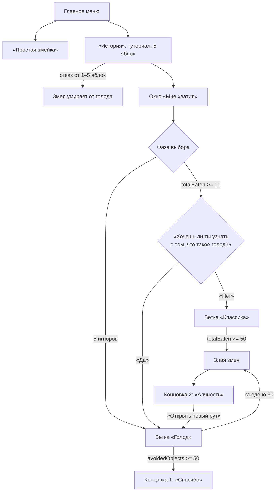

# 🐍 Science Snake — Game Design Document

> **GDD** · рабочее название · [оригинал в Google Docs](https://docs.google.com/document/d/1ias3MrEGeJViLIlTGnDJIdscI9s4r638mBwv-0fzWWo/edit?usp=drivesdk)


|                       |                                                                   |
| --------------------- | ----------------------------------------------------------------- |
| **Игра**              | «Science Snake» (рабочее название)                                |
| **Жанр**              | аркадная змейка / нарративная сатира                              |
| **Платформы**         | iOS, Android                                                      |
| **Ориентация**        | портретная                                                        |
| **Движок**            | Unity 2D                                                          |
| **Целевая аудитория** | 12+, игроки в мобильные аркады с короткими нарративными историями |


> [!IMPORTANT]
> **Ключевая тема:** капитализм производит изобилие продуктов и становится причиной голода из-за несправедливого сосредоточения ресурсов в одних руках; игроку предстоит выбор между потреблением и отказом.

---

## Оглавление

1. [Общая концепция](#1-общая-концепция)
2. [Платформы и технические требования](#2-платформы-и-технические-требования)
3. [Игровой цикл](#3-игровой-цикл)
4. [Управление](#4-управление)
5. [Игровое поле и сетка](#5-игровое-поле-и-сетка)
6. [Змейка: части, состояния, анимация](#6-змейка-части-состояния-анимация)
7. [Предметы и сущности](#7-предметы-и-сущности)
8. [Основные механики и правила](#8-основные-механики-и-правила)
9. [Ветвление сюжета и концовки](#9-ветвление-сюжета-и-концовки)
10. [UI/UX и экраны](#10-uiux-и-экраны)
11. [Тексты окон и реплики](#11-тексты-окон-и-реплики)
12. [Звук и музыка](#12-звук-и-музыка)
13. [Арт-стиль и палитра](#13-арт-стиль-и-палитра)
14. [Прогрессия, меню и сохранения](#14-прогрессия-меню-и-сохранения)
15. [Техническая реализация и данные](#15-техническая-реализация-и-данные)
16. [Тестирование и метрики](#16-тестирование-и-метрики)

---

## 1. Общая концепция

«Простая змейка» — классическая аркада без сюжета, в которую играют на телефоне в портретной ориентации. Змейка ползет по полю 16×24 клетки, окруженному тёмно-зелёными стенами, и стартует из центра длиной в 3 сегмента, двигаясь вправо. Она движется без остановки со скоростью 5 клеток в секунду, а направление игрок меняет свайпами или экранными стрелками, причем развернуться на 180° нельзя.

На поле одновременно лежат от одного до трёх красных яблок, и каждое из них исчезает через 6 секунд, если его не съесть. Каждое съеденное яблоко удлиняет змейку на один сегмент, поэтому с ростом управлять ею становится всё сложнее. Если змейка врежется в стену или в собственное тело, игра заканчивается.

### 1.1. Замысел

**Туториал:** Игрок управляет змейкой на клеточном поле. В туториале змея съедает 5 яблок. Он предназначен для того, чтобы понять как управлять свайпами Змейкой. Затем игра останавливается и появляется окно на весь экран:

> «Мне хватит.»

С этого момента игрок может либо продолжать есть, либо уворачиваться от элементов на экране.

Если игрок продолжает есть, змея растёт. Если игрок не ест даже в туториале 1-5 яблок → концовка 3 (смотреть ниже вариант C)

После +5 съеденных яблок (итого 10) появляется окно:

> «**Хочешь ли ты узнать** о том, что такое голод, дорогой игрок?»

и в нем кнопки вариантов сверху вниз: **«Да»** и **«Нет**, я просто хочу играть».


| Вариант                       | Что происходит                                                                                                                                                                         |
| ----------------------------- | -------------------------------------------------------------------------------------------------------------------------------------------------------------------------------------- |
| **A. «Нет»**                  | Обычная змейка. После 50 съеденных объектов змея превращается в Злую змею, которая быстро движется и пожирает яблоки, котят, фермеров и само поле. Концовка 2: «Алчность. Конец игры». |
| **B. «Да»**                   | Игра переходит в ветку Концовки 1: «Голод знаний» (см. ниже).                                                                                                                          |
| **C. Отказ от 1-5-го яблока** | **Змея умирает от голода.** Конец игры и текстовое окно (текст ниже). Ниже кнопка «Новая игра».                                                                                        |
| **D. Все другие варианты**    | Приводят к концу игры. И ниже кнопка «Новая игра».                                                                                                                                     |


Текст окна для варианта C:

> «Если совсем не заботиться о себе, то тебе не хватит сил помочь другим. К счастью, я всего лишь концепция Змеи и ты можешь начать заново.»

#### B. «Голод знаний»

Если игрок уклоняется от яблок, после первых 5 исчезновений яблок показываются тексты о голоде, а на поле появляются фермеры, кошки и другие персонажи-иллюстрации. Игрок уворачивается от объектов. Через 50 успешно избегнутых объектов наступает Концовка 1: змея благодарит игрока и говорит, что это любимая концовка Марка.

### 1.2. Идея

Игрок — не просто змейка, а метафора потребителя в системе изобилия. Еда всегда доступна, но решение «есть или не есть» становится моральным и нарративным выбором.

### 1.3. Уникальное торговое предложение

- 🎮 Знакомая механика змейки, переосмысленная как сатира.
- 🔀 Две концовки, достижимые через поведение, а не через выбор в меню.
- ⏱️ Короткие сессии: 3–7 минут на одну ветку.
- 📱 Мобильный формат: свайпы, крупные кнопки, вертикальный экран.

### 1.4. Режим «Простая змейка»

«Простая змейка» — классический режим без сюжета, окон с вопросами и ветвления. Игрок управляет змейкой на клеточном поле 16×24 свайпами или экранными кнопками. Змейка начинает с длины 3 и непрерывно движется вперёд. На поле появляются яблоки: каждое съеденное яблоко удлиняет змейку на один сегмент и приносит очко.

Столкновение со стеной или собственным телом завершает игру, после чего показываются счёт и рекорд, а также кнопки «Ещё раз» и «В меню». Режим подходит для коротких сессий и знакомства с управлением перед сюжетным режимом.

---

## 2. Платформы и технические требования


| Параметр       | Значение                                |
| -------------- | --------------------------------------- |
| iOS            | 15.0+                                   |
| Android        | 9.0+                                    |
| Ориентация     | Портретная, фиксированная               |
| Частота кадров | 60 FPS целевая, 30 FPS минимальная      |
| Разрешение     | Адаптивное                              |
| Управление     | Свайпы; альтернативно — экранные кнопки |
| Сохранения     | Локально, JSON / PlayerPrefs            |
| Локализация    | Русский (основной), английский (задел)  |
| Реклама        | Отсутствует                             |
| Покупки        | Отсутствуют                             |


---

## 3. Игровой цикл

1. **Запуск** → Главное меню.
2. **Выбор режима:**
   - «Простая змейка» — классическая бесконечная змейка без сюжета.
   - «История» — сюжетный режим с ветвлением и концовками.
3. **Сюжетный режим:**
   - Туториал: съесть 5 яблок.
   - Окно «Мне хватит.»
   - Свободная фаза: есть или игнорировать.
   - Ветвление и концовка.
4. **После концовки:** кнопки перезапуска/меню.


|            |                                                                                                                                                                                                 |
| ---------- | ----------------------------------------------------------------------------------------------------------------------------------------------------------------------------------------------- |
| **Сессия** | 3–7 минут.                                                                                                                                                                                      |
| **Смерть** | При столкновении со стеной или собственным телом. В сюжетном режиме — возврат к последнему чекпоинту (после окна «Мне хватит» или к началу текущей фазы), чтобы не терять нарративный прогресс. |


---

## 4. Управление

### 4.1. Основное управление

- Свайп вверх/вниз/влево/вправо задаёт направление движения.
- Змея движется непрерывно с постоянной скоростью.
- Разворот на 180° запрещён (нельзя мгновенно повернуть назад).
- Очередь ввода: до 2 свайпов буферизуются.

### 4.2. Альтернативное управление

- **В настройках:** «Кнопки» — четыре экранные стрелки в нижней части экрана.
- Кнопка паузы в верхнем правом углу.

### 4.3. Дополнительные жесты

- Свайп вниз от верхнего края — пауза (опционально).

---

## 5. Игровое поле и сетка

### 5.1. Сетка


| Параметр                 | Значение                                               |
| ------------------------ | ------------------------------------------------------ |
| Тип                      | Ортогональная, квадратная                              |
| Размер логического поля  | 16 столбцов × 24 строки                                |
| Размер клетки            | 24×24 логических пикселя                               |
| Игровая область          | 384×576 логических пикселей                            |
| Границы                  | Стены по периметру, 1 клетка                           |
| Стартовая позиция змейки | Центр, координаты (8, 12), длина 3, направление вправо |
| Координаты (0,0)         | Левый верхний угол                                     |


### 5.2. Визуализация поля

- **Фон:** минималистичная сетка с мягкими линиями.
- **Стены:** тёмно-зелёные блоки.
- **Сетка**
- При «поедании поля» Злой змеёй клетки фона последовательно заменяются на чёрные.

### 5.3. Камера

- Фиксированная, без скролла.
- Поле центрировано.
- Учёт safe area на iPhone с «челкой».

---

## 6. Змейка: части, состояния, анимация

### 6.1. Состав змейки


| Часть      | Описание                            | Размер               | Визуал                             |
| ---------- | ----------------------------------- | -------------------- | ---------------------------------- |
| **Голова** | Ведущий сегмент, задаёт направление | 1 клетка (24×24)     | Круглая/овальная, глаза, рот, язык |
| **Шея**    | 1–3 сегмента сразу за головой       | 0.9 клетки           | Плавный переход к телу             |
| **Тело**   | Основные сегменты                   | 0.9 клетки, градиент |                                    |
| **Хвост**  | Последний сегмент                   | 0.7 клетки, сужается | Закруглённый кончик                |


|                        |                                                                        |
| ---------------------- | ---------------------------------------------------------------------- |
| **Длина на старте**    | 3 сегмента (голова + тело + хвост).                                    |
| **Рост**               | Каждый съеденный объект добавляет 1 сегмент в хвост.                   |
| **Максимальная длина** | Не ограничена, но при 100+ сегментах включается оптимизация отрисовки. |


### 6.2. Детализация головы

- **Форма:** округлая, слегка вытянутая по направлению движения.
- **Глаза:**
- **Язык:** красный, раздвоенный
- **Брови (опционально):** при злой форме — наклонные, агрессивные.

### 6.3. Детализация тела

- **Сегменты:** прямоугольники
- **Цвет:** градиент от насыщенного зелёного у головы к более светлому у хвоста.
- **При росте:** новый сегмент появляется у хвоста с анимацией 0.2 сек.
- **Изгиб:** сегменты следуют за головой с задержкой, создавая плавную волну.

### 6.4. Состояния змейки

> [!CAUTION]
> В оригинале таблица выделена красным.


| Состояние                | Триггер     | Визуал                                 | Скорость       |
| ------------------------ | ----------- | -------------------------------------- | -------------- |
| 🟢 **Базовая**           | Старт       | Зелёная, глаза чёрные                  | 5 клеток/сек   |
| 🟡 **Сытая**             | Съедено 10+ | Лёгкий жёлтый оттенок, довольные глаза | 5 клеток/сек   |
| ⚪ **Голодная** (ветка 1) | Игнор яблок | Бледнее, глаза грустные                | 4.5 клетки/сек |
| 🔴 **Злая**              | Съедено 50  | Тёмно-бордовая, красные глаза, зубы    | 10 клеток/сек  |


### 6.5. Анимации


| Событие            | Анимация                             |
| ------------------ | ------------------------------------ |
| Съедение           | Объект исчезает, тело увеличивается. |
| Смерть             | Экран затемняется.                   |
| Злая трансформация | Змея меняет цвет                     |
| Поедание поля      | Клетки фона исчезают под змеёй       |


---

## 7. Предметы и сущности

### 7.1. Визуал предметов


| Предмет      | Визуал                   |
| ------------ | ------------------------ |
| 🍎 Яблоко    | Красное, зелёный лист,   |
| 🐱 Котёнок   | Серый, уши, хвост.       |
| 👨‍🌾 Фермер | Шляпа, комбинезон, вилы. |
| 🧺 Корзина   | Плетёная, овощи.         |


### 7.3. Поведение объектов в ветке «Голод»

- Объекты появляются в случайных свободных клетках.
- Перед исчезновением мигают 0.5 сек.
- Если змея касается объекта — показывается короткое окно с дополнительным текстом (не блокирует игру надолго), объект исчезает, счётчик избеганий не растёт.
- Если объект исчез, не будучи задетым, — счётчик избеганий +1.
- Яблоки в этой ветке тоже считаются: съеденное яблоко увеличивает счётчик съеденного; несъеденное — счётчик игнора.

### 7.4. Злая змея и «поедание поля»

- При 50 съеденных объектах змея становится Злой.
- Она автоматически движется к ближайшему объекту (яблоко, котёнок, фермер), ускоряясь.
- После поедания всех объектов начинает «есть поле»: клетки фона исчезают в радиусе 1 клетки вокруг головы.
- **Анимация:** 3 секунды, затемнение, надпись концовки.

---

## 8. Основные механики и правила

### 8.1. Базовые правила

- Змея движется непрерывно.
- Столкновение со стеной или собственным телом — смерть.
- Съедение объекта добавляет сегмент.
- Яблоко исчезает через 6 секунд, если не съедено; считается проигнорированным.
- На поле одновременно может быть 1–3 яблока (в туториале — 1).

### 8.2. Счётчики


| Счётчик               | Описание                                            |
| --------------------- | --------------------------------------------------- |
| `tutorialApplesEaten` | Съедено в туториале, 0–5                            |
| `totalEaten`          | Всего съедено объектов                              |
| `ignoredApples`       | Проигнорировано яблок                               |
| `avoidedObjects`      | Успешно избегнуто объектов в ветке «Голод»          |
| `questionShown`       | Показан ли вопрос после 10 съеденных                |
| `mode`                | `tutorial`, `choice`, `classic`, `hunger`, `ending` |


### 8.3. Туториал

1. Игрок управляет змеёй.
2. На поле по одному появляются яблоки.
3. При съедении 5-го яблока игра ставится на паузу.
4. Показывается окно «Мне хватит.» с кнопкой «ОК».
5. После нажатия `mode = choice`.

### 8.4. Фаза выбора

- Яблоки продолжают появляться.
- Если игрок съедает ещё 5 яблок (`totalEaten >= 10`) и вопрос не показан — показывается окно с вопросом.
- Если игрок игнорирует яблоки (`ignoredApples` растёт), при `ignoredApples = 1..5` показываются тексты о голоде.
- После 5 игноров включается ветка «Голод»: появляются объекты-иллюстрации, счётчик `avoidedObjects`.

### 8.5. Ветка «Классика» (ответ «Нет»)

- Обычная змейка.
- При `totalEaten >= 50` — трансформация в Злую змею.
- Злая змея автоматически ест всё, затем поле.
- Концовка 2.

### 8.6. Ветка «Голод» (ответ «Да» или игнор)

- **Цель:** избегать объектов.
- При `avoidedObjects >= 50` — Концовка 1.
- Если игрок съедает 50 объектов — Концовка 2 (Алчность).
- Тексты о голоде показываются при первых 5 игнорах; в ветке «Да» — сразу после ответа.

### 8.7. Смерть и чекпоинты

- **Смерть от стены/себя:** окно «Игра окончена» с кнопками «Заново» и «Меню».
- В сюжетном режиме «Заново» возвращает к последнему чекпоинту:
  - до окна «Мне хватит» — к началу туториала;
  - после — к фазе выбора/ветке.
- Прогресс счётчиков сохраняется.

---

## 9. Ветвление сюжета и концовки

### Схема ветвления



### 9.1. Концовка 1: «Спасибо»


|             |                                              |
| ----------- | -------------------------------------------- |
| **Условие** | `avoidedObjects >= 50` в ветке «Голод».      |
| **Экран**   | Затемнение, змея в центре, спокойная музыка. |
| **Кнопки**  | «Главное меню», «Играть снова».              |


**Текст:**

> «Спасибо. Я хорошо провёл с тобой время. Это любимая концовка Марка — он тоже будет рад.»

> [!NOTE]
> **Заметка:** имя «Марк» не объясняется; это пасхалка.

### 9.2. Концовка 2: «Алчность»


|             |                                                  |
| ----------- | ------------------------------------------------ |
| **Условие** | `totalEaten >= 50` в классике или ветке «Голод». |
| **Экран**   | Злая змея пожирает поле, экран чернеет.          |


**Надпись:**

> «Концовка 2: Алчность. Конец игры»

**Кнопки:**

- «Открыть новый рут» — сбрасывает сюжетный прогресс и запускает ветку «Голод» с начала (после туториала), с подсказкой «Попробуй не есть яблоки».
- «Главное меню».

### 9.3. Дополнительные тексты при игноре

При `ignoredApples = 1..5` показываются окна с текстами (см. [раздел 11](#11-тексты-окон-и-реплики)). На поле появляются соответствующие персонажи.

---

## 10. UI/UX и экраны

### 10.1. Главное меню

- **Фон:** минималистичная трава, логотип.
- **Кнопки (сверху вниз):**
  1. «История» — сюжетный режим.
  2. «Простая змейка» — классическая змейка без сюжета.
  3. «Настройки» — звук, управление, сброс прогресса.
  4. «Об игре» — авторы, тема, дисклеймер.
- Кнопки крупные, минимум 44×44 pt, с отступами.

### 10.2. Экран игры

- **Верхняя панель:** счётчик съеденного/избегнутого, кнопка паузы.
- Игровое поле по центру.
- **Нижняя панель:** подсказка по управлению (исчезает через 5 сек) или кнопки управления.
- **Модальные окна:** затемнение 60%, карточка с текстом, кнопки.

### 10.3. Окна


| Окно            | Текст                                                                                     | Кнопки                              |
| --------------- | ----------------------------------------------------------------------------------------- | ----------------------------------- |
| Туториал-финал  | «Мне хватит.»                                                                             | «ОК»                                |
| Вопрос          | «Хочешь ли ты узнать о том, что такое голод, дорогой игрок?»                              | «Да», «Нет, я просто хочу играть»   |
| Тексты о голоде | 5 окон (см. [раздел 11](#11-тексты-окон-и-реплики))                                       | «ОК»                                |
| Смерть          | «Игра окончена»                                                                           | «Заново», «Меню»                    |
| Концовка 1      | «Спасибо. Я хорошо провёл с тобой время. Это любимая концовка Марка — он тоже будет рад.» | «Главное меню», «Играть снова»      |
| Концовка 2      | «Концовка 2: Алчность. Конец игры»                                                        | «Открыть новый рут», «Главное меню» |


### 10.4. Доступность

- Крупный шрифт, высокий контраст.
- Возможность отключить вибрацию.
- Без таймеров в окнах.
- Поддержка Dynamic Type (iOS) и масштабирования шрифта (Android) — опционально.

---

## 11. Тексты окон и реплики

### 11.1. Тексты о голоде

Показываются при `ignoredApples = 1..5` (см. [8.4](#84-фаза-выбора) и [9.3](#93-дополнительные-тексты-при-игноре)); в ветке «Да» — сразу после ответа. Кнопка — «ОК».

| № | Когда показывается | Текст |
|---|---|---|
| 1 | `ignoredApples = 1` | «В 2024 году от хронического голода страдали около 673 миллионов человек — примерно каждый двенадцатый на Земле.» |
| 2 | `ignoredApples = 2` | «В том же мире за 2022 год выбросили 1,05 миллиарда тонн еды — почти пятую часть всего, что было в магазинах, кафе и дома.» |
| 3 | `ignoredApples = 3` | «Одни только домохозяйства каждый день выбрасывают больше миллиарда порций еды. Это больше одной порции на каждого голодающего.» |
| 4 | `ignoredApples = 4` | «2,6 миллиарда человек не могут позволить себе здоровое питание. Еды хватает. Не хватает доступа к ней.» |
| 5 | `ignoredApples = 5` | «Голод — это не про то, сколько яблок выросло. Это про то, кому они достались. Давай попробуем не брать лишнего.» |

> [!NOTE]
> **Источники цифр:** ФАО и др., *SOFI 2025* (данные за 2024 г.) — тексты 1 и 4; ЮНЕП, *Food Waste Index Report 2024* (данные за 2022 г.) — тексты 2 и 3. Тексты взяты из прототипа `snake_prototype.html`; там же есть английские версии.

Тексты остальных окон — в таблице [10.3](#103-окна).

---

## 12. Звук и музыка


| Событие                           | Звук                                  |
| --------------------------------- | ------------------------------------- |
| 🎵 Фоновая музыка (меню)          | Спокойная, минималистичная, 90 BPM    |
| 🎵 Фоновая музыка (игра)          | Лёгкая, с лёгким напряжением          |
| 🎵 Фоновая музыка (ветка «Голод») | Грустная, тихая                       |
| 🎵 Фоновая музыка (Злая змея)     | Тревожная, быстрая, 140 BPM           |
| 🔊 Съедение                       | Короткий «чоп», варьируется по высоте |
| 🔊 Смерть                         | Глухой удар, рассыпание               |
| 🔊 Окно                           | Мягкий «динь»                         |
| 🔊 Концовка 1                     | Тёплый аккорд, тишина                 |
| 🔊 Концовка 2                     | Резкий удар, гул                      |
| 🔊 Трансформация                  | Рычание, вспышка                      |


**Настройки:** громкость музыки и эффектов отдельно, вибрация вкл/выкл.

---

## 13. Арт-стиль и палитра

### 13.1. Стиль

- Минимализм
- Читаемость на маленьком экране.

### 13.2. Палитра

<details>
<summary>🎨 Как показать цвет в Markdown (пример, не утверждённые цвета)</summary>

Плашка — LaTeX-квадрат: точный цвет на GitHub и в VS Code, без интернета и внешних файлов.

| Цвет | Плашка |
|---|---|
| Зелёный | $\color{#2E7D32}{\blacksquare}$ `#2E7D32` |
| Бордовый | $\color{#7B1E3A}{\blacksquare}$ `#7B1E3A` |
| Красный | $\color{#D32F2F}{\blacksquare}$ `#D32F2F` |

Строка палитры:

```markdown
| Змея (базовая) | $\color{#2E7D32}{\blacksquare}$ `#2E7D32` |
```

</details>


| Элемент         | Цвет |
| --------------- | ---- |
| Змея (базовая)  | #    |
| Змея (сытая)    | #    |
| Змея (голодная) | #    |
| Змея (злая)     | #    |
| Яблоко          | #    |
| Поле            | #    |
| Стены           | #    |
| UI-фон          | #    |
| Текст           | #    |
| Акцент          | #    |


### 13.3. Шрифты

- **Основной:** без засечек, крупный, читаемый (Georgia).
- **Заголовки:** полужирный.
- **Текст окон:** 20–24 pt, межстрочный интервал 1.3.

---

## 14. Прогрессия, меню и сохранения

### 14.1. Открытие режимов

- «Простая змейка» доступна сразу в главном меню под соответствующей кнопкой.
- «История» доступна сразу.

### 14.2. Сохранения

**Сохраняется:**

- факт прохождения концовок;
- настройки;
- текущий чекпоинт сюжетного режима;
- счётчики (для возможности продолжить).

### 14.3. Сброс прогресса

В настройках: «Сбросить прогресс» с подтверждением.

---

## 15. Техническая реализация и данные

### 15.1. Рекомендуемый стек

- Unity 2D, URP, Input System.
- Скрипты на C#.

### 15.2. Структура данных

### 15.3. Основные системы


| Система            | Ответственность                                   |
| ------------------ | ------------------------------------------------- |
| `GridSystem`       | Координаты, свободные клетки, появление объектов. |
| `SnakeController`  | Движение, рост, коллизии, состояния.              |
| `ObjectSpawner`    | Таймеры появления, срок жизни, типы объектов.     |
| `NarrativeManager` | Счётчики, условия окон, ветвление, концовки.      |
| `UIManager`        | Модальные окна, меню, пауза.                      |
| `AudioManager`     | Музыка, эффекты.                                  |
| `SaveManager`      | Сохранение/загрузка.                              |


### 15.4. Производительность

- Пул объектов для яблок и персонажей.
- Ограничение частиц.
- Оптимизация отрисовки сегментов змеи при длине &gt; 50.

---

## 16. Тестирование и метрики

### 16.1. Тест-кейсы

- [ ] Туториал: 5 яблок → окно.
- [ ] Съедение 10-го яблока → вопрос.
- [ ] Ответ «Нет» → классика → 50 съеденных → концовка 2.
- [ ] Ответ «Да» → ветка «Голод» → 50 избеганий → концовка 1.
- [ ] Игнор 5 яблок → 5 текстов → ветка «Голод».
- [ ] Смерть от стены/себя → окно смерти → чекпоинт.
- [ ] Кнопка «Открыть новый рут» → запуск ветки «Голод».
- [ ] «Простая змейка» из меню → классическая игра без сюжета.

### 16.2. Метрики (опционально)

- Доля игроков, дошедших до окна «Мне хватит».
- Распределение ответов «Да»/«Нет».
- Доля дошедших до каждой концовки.
- Средняя длина сессии.
- Количество смертей на игрока.

---

## Приложение А: таблица параметров


| Параметр                            | Значение       |
| ----------------------------------- | -------------- |
| Размер сетки                        | 16×24          |
| Клетка                              | 24×24 px       |
| Стартовая длина змейки              | 3              |
| Скорость базовой змеи               | 5 клеток/сек   |
| Скорость голодной змеи              | 4.5 клетки/сек |
| Скорость злой змеи                  | 10 клеток/сек  |
| Время жизни яблока                  | 6 сек          |
| Время жизни персонажа               | 4–6 сек        |
| Туториал: яблок                     | 5              |
| Вопрос: порог съеденного            | 10             |
| Концовка 2: порог съеденного        | 50             |
| Концовка 1: порог избеганий         | 50             |
| Тексты о голоде                     | 5              |
| Задержка между появлениями яблок    | 0.8–1.2 сек    |
| Максимум яблок на поле              | 3              |
| Длительность анимации трансформации | 0.5 сек        |
| Длительность поедания поля          | 3 сек          |


---

> [!TIP]
> При необходимости детали можно расширить: добавить покадровые анимации, точные координаты появления объектов, тексты на английском, а также схему экранов в Figma.