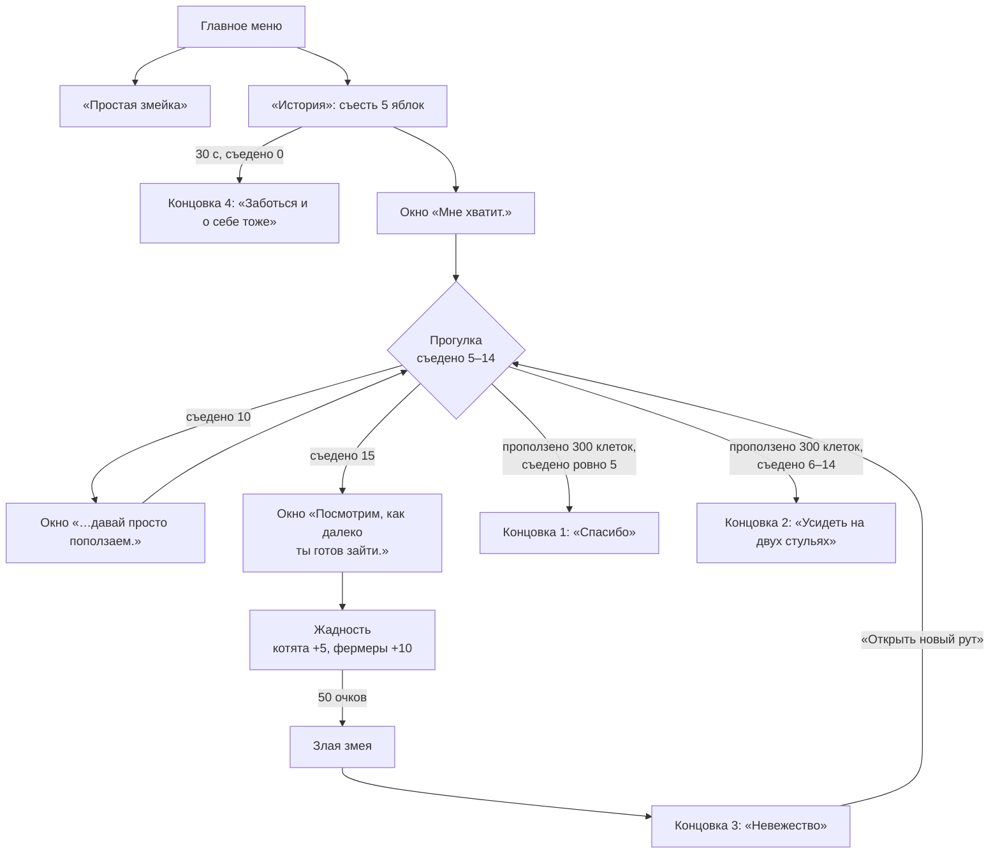

# 🐍 Science Snake — Game Design Document

> **GDD** · рабочее название · **версия документа 2.1 (18.11.2026)** · версия прототипа **2.1** (показана в меню и в «Об игре») · [история версий](#история-версий) · [оригинал в Google Docs](https://docs.google.com/document/d/1ias3MrEGeJViLIlTGnDJIdscI9s4r638mBwv-0fzWWo/edit?usp=drivesdk) · [▶ играть в прототип](https://raw.githack.com/Zaidejas/GC26/gc26_science_snake/docs/prototype_snake_2.html)


|                       |                                                                   |
| --------------------- | ----------------------------------------------------------------- |
| **Игра**              | «Science Snake» (рабочее название)                                |
| **Жанр**              | аркадная змейка / нарративная сатира                              |
| **Платформы**         | iOS, Android                                                      |
| **Ориентация**        | портретная                                                        |
| **Движок**            | Unity 2D                                                          |
| **Целевая аудитория** | 12+, игроки в мобильные аркады с короткими нарративными историями |


> [!IMPORTANT]
> **Ключевая тема:** капитализм производит изобилие продуктов и становится причиной голода из-за несправедливого сосредоточения ресурсов в одних руках; игроку предстоит выбор между потреблением и отказом.

---

## Коротко об игре

**Что это.** Знакомая «змейка» для телефона, в которой главное решение — не как съесть больше, а **сколько тебе на самом деле нужно**. Тема игры: еды в мире хватает, но голод остаётся, потому что еда достаётся тем, кто может за неё заплатить.

**Два режима.**

- **История** — короткий сюжет (3–7 минут). После 5 яблок змея говорит «Мне хватит.», и дальше игрок сам решает, слушать её или нет. От его поведения зависит одна из 4 концовок.
- **Простая змейка** — классическая игра на счёт. Над полем по одному предложению идёт короткий текст о том, как голод связан с капитализмом.

**Четыре концовки.**

| Что сделал игрок | Концовка |
| --- | --- |
| Не съел ни одного яблока за 30 секунд | 4 · «Заботься и о себе тоже» |
| Съел ровно 5 и дальше просто ползал | 1 · «Спасибо» (хорошая) |
| Съел от 6 до 14 и остановился | 2 · «Усидеть на двух стульях» |
| Съел 15 и больше — дошёл до 50 очков | 3 · «Невежество» (плохая) |

**Управление.** Свайпы и экранные стрелки на телефоне; стрелки/WASD и клик мышью на ПК.

**Где посмотреть.** [▶ Играть в прототип](https://raw.githack.com/Zaidejas/GC26/gc26_science_snake/docs/prototype_snake_2.html) — всё, что описано ниже, уже работает в нём.

---

## Оглавление

0. [Коротко об игре](#коротко-об-игре)
1. [Общая концепция](#1-общая-концепция)
2. [Платформы и технические требования](#2-платформы-и-технические-требования)
3. [Игровой цикл](#3-игровой-цикл)
4. [Управление](#4-управление)
5. [Игровое поле и сетка](#5-игровое-поле-и-сетка)
6. [Змейка: части, состояния, анимация](#6-змейка-части-состояния-анимация)
7. [Предметы и сущности](#7-предметы-и-сущности)
8. [Основные механики и правила](#8-основные-механики-и-правила)
9. [Ветвление сюжета и концовки](#9-ветвление-сюжета-и-концовки)
10. [UI/UX и экраны](#10-uiux-и-экраны)
11. [Тексты окон и реплики](#11-тексты-окон-и-реплики)
12. [Звук и музыка](#12-звук-и-музыка)
13. [Арт-стиль и палитра](#13-арт-стиль-и-палитра)
14. [Прогрессия, меню и сохранения](#14-прогрессия-меню-и-сохранения)
15. [Техническая реализация и данные](#15-техническая-реализация-и-данные)
16. [Тестирование и метрики](#16-тестирование-и-метрики)
17. [История версий](#история-версий)

---

## 1. Общая концепция

«Простая змейка» — классическая аркада без сюжета, в которую играют на телефоне в портретной ориентации. Змейка ползет по полю 16×24 клетки, окруженному тёмно-зелёными стенами, и стартует из центра длиной в 3 сегмента, двигаясь вправо. Она движется без остановки со скоростью 5 клеток в секунду, а направление игрок меняет свайпами или экранными стрелками, причем развернуться на 180° нельзя.

На поле одновременно лежат от одного до трёх красных яблок, и каждое из них исчезает через 6 секунд, если его не съесть. Каждое съеденное яблоко удлиняет змейку на один сегмент, поэтому с ростом управлять ею становится всё сложнее. Если змейка врежется в стену или в собственное тело, игра заканчивается.

### 1.1. Замысел

Сюжетный режим строится на одном вопросе: **сколько тебе нужно?** Змея сама говорит, когда ей достаточно, — а игрок решает, слушать её или нет. Выбор делается поведением, а не кнопкой.

**Начало.** Змея ползёт по полю, яблоки лежат, пока их не съедят. Если игрок **не ест совсем** — ни одного яблока за первые 30 секунд — наступает Концовка 4 «Заботься и о себе тоже». После 5-го яблока игра останавливается, окно:

> «Мне хватит.»

**Прогулка (съедено 5–14).** Змея хочет просто ползать. Голодом она больше не умирает. Игрок может есть дальше или просто ползти. Если съесть ещё 5 (итого 10), змея говорит:

> «Я бы хотел просто прогуляться… То есть давай просто поползаем.»

Если съесть ещё 5 (итого 15):

> «Ну ладно. Посмотрим, как далеко ты готов зайти.»

После этого пути назад нет: начинается фаза **«Жадность»**, на поле появляются котята и фермеры.

**Как работает прогулка.** После «Мне хватит» считается, сколько клеток проползла змея. Еда этот счёт **не сбрасывает**. Когда змея проползёт 300 клеток (100 в тестовом режиме; при обычной скорости ≈ 1,5 минуты), прогулка заканчивается — и концовка зависит от того, сколько съедено:

| Съедено всего | Что делает игрок | Концовка |
| --- | --- | --- |
| **0** | не ест вообще 30 секунд с начала | **Концовка 4 «Заботься и о себе тоже»** |
| **ровно 5** | после «Мне хватит» больше не ест, просто ползёт | **Концовка 1 «Спасибо»** (хорошая) |
| **6–14** | немного поел сверх нормы, но не дошёл до 15 | **Концовка 2 «Усидеть на двух стульях»** |
| **15 и больше** | ест дальше; котёнок = +5, фермер = +10, яблоко = +1 | при **50 очках** — Злая змея → **Концовка 3 «Невежество»** (плохая) |

После 15 прогулка больше не считается: история заканчивается только плохой концовкой.

**Информация о голоде** не останавливает игру: факты сменяются в полосе над полем каждые 15 секунд, начиная с окна «Мне хватит» (см. [раздел 11](#11-тексты-окон-и-реплики)).

### 1.2. Идея

Игрок — не просто змейка, а метафора потребителя в системе изобилия. Еда всегда доступна, но решение «есть или не есть» становится моральным и нарративным выбором.

### 1.3. Уникальное торговое предложение

- 🎮 Знакомая механика змейки, переосмысленная как сатира.
- 🔀 Четыре концовки, достижимые через поведение, а не через выбор в меню.
- ⏱️ Короткие сессии: 3–7 минут на одну ветку.
- 📱 Мобильный формат: свайпы, крупные кнопки, вертикальный экран.

### 1.4. Режим «Простая змейка»

«Простая змейка» — классический режим без сюжета, окон с вопросами и ветвления. Игрок управляет змейкой на клеточном поле 16×24 свайпами или экранными кнопками. Змейка начинает с длины 3 и непрерывно движется вперёд. На поле появляются яблоки: каждое съеденное яблоко удлиняет змейку на один сегмент и приносит очко.

Столкновение со стеной или собственным телом завершает игру, после чего показываются счёт и рекорд, а также кнопки «Ещё раз» и «В меню». Режим подходит для коротких сессий и знакомства с управлением перед сюжетным режимом.

**Текст над полем.** Над полем есть полоса, которая **не останавливает игру**. В «Простой змейке» в ней по одному предложению показывается короткий текст «Голод среди изобилия» (23 предложения, каждое — законченная мысль). Текст идёт по порядку с начала партии, смена каждые 10 секунд, после последнего — снова с начала. Полный текст и источники — в [11.2](#112-текст-для-простой-змейки).

**Предупреждение при перезапуске.** Рекорд сохраняется только в конце партии. Поэтому «Начать заново» из паузы при счёте больше 0 сначала спрашивает: «Текущий счёт (N) не сохранится» — или, если счёт выше рекорда, «Твой счёт N — новый рекорд, но он не сохранится!». Кнопки: «Начать заново», «Отмена» (возврат в паузу). При счёте 0 перезапуск без вопроса. В «Истории» кнопка «История» при сохранённом прогрессе тоже предупреждает: «Сохранённый прогресс истории будет потерян».

---

## 2. Платформы и технические требования


| Параметр       | Значение                                |
| -------------- | --------------------------------------- |
| iOS            | 15.0+                                   |
| Android        | 9.0+                                    |
| Ориентация     | Портретная, фиксированная               |
| Частота кадров | 60 FPS целевая, 30 FPS минимальная      |
| Разрешение     | Адаптивное                              |
| Управление     | Свайпы; экранные стрелки; на ПК — клавиатура и клик мышью |
| Сохранения     | Локально, JSON / PlayerPrefs            |
| Локализация    | Русский (основной), английский (задел)  |
| Реклама        | Отсутствует                             |
| Покупки        | Отсутствуют                             |


---

## 3. Игровой цикл

1. **Запуск** → Главное меню.
2. **Выбор режима:**
   - «Простая змейка» — классическая бесконечная змейка без сюжета.
   - «История» — сюжетный режим с ветвлением и концовками.
3. **Сюжетный режим:**
   - Начало: съесть 5 яблок → окно «Мне хватит.»
   - Прогулка: проползти 300 клеток; есть можно, окна на 10 и 15 съеденных.
   - Жадность (после 15): котята и фермеры, путь к плохой концовке.
   - Одна из четырёх концовок.
4. **После концовки:** кнопки перезапуска/меню.


|            |                                                                                                                                                                                                 |
| ---------- | ----------------------------------------------------------------------------------------------------------------------------------------------------------------------------------------------- |
| **Сессия** | 3–7 минут.                                                                                                                                                                                      |
| **Смерть** | При столкновении со стеной или собственным телом. В сюжетном режиме — возврат к последнему чекпоинту (после окна «Мне хватит» или к началу текущей фазы), чтобы не терять нарративный прогресс. |


---

## 4. Управление

### 4.1. Основное управление

- Свайп вверх/вниз/влево/вправо задаёт направление движения.
- Змея движется непрерывно с постоянной скоростью.
- Разворот на 180° запрещён (нельзя мгновенно повернуть назад).
- Очередь ввода: до 2 свайпов буферизуются.

### 4.2. Альтернативное управление

- **В настройках:** «Кнопки» — четыре экранные стрелки в нижней части экрана.
- **Клавиатура (ПК):** стрелки или WASD; пробел / P / Esc — пауза.
- **Мышь (ПК):** клик по полю — змея поворачивает **в сторону клика**. Выбирается ось, по которой до точки клика дальше (горизонталь или вертикаль). Если клик позади головы (разворот на 180°), змея сначала поворачивает вбок, в сторону клика. Клик по самой голове игнорируется. На сенсорных экранах клик не используется — работают свайпы.
- Кнопка паузы в верхнем правом углу.

### 4.3. Дополнительные жесты

- Свайп вниз от верхнего края — пауза (опционально).

---

## 5. Игровое поле и сетка

### 5.1. Сетка


| Параметр                 | Значение                                               |
| ------------------------ | ------------------------------------------------------ |
| Тип                      | Ортогональная, квадратная                              |
| Размер логического поля  | 16 столбцов × 24 строки                                |
| Размер клетки            | 24×24 логических пикселя                               |
| Игровая область          | 384×576 логических пикселей                            |
| Границы                  | Стены по периметру, 1 клетка                           |
| Стартовая позиция змейки | Центр, координаты (8, 12), длина 3, направление вправо |
| Координаты (0,0)         | Левый верхний угол                                     |


### 5.2. Визуализация поля

- **Фон:** минималистичная сетка с мягкими линиями.
- **Стены:** тёмно-зелёные блоки.
- **Сетка**
- При «поедании поля» Злой змеёй клетки фона последовательно заменяются на чёрные.

### 5.3. Камера

- Фиксированная, без скролла.
- Поле центрировано.
- Учёт safe area на iPhone с «челкой».

---

## 6. Змейка: части, состояния, анимация

### 6.1. Состав змейки


| Часть      | Описание                            | Размер               | Визуал                             |
| ---------- | ----------------------------------- | -------------------- | ---------------------------------- |
| **Голова** | Ведущий сегмент, задаёт направление | 1 клетка (24×24)     | Круглая/овальная, глаза, рот, язык |
| **Шея**    | 1–3 сегмента сразу за головой       | 0.9 клетки           | Плавный переход к телу             |
| **Тело**   | Основные сегменты                   | 0.9 клетки, градиент |                                    |
| **Хвост**  | Последний сегмент                   | 0.7 клетки, сужается | Закруглённый кончик                |


|                        |                                                                        |
| ---------------------- | ---------------------------------------------------------------------- |
| **Длина на старте**    | 3 сегмента (голова + тело + хвост).                                    |
| **Рост**               | Каждый съеденный объект добавляет 1 сегмент в хвост.                   |
| **Максимальная длина** | Не ограничена, но при 100+ сегментах включается оптимизация отрисовки. |


### 6.2. Детализация головы

- **Форма:** округлая, слегка вытянутая по направлению движения.
- **Глаза:**
- **Язык:** красный, раздвоенный
- **Брови (опционально):** при злой форме — наклонные, агрессивные.

### 6.3. Детализация тела

- **Сегменты:** прямоугольники
- **Цвет:** градиент от насыщенного зелёного у головы к более светлому у хвоста.
- **При росте:** новый сегмент появляется у хвоста с анимацией 0.2 сек.
- **Изгиб:** сегменты следуют за головой с задержкой, создавая плавную волну.

### 6.4. Состояния змейки

> [!CAUTION]
> В оригинале таблица выделена красным.


| Состояние                | Триггер     | Визуал                                 | Скорость       |
| ------------------------ | ----------- | -------------------------------------- | -------------- |
| 🟢 **Базовая**           | Старт       | Зелёная, глаза чёрные                  | 5 клеток/сек   |
| 🟡 **Сытая**             | Съедено 10+ | Лёгкий жёлтый оттенок, довольные глаза | 5 клеток/сек   |
| ⚪ **Голодная** (ветка 1) | Игнор яблок | Бледнее, глаза грустные                | 4.5 клетки/сек |
| 🔴 **Злая**              | Съедено 50  | Тёмно-бордовая, красные глаза, зубы    | 10 клеток/сек  |


### 6.5. Анимации


| Событие                       | Анимация                                                                                                                         |
| ----------------------------- | -------------------------------------------------------------------------------------------------------------------------------- |
| Съедение                      | Вспышка-круг и 4–6 частиц цвета объекта; голова «пружинит» (растягивается и возвращается); по телу к хвосту проходит «комок» еды. |
| Объект исчез сам (избегание)  | Мягкий «пуф»: 3–4 бледные частицы и маленький круг — исчезновение не наказание, а тихая награда.                                   |
| Потеря жизни                  | Змея на 0,15 с вспыхивает белым, 6–9 частиц, тряска 0,5 с, замедление времени до 25 % с плавным возвратом за 1 с; возрождение через 0,55 с. |
| Смерть                        | То же, затем экран затемняется и появляется окно.                                                                                |
| Злая трансформация            | Змея меняет цвет, белая вспышка, 10–14 частиц, сильная тряска 1 с, замедление до 40 %.                                            |
| Поедание поля                 | Клетки фона исчезают под змеёй; каждое съедение Злой змеёй — короткая тряска.                                                    |
| Концовка 3                    | Самая сильная тряска (1 с) перед окном «Невежество».                                                                               |

### 6.6. Ощущение игры (game feel)

Приёмы взяты из исходного кода **SNKRX** (a327ex, лицензия MIT, [github.com/a327ex/SNKRX](https://github.com/a327ex/SNKRX)) — переносятся только техники, не арт, звук или дизайн. Цель — чтобы каждое действие игрока получало немедленный физический отклик, а ключевые моменты сюжета (удар, превращение в Злую змею) ощущались весомо.

| Приём                         | Как устроен в SNKRX                                                           | Как применён у нас                                                               | Зачем                                                                                         |
| ----------------------------- | ----------------------------------------------------------------------------- | -------------------------------------------------------------------------------- | --------------------------------------------------------------------------------------------- |
| **Пружина** (spring)          | `Spring(x, k, d)`: затухающая пружина, жёсткость 200, демпфирование 10         | Масштаб головы; при съедении `+0.3`, при ударе `+0.35`, при превращении `+0.5`   | Голова «проглатывает» еду — съедение читается мгновенно, даже краем глаза                     |
| **Частицы удара** (HitParticle) | 4–6 прямоугольников, летят в случайные стороны и уменьшаются за 0,2–0,6 с    | Цвет частиц = цвет объекта (яблоко красное, котёнок серый, фермер коричневый)     | Видно, *что* было съедено; в фазе «Жадность» это работает на тему — съеденный котёнок заметен    |
| **Круг удара** (HitCircle)    | Круг сначала белый, затем в цвет объекта, сжимается                           | В точке съедения/удара/исчезновения                                              | Отмечает точку события                                                                        |
| **Тряска экрана** (shake)     | Интерполированный шум, линейное затухание; опция `no_screen_shake`            | Трясётся только поле; 3 px — съедение Злой змеёй, 6 px — удар, 9–10 px — превращение и концовка 2 | Сила тряски = важность события; есть выключатель в настройках                                |
| **Замедление** (slow)         | `slow(0.25, 1)` при потере юнита                                              | Потеря жизни — 25 %, превращение — 40 %, возврат к 100 % плавно                  | Игрок успевает увидеть, во что врезался, и не злится на «внезапную» смерть                     |
| **Белая вспышка** (hit flash) | Объект рисуется белым ~0,1 с                                                  | Вся змея белая 0,15 с при ударе, 0,2 с при превращении                           | Однозначный сигнал «по мне попали»                                                            |
| **Разброс высоты звука**      | Каждый звук с `pitch` 0,95–1,05                                                | Все короткие звуки (съедение, удар, «динь», промах)                              | Повторяющиеся звуки не утомляют                                                               |

Своё (не из SNKRX): **«комок» в теле** — после съедения утолщение проходит от головы к хвосту со скоростью змеи. Делает рост змеи осязаемым и подчёркивает тему потребления: видно, как еда «уходит» внутрь.

**Ограничения:** эффекты не меняют правила и не мешают управлению; тряска двигает только поле, а не кнопки; при системной настройке «уменьшить движение» тряска по умолчанию выключена.


---

## 7. Предметы и сущности

### 7.1. Визуал предметов


| Предмет      | Визуал                   | Очки (фаза «Жадность») |
| ------------ | ------------------------ | ---------------------- |
| 🍎 Яблоко    | Красное, зелёный лист.   | +1                     |
| 🐱 Котёнок   | Серый, уши, хвост.       | +5                     |
| 👨‍🌾 Фермер | Шляпа, комбинезон, вилы. | +10                    |


### 7.2. Где что появляется

| Фаза | Объекты | Одновременно на поле | Срок жизни | Пауза между появлениями |
| --- | --- | --- | --- | --- |
| Начало (0–4 съедено) | яблоки | 1 | не исчезают | 1,2 с |
| Прогулка (5–14) | яблоки | до 2 | 10 с | 3–5 с |
| Жадность (15+) | яблоки 50 %, котята 25 %, фермеры 25 % | до 3 | 9–12 с | 2,5–3,5 с |

### 7.3. Поведение объектов

- Объекты появляются в случайных свободных клетках, не ближе 3–4 клеток к голове.
- Кольцо вокруг объекта показывает оставшееся время; за 2 с до исчезновения объект мигает.
- Исчезнувший объект растворяется мягким «пуфом» (см. [6.5](#65-анимации)).
- Съеденный котёнок или фермер: всплывает «+5» / «+10» и короткая подсказка поверх поля (игра не останавливается): «Это был котёнок. Он тоже хотел есть.», «Фермер вырастил еду, которую сам не может купить.»
- В фазе «Жадность» после каждых 5 очков (если съедено яблоко) — короткая реплика змеи поверх поля, тоже без остановки игры.

### 7.4. Злая змея и «поедание поля»

- При 50 очках змея становится Злой.
- Управление отключается: она сама движется к ближайшему объекту (яблоко, котёнок, фермер), ускоряясь.
- После поедания всех объектов начинает «есть поле»: клетки фона исчезают в радиусе 1 клетки вокруг головы.
- **Анимация:** 3 секунды, затемнение, окно концовки.

---

## 8. Основные механики и правила

### 8.1. Базовые правила

- Змея движется непрерывно.
- Стен нет: поле замкнуто, змея выходит с противоположной стороны. Смерть — только от столкновения с собственным телом.
- Съедение объекта добавляет сегмент.
- 3 жизни: при потере жизни змея возрождается в центре через 0,55 с; после третьей — окно «Игра окончена».

### 8.2. Счётчики


| Счётчик  | Описание                                                                        |
| -------- | ------------------------------------------------------------------------------- |
| `total`  | Сколько съедено. До 15 — число яблок; в фазе «Жадность» — очки (+1 / +5 / +10). |
| `dist`   | Сколько клеток проползла змея в фазе «Прогулка». Еда счёт не сбрасывает.        |
| `noEat`  | Сколько секунд прошло с начала истории, пока не съедено ни одного яблока.       |
| `fact`   | Номер текущего факта о голоде в полосе над полем.                               |
| `phase`  | `tutorial` (Начало), `walk` (Прогулка), `greed` (Жадность), `evil`.            |


### 8.3. Начало

1. Яблоки появляются по одному и не исчезают.
2. Если за 30 секунд игры не съедено ни одного яблока — Концовка 4. За 10 секунд до этого в HUD: «Змея голодает… N с», змея бледнеет с середины отсчёта.
3. Туториал из 3 шагов показывается только при **первом** запуске истории (и снова после сброса прогресса); при «Играть снова», «Открыть новый рут» и новых попытках игра сразу начинается с отсчёта. Туториал всегда можно открыть из меню.
4. При съедении 5-го яблока игра ставится на паузу, окно «Мне хватит.» с кнопкой «ОК».
5. После нажатия — фаза «Прогулка», в полосе над полем начинаются факты о голоде.

### 8.4. Прогулка (съедено 5–14)

- Яблоки появляются и исчезают через 10 с; исчезновение ни на что не влияет. Голодом змея не умирает.
- В HUD — «Проползено N/300».
- Съедено 10 → окно «Я бы хотел просто прогуляться… То есть давай просто поползаем.»
- Съедено 15 → окно «Ну ладно. Посмотрим, как далеко ты готов зайти.» → фаза «Жадность».
- Проползено 300 клеток → концовка: при `total == 5` — Концовка 1, при `total` 6–14 — Концовка 2.

### 8.5. Жадность (съедено 15+)

- Пути назад нет: прогулка больше не считается.
- Появляются котята (+5) и фермеры (+10) вместе с яблоками (+1).
- При `total >= 50` — Злая змея → Концовка 3.

### 8.6. Смерть и чекпоинты

- **Смерть (3 жизни потеряны):** окно «Игра окончена» с кнопками «С чекпоинта» и «В меню».
- «С чекпоинта» возвращает к началу текущей фазы с полными жизнями; `total` и `dist` сохраняются. Если смерть в «Начале» — история начинается заново.
- Чекпоинт сохраняется на входе в «Прогулку» и «Жадность»; кнопка «Продолжить историю» в меню продолжает с него.

---

## 9. Ветвление сюжета и концовки

### Схема ветвления



### 9.1. Концовка 1: «Спасибо» (хорошая)


|             |                                                             |
| ----------- | ----------------------------------------------------------- |
| **Условие** | Съедено ровно 5; змея проползла 300 клеток после «Мне хватит». |
| **Экран**   | Окно поверх поля, тёплый аккорд.                            |
| **Кнопки**  | «Главное меню», «Играть снова».                             |


**Текст:**

> «Спасибо. Я хорошо провёл с тобой время. Это любимая концовка Марка — он тоже будет рад.»

> [!NOTE]
> **Заметка:** имя «Марк» (в английской версии — **Marc**) не объясняется; это пасхалка.

### 9.2. Концовка 2: «Усидеть на двух стульях»


|             |                                                          |
| ----------- | -------------------------------------------------------- |
| **Условие** | Съедено 6–14; змея проползла 300 клеток после «Мне хватит».     |
| **Экран**   | Окно поверх поля.                                        |
| **Кнопки**  | «Главное меню», «Играть снова».                          |


**Текст:**

> «Есть или не есть — вот в чём вопрос…»
>
> EN: «To eat or not to eat — that is the question…»

### 9.3. Концовка 3: «Невежество» (плохая)


|             |                                         |
| ----------- | --------------------------------------- |
| **Условие** | 50 очков в фазе «Жадность».             |
| **Экран**   | Злая змея пожирает поле, экран чернеет. |


**Название:** «Невежество» (EN: *Ignorance*). Надписи «Конец игры» нет.

**Текст:**

> «Жадность поглотила мир.»
>
> EN: «Greed consumed the world.»

**Кнопки:**

- «Открыть новый рут» — сбрасывает прогресс и начинает с фазы «Прогулка», будто съедено ровно 5, с подсказкой «Попробуй больше не есть — просто ползи».
- «Главное меню».

### 9.4. Концовка 4: «Заботься и о себе тоже»


|             |                                                        |
| ----------- | ------------------------------------------------------ |
| **Условие** | За первые 30 секунд игры не съедено ни одного яблока.  |
| **Экран**   | Окно поверх поля.                                      |
| **Кнопки**  | «Играть снова», «Главное меню».                        |


**Текст:**

> «Если совсем не заботиться о себе, то тебе не хватит сил помочь другим. К счастью, я всего лишь концепция Змеи и ты можешь начать заново.»

---

## 10. UI/UX и экраны

### 10.1. Главное меню

- **Фон:** минималистичная трава, логотип.
- **Логотип:** змея, свернувшаяся кольцами, смотрит **прямо на игрока** (вид спереди, зрачки по центру), рядом яблоко. Змея иногда моргает и высовывает язык; при «уменьшить движение» в системе — без анимации.
- **Версия** прототипа — мелким шрифтом под статистикой.
- **Кнопки (сверху вниз):**
  1. «История» — сюжетный режим.
  2. «Простая змейка» — классическая змейка без сюжета.
  3. «Настройки» — звук, управление, вибрация, тряска экрана, сброс прогресса.
  4. «Об игре» — авторы, тема, дисклеймер.
- Кнопки крупные, минимум 44×44 pt, с отступами.

### 10.2. Экран игры

- **Верхняя панель:** счётчики (съедено; «проползено N/300» или очки до 50; в начале — предупреждение «Змея голодает…»), жизни, название фазы, кнопка паузы.
- **Полоса фактов** (только «История»): между панелью и полем, фиксированной высоты; факты о голоде сменяются каждые 15 с и **не останавливают игру**.
- Игровое поле по центру.
- **Нижняя панель:** подсказка по управлению (исчезает через 5 сек) или кнопки управления.
- **Модальные окна:** затемнение 60%, карточка с текстом, кнопки.

### 10.3. Окна


| Окно       | Текст                                                                                     | Кнопки                              |
| ---------- | ----------------------------------------------------------------------------------------- | ----------------------------------- |
| 5 съедено  | «Мне хватит.»                                                                             | «ОК»                                |
| 10 съедено | «Я бы хотел просто прогуляться… То есть давай просто поползаем.»                          | «ОК»                                |
| 15 съедено | «Ну ладно. Посмотрим, как далеко ты готов зайти.»                                         | «ОК»                                |
| Смерть     | «Игра окончена»                                                                           | «С чекпоинта», «В меню»             |
| Концовка 1 | «Спасибо. Я хорошо провёл с тобой время. Это любимая концовка Марка — он тоже будет рад.» | «Главное меню», «Играть снова»      |
| Концовка 2 | «Усидеть на двух стульях» — «Есть или не есть — вот в чём вопрос…»                        | «Главное меню», «Играть снова»      |
| Концовка 3 | «Невежество» — «Жадность поглотила мир.»                                                  | «Открыть новый рут», «Главное меню» |
| Концовка 4 | «Заботься и о себе тоже» (текст — в [9.4](#94-концовка-4-заботься-и-о-себе-тоже))         | «Играть снова», «Главное меню»      |

Факты о голоде — **не окна**: они в полосе над полем (см. [11.1](#111-тексты-о-голоде)).


### 10.4. Доступность

- Крупный шрифт, высокий контраст.
- Возможность отключить вибрацию.
- Без таймеров в окнах.
- Возможность отключить тряску экрана; если в системе включено «уменьшить движение» (`prefers-reduced-motion`), тряска выключена по умолчанию.
- Поддержка Dynamic Type (iOS) и масштабирования шрифта (Android) — опционально.

---

## 11. Тексты окон и реплики

### 11.1. Тексты о голоде

Показываются **в полосе над полем**, игра при этом не останавливается. Первый факт — сразу после окна «Мне хватит.», дальше они сменяются по кругу каждые 15 секунд игрового времени (8 с в тестовом режиме), в любой фазе истории. До «Мне хватит» в полосе — «Съешь 5 яблок, чтобы начать историю.»

| № | Когда появляется (впервые) | Текст |
|---|---|---|
| 1 | через 0 с после «Мне хватит» | «Около 673 миллионов человек страдали от хронического голода в 2024 году — примерно каждый двенадцатый на Земле.» |
| 2 | через 15 с после «Мне хватит» | «И в том же мире в 2022 году выбросили 1,05 миллиарда тонн еды — почти пятую часть всего, что было в магазинах, ресторанах и дома.» |
| 3 | через 30 с после «Мне хватит» | «Только домохозяйства каждый день выбрасывают больше миллиарда порций еды. Это больше одной порции на каждого голодающего.» |
| 4 | через 45 с после «Мне хватит» | «2,6 миллиарда человек не могут позволить себе здоровое питание. Еды хватает — не хватает доступа к ней.» |
| 5 | через 60 с после «Мне хватит» | «Голод — это не о том, сколько яблок выросло, а о том, кому они достались. Давай попробуем не брать лишнего.» |

> [!NOTE]
> **Источники цифр:** ФАО и др., *SOFI 2025* (данные за 2024 г.) — тексты 1 и 4; ЮНЕП, *Food Waste Index Report 2024* (данные за 2022 г.) — тексты 2 и 3. Тексты взяты из прототипа `prototype_snake_2.html`; там же есть английские версии.

### 11.2. Текст для «Простой змейки»

Вместо отдельных фактов в «Простой змейке» показывается **короткий связный текст** о том, как голод связан с капитализмом. Он разбит на 23 предложения: каждое помещается в полосу над полем и само по себе является законченной мыслью, поэтому его можно понять, даже если увидеть только одно. Предложения идут по порядку, по 10 секунд каждое.

#### Полный текст

**Голод среди изобилия: как капитализм определяет, кто ест**

Глобальный голод — прежде всего не проблема недостаточного производства. Мировое предложение продовольствия составляет почти 3000 ккал на человека в день (ФАО, 2023), что заметно превышает средние потребности. Тем не менее в 2024 году около 673 млн человек страдали от хронического голода, а 2,6 млрд не могли позволить себе здоровое питание (ФАО и др., 2025). Этот парадокс объясняется тем, что еда — не только средство существования, но и товар. В рыночной экономике продовольствие распределяется по платёжеспособности, а не по потребности. Как показал А. Сен (1981) на примере голода в Бенгалии 1943 года, люди умирают не потому, что еды нет, а потому, что утрачивают *право* её получить.

Капитализм связан с голодом через три механизма. Во-первых, производство следует за прибылью. Около 36% калорий урожая идёт на корм скоту, и лишь 12% из них возвращается людям в виде пищи (Cassidy et al., 2013); кукуруза к тому же служит основным сырьём для биотоплива (ОЭСР/ФАО, 2025). Во-вторых, рыночная власть сосредоточена. Четыре компании контролируют около 70% мировой торговли зерном (Clapp, 2015), и их прибыли резко выросли в 2021–2022 годах, когда росли и цены на еду, и число голодающих (ЮНКТАД, 2023). В-третьих, издержки системы ложатся на самых бедных. Мелкие хозяйства производят около трети мирового продовольствия на 12% земель (Lowder et al., 2021), однако именно их семьи составляют примерно половину голодающих (Проект тысячелетия ООН, 2005). При этом 3,3 млрд человек живут в странах, которые тратят на проценты по долгам больше, чем на здравоохранение или образование (ЮНКТАД, 2024).

Следовательно, голод — результат не столько природы, сколько распределения. Ресурсы для его преодоления существуют. Налог в 2% на состояние менее чем 3000 миллиардеров приносил бы около 250 млрд долларов в год (EU Tax Observatory, 2024). Это более чем в семь раз превышает 33 млрд долларов дополнительных ежегодных расходов, которые, по оценкам, нужны для ликвидации голода (Ceres2030, 2020). Поэтому вопрос, который задаёт игра, — «сколько тебе достаточно?» — не только личный, но и политический.

#### Как текст показывается на экране

| № | Предложение на экране (RU) | EN |
| --- | --- | --- |
| 1 | Голод в мире — прежде всего не проблема нехватки еды. | World hunger is not, first of all, a problem of too little food. |
| 2 | В мире производится почти 3000 ккал еды на человека в день — больше средней потребности. | The world produces almost 3,000 kcal of food per person a day — more than the average need. |
| 3 | И всё же в 2024 году около 673 миллионов человек страдали от хронического голода. | Yet in 2024 about 673 million people lived with chronic hunger. |
| 4 | 2,6 миллиарда человек не могут позволить себе здоровое питание. | 2.6 billion people cannot afford a healthy diet. |
| 5 | Этот парадокс объясняется просто: еда — не только средство к жизни, но и товар. | The paradox has a simple explanation: food is not only a means of life, but also a commodity. |
| 6 | На рынке еда распределяется по платёжеспособности, а не по потребности. | On the market, food is distributed by ability to pay, not by need. |
| 7 | Экономист Амартья Сен показал: в голод 1943 года в Бенгалии еды было почти как обычно — у бедных просто не стало денег её купить. | Economist Amartya Sen showed that in the 1943 Bengal famine there was almost as much food as usual — the poor could no longer afford it. |
| 8 | Люди голодают не потому, что еды нет, а потому, что теряют право её получить. | People starve not because food is missing, but because they lose the entitlement to obtain it. |
| 9 | Первый механизм: производство следует за прибылью, а не за голодом. | The first mechanism: production follows profit, not hunger. |
| 10 | 36% калорий урожая идёт на корм скоту, и лишь 12% из них возвращается людям в виде пищи. | 36% of crop calories are fed to livestock, and only 12% of them return to people as food. |
| 11 | Кукуруза — основное сырьё для биотоплива: зерно идёт в бензобак, когда это выгоднее. | Maize is the main feedstock for ethanol fuel: grain goes into fuel tanks when that pays better. |
| 12 | Второй механизм: рынок контролируют немногие компании. | The second mechanism: a few companies control the market. |
| 13 | Четыре компании держат около 70% мировой торговли зерном. | Four firms hold about 70% of the global grain trade. |
| 14 | В 2021–2022 годах цены на еду и число голодающих росли — а прибыли крупнейших зернотрейдеров резко выросли. | In 2021–2022, as food prices and hunger rose, the profits of the largest grain traders soared. |
| 15 | Третий механизм: издержки системы ложатся на самых бедных. | The third mechanism: the costs of the system fall on the poorest. |
| 16 | Мелкие хозяйства производят около трети еды в мире всего на 12% земель. | Small farms grow about a third of the world's food on just 12% of farmland. |
| 17 | Но именно семьи мелких фермеров составляют около половины голодающих. | Yet small farming families make up about half of the world's hungry. |
| 18 | 3,3 миллиарда человек живут в странах, которые тратят на проценты по долгам больше, чем на здравоохранение или образование. | 3.3 billion people live in countries that spend more on debt interest than on health or education. |
| 19 | Поэтому голод — результат не столько природы, сколько распределения. | Hunger is therefore less a matter of nature than of distribution. |
| 20 | Ресурсы, чтобы покончить с голодом, существуют. | The resources to end hunger exist. |
| 21 | Налог 2% на состояние менее чем 3000 миллиардеров приносил бы около 250 млрд долларов в год. | A 2% tax on fewer than 3,000 billionaires would raise about $250 billion a year. |
| 22 | 250 млрд — более чем в семь раз больше 33 млрд в год, нужных, по оценкам, чтобы покончить с голодом. | $250 billion is more than seven times the $33 billion a year estimated to end hunger. |
| 23 | Вопрос этой игры — «сколько тебе достаточно?» — не только личный, но и политический. | The question this game asks — how much is enough? — is not only personal but political. |

#### Источники

- Cassidy, E. S., West, P. C., Gerber, J. S., & Foley, J. A. (2013). Redefining agricultural yields: From tonnes to people nourished per hectare. *Environmental Research Letters, 8*(3).
- Ceres2030. (2020). *Sustainable solutions to end hunger*. Cornell University, IFPRI, IISD.
- Clapp, J. (2015). ABCD and beyond: From grain merchants to agricultural value chain managers. *Canadian Food Studies, 2*(2).
- EU Tax Observatory. (2024). *Global Tax Evasion Report 2024*.
- FAO. (2023). *Food balance sheets 2010–2022*.
- FAO, IFAD, UNICEF, WFP, & WHO. (2025). *The State of Food Security and Nutrition in the World 2025*.
- Lowder, S. K., Sánchez, M. V., & Bertini, R. (2021). Which farms feed the world and has farmland become more concentrated? *World Development, 142*.
- OECD/FAO. (2025). *OECD-FAO Agricultural Outlook 2025–2034*.
- Sen, A. (1981). *Poverty and Famines: An Essay on Entitlement and Deprivation*. Oxford University Press.
- UN Millennium Project. (2005). *Halving Hunger: It Can Be Done*. Task Force on Hunger.
- UNCTAD. (2023). *Trade and Development Report 2023*.
- UNCTAD. (2024). *A World of Debt 2024*.

Тексты остальных окон — в таблице [10.3](#103-окна).

---

## 12. Звук и музыка


| Событие                           | Звук                                  |
| --------------------------------- | ------------------------------------- |
| 🎵 Фоновая музыка (меню)          | Спокойная, минималистичная, 90 BPM    |
| 🎵 Фоновая музыка (игра)          | Лёгкая, с лёгким напряжением          |
| 🎵 Фоновая музыка (Прогулка)      | Грустная, тихая                       |
| 🎵 Фоновая музыка (Злая змея)     | Тревожная, быстрая, 140 BPM           |
| 🔊 Съедение                       | Короткий «чоп», варьируется по высоте |
| 🔊 Смерть                         | Глухой удар, рассыпание               |
| 🔊 Окно                           | Мягкий «динь»                         |
| 🔊 Концовка 1                     | Тёплый аккорд, тишина                 |
| 🔊 Концовка 2                     | Резкий удар, гул                      |
| 🔊 Трансформация                  | Рычание, вспышка                      |


**Настройки:** громкость музыки и эффектов отдельно, вибрация вкл/выкл.

**Разброс высоты:** каждый короткий звук играется со случайной высотой ×0,95–1,05 (приём из SNKRX, см. [6.6](#66-ощущение-игры-game-feel)), чтобы десятки одинаковых «чопов» подряд не утомляли.

---

## 13. Арт-стиль и палитра

### 13.1. Стиль

- Минимализм
- Читаемость на маленьком экране.

### 13.2. Палитра

<details>
<summary>🎨 Как показать цвет в Markdown (пример, не утверждённые цвета)</summary>

Плашка — LaTeX-квадрат: точный цвет на GitHub и в VS Code, без интернета и внешних файлов.

| Цвет | Плашка |
|---|---|
| Зелёный | $\color{#2E7D32}{\blacksquare}$ `#2E7D32` |
| Бордовый | $\color{#7B1E3A}{\blacksquare}$ `#7B1E3A` |
| Красный | $\color{#D32F2F}{\blacksquare}$ `#D32F2F` |

Строка палитры:

```markdown
| Змея (базовая) | $\color{#2E7D32}{\blacksquare}$ `#2E7D32` |
```

</details>


| Элемент         | Цвет |
| --------------- | ---- |
| Змея (базовая)  | #    |
| Змея (сытая)    | #    |
| Змея (голодная) | #    |
| Змея (злая)     | #    |
| Яблоко          | #    |
| Поле            | #    |
| Стены           | #    |
| UI-фон          | #    |
| Текст           | #    |
| Акцент          | #    |


### 13.3. Шрифты

- **Основной:** без засечек, крупный, читаемый (Georgia).
- **Заголовки:** полужирный.
- **Текст окон:** 20–24 pt, межстрочный интервал 1.3.

---

## 14. Прогрессия, меню и сохранения

### 14.1. Открытие режимов

- «Простая змейка» доступна сразу в главном меню под соответствующей кнопкой.
- «История» доступна сразу.

### 14.2. Сохранения

**Сохраняется:**

- факт прохождения концовок;
- был ли уже показан туториал;
- настройки;
- текущий чекпоинт сюжетного режима;
- счётчики (для возможности продолжить).

### 14.3. Сброс прогресса

В настройках: «Сбросить прогресс» с подтверждением.

---

## 15. Техническая реализация и данные

### 15.1. Рекомендуемый стек

- Unity 2D, URP, Input System.
- Скрипты на C#.

### 15.2. Структура данных

### 15.3. Основные системы


| Система            | Ответственность                                   |
| ------------------ | ------------------------------------------------- |
| `GridSystem`       | Координаты, свободные клетки, появление объектов. |
| `SnakeController`  | Движение, рост, коллизии, состояния.              |
| `ObjectSpawner`    | Таймеры появления, срок жизни, типы объектов.     |
| `NarrativeManager` | Счётчики, условия окон, ветвление, концовки.      |
| `UIManager`        | Модальные окна, меню, пауза.                      |
| `AudioManager`     | Музыка, эффекты.                                  |
| `SaveManager`      | Сохранение/загрузка.                              |


### 15.4. Производительность

- Пул объектов для яблок и персонажей.
- Ограничение частиц.
- Оптимизация отрисовки сегментов змеи при длине &gt; 50.

---

## 16. Тестирование и метрики

### 16.1. Тест-кейсы

> [!NOTE]
> **Тестовые пороги** (меньше клеток, секунд и очков — значения «тест» в этом документе) игрокам не показываются: в настройках их нет. Команда включает их, добавляя `?test` к адресу страницы, например `prototype_snake_2.html?test`.

- [x] Начало: 5 яблок → окно «Мне хватит.»; яблоки в начале не исчезают.
- [x] Ничего не съедено 30 с (тест: 10) → Концовка 4.
- [x] Съедено ровно 5 → проползено 300 клеток (тест: 100) → Концовка 1.
- [x] Съедено 6–14 → проползено 300 клеток → Концовка 2; еда не сбрасывает пройденное.
- [x] Съедено 10 → окно «…поползаем»; 15 → окно «Посмотрим…» → котята и фермеры.
- [x] Котёнок +5, фермер +10 → 50 очков (тест: 25) → Злая змея → Концовка 3.
- [x] После 15 прогулка не считается.
- [x] Факты о голоде сменяются в полосе над полем, игра не останавливается.
- [x] «Открыть новый рут» → Прогулка с 5 съеденными.
- [x] Клик мышью по полю поворачивает змею к месту клика; клик позади головы — поворот вбок.
- [x] «Простая змейка»: текст из 23 предложений идёт по порядку, каждое помещается на экран телефона (375 px).
- [x] Перезапуск при счёте > 0 предупреждает о потере счёта / рекорда; «Отмена» возвращает в паузу.
- [ ] Смерть → окно «Игра окончена» → «С чекпоинта».
- [ ] «Простая змейка» из меню → классическая игра без сюжета.

### 16.2. Метрики (опционально)

- Доля игроков, дошедших до окна «Мне хватит».
- Сколько игроков остановились на 5, на 6–14 и прошли за 15.
- Доля дошедших до каждой концовки.
- Средняя длина сессии.
- Количество смертей на игрока.

---

## Приложение А: таблица параметров


| Параметр                            | Значение       |
| ----------------------------------- | -------------- |
| Размер сетки                        | 16×24          |
| Клетка                              | 24×24 px       |
| Стартовая длина змейки              | 3              |
| Скорость базовой змеи               | 5 клеток/сек   |
| Скорость голодной змеи              | 4.5 клетки/сек |
| Скорость злой змеи                  | 10 клеток/сек  |
| Время жизни яблока (Прогулка)       | 10 сек; в Начале — не исчезают |
| Время жизни объекта (Жадность)      | 9–12 сек       |
| Окна змеи: съедено                  | 5 / 10 / 15    |
| Концовки 1–2: проползти клеток      | 300 (тест: 100) |
| Концовка 4: секунд без еды с начала | 30 (тест: 10)  |
| Концовка 3: очков                   | 50 (тест: 25)  |
| Очки: яблоко / котёнок / фермер     | 1 / 5 / 10     |
| Тексты о голоде                     | 5, смена каждые 15 сек (тест: 8) |
| Задержка между появлениями яблок    | 0.8–1.2 сек    |
| Максимум яблок на поле              | 3              |
| Длительность анимации трансформации | 0.5 сек        |
| Длительность поедания поля          | 3 сек          |
| Пауза перед возрождением            | 0.55 сек       |
| Замедление при ударе                | 25 %, возврат за 1 сек |
| Замедление при превращении          | 40 %, возврат за 0.8 сек |
| Тряска: удар / превращение          | 6 px · 0.5 сек / 9 px · 1 сек |
| Пружина головы (жёсткость, демпф.)  | 200 / 10       |
| Белая вспышка змеи                  | 0.15 сек       |


---

> [!TIP]
> При необходимости детали можно расширить: добавить покадровые анимации, точные координаты появления объектов, тексты на английском, а также схему экранов в Figma.

---

## История версий

Номер версии документа совпадает с версией прототипа, которую он описывает, и входит в имя файла без точек: `gdd_snake_draft_v2_1.md` (версия 2.2 → `v2_2`). При каждом изменении правил или текстов игры увеличивайте номер в четырёх местах: в имени файла, в шапке документа, в этой таблице и в константе `VERSION` в прототипе.

| Версия | Дата | Что изменилось |
| --- | --- | --- |
| **2.1** | 18.11.2026 | Новая «История»: окна на 5/10/15 яблоках, прогулка в 300 клеток, четыре концовки, котята и фермеры после 15. Факты о голоде над полем без остановки игры. В «Простой змейке» — текст «Голод среди изобилия». «Ощущение игры» по мотивам SNKRX, управление мышью, предупреждение при перезапуске. Добавлен раздел «Коротко об игре». |
| 2.0 | 11.11.2026 | GDD перенесён в Markdown (`gdd_draft.md`), дописаны тексты о голоде (раздел 11). |
| 1.0 | 04.11.2026 | Первый черновик GDD (`draft_gdd_snake.docx`). |
